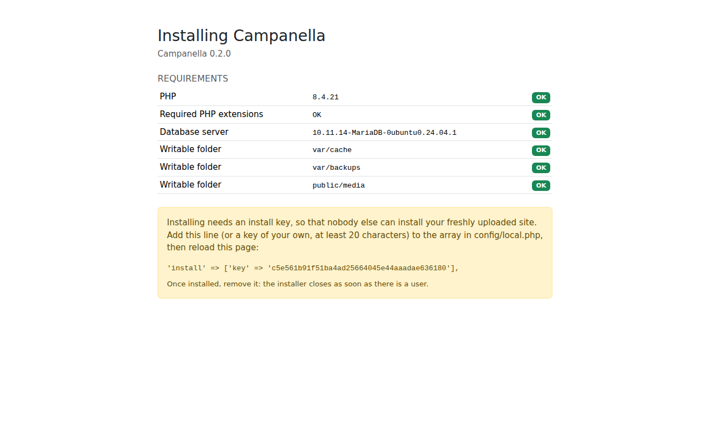
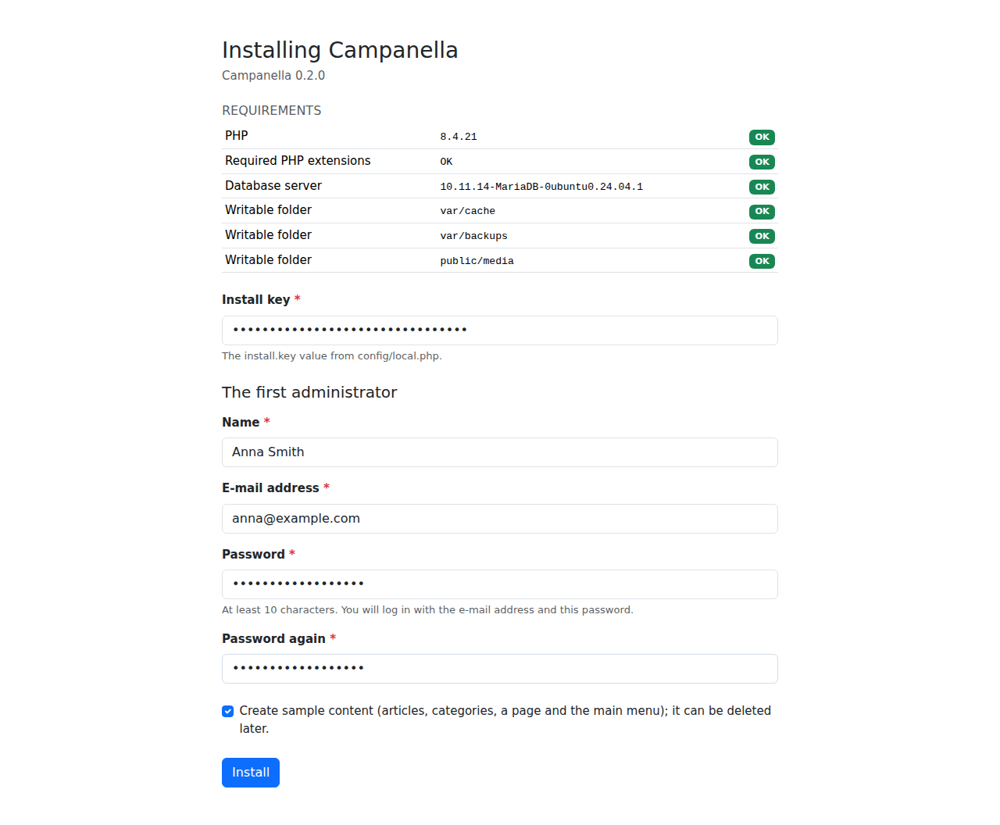

# 1. Installation

This chapter shows how to put Campanella on a web host and install it from
the browser. No command line is needed: a file manager (FTP, or the host's
own) and the host's control panel are enough.

## What you need

- **A web host** with PHP 8.3 or newer. The PHP extensions Campanella needs
  (`pdo_mysql`, `mbstring`, `dom`, `ctype`, `json`, `session`, and `gd` for
  uploading images) are on at most hosts, and the installer checks them.
- **A database:** MariaDB 10.6 or MySQL 8.0, or newer. You need its name, the
  user's name and password, and the server's address (usually `localhost`).
  You find these in the host's control panel, or create a new database there.
- **The Campanella package:** the latest `campanella-<version>.zip` from the
  [GitHub releases page](https://github.com/szhajagos/campanella/releases).
  It holds everything the site needs (the `vendor/` folder too); nothing else
  to download.
- **A domain, with HTTPS.** Most hosts give a free certificate (Let's
  Encrypt). Turn it on before installing (see below).

## 1. Uploading the files

Unpack the zip on your own computer: you get a folder named
`campanella-<version>`. Upload its **contents**, and keep the folders
together: next to `public/` there must be `config/`, `src/`, `vendor/` and
the others.

Hosts decide in one of two ways which folder visitors see (the *web root*):

| If your host… | Then… |
|---|---|
| lets you choose the web root | Upload the folder, e.g. as `campanella`, and set the web root to the `public` folder inside it. This is the safer setup. |
| uses a fixed folder as the web root (e.g. `public_html` or `www`) | Upload all of the package's contents into that folder. The package's `.htaccess` file sends every request to the `public/` folder and keeps visitors out of the others. It needs Apache's `mod_rewrite`, which almost every host has. |

**Do not upload only the contents of `public/`!** The system then cannot find
its other folders, and shows a "The vendor folder is missing" page.

Files whose names start with `.htaccess` are hidden files: if your file
manager does not show them, turn on showing hidden files, and check that
they were uploaded.

## 2. The settings file

In the `config` folder there is a file named `local.php.dist`. Make a copy of
it named `local.php` (in the file manager: copy, then rename), and open it for
editing. Enter the database's details:

```php
'database' => [
    'host' => 'localhost',
    'name' => 'the_database_name',
    'user' => 'the_database_user',
    'password' => 'the database password',
    'prefix' => 'cc_',
],
```

The `prefix` is the beginning of the tables' names. `cc_` is fine; if one
database holds several sites, give each a different one.

Leave the `'debug' => false` line as it is: debug mode would show the details
of errors to every visitor, so never turn it on on a public site.

## 3. The installer

Open your site in the browser with `/install` at the end of the address, e.g.
`https://example.com/install`.

**Important:** open the installer at the address where the site is meant to
work, with `https://`. Campanella remembers it as the site's address (you can
change it later in the settings).

### The install key

The first time, you see this:



The **Requirements** table shows whether the host is suitable. Every row must
say "OK". If one says "Error":

| Row | What to do |
|---|---|
| PHP | Choose PHP 8.3 or newer in the host's control panel. |
| Required PHP extensions | Turn the missing extension on in the host's PHP settings, or ask the host to. |
| Database server | The database details in `config/local.php` are wrong, or the database does not exist. Check them in the host's control panel. |
| Writable folder | PHP cannot write into the folder. Give it write permission in the file manager (usually 755 or 775). |

The yellow box asks for an **install key**. Anyone could find a freshly
uploaded site, and without the key could install it as their own. Copy the
line in the box (a random key, different on every load), and add it to the
array in `config/local.php`, e.g. under the `'debug' => false,` line:

```php
'install' => ['key' => '0560664264d537d1dda97fde163efd4b9bdb244e'],
```

Save the file, and reload the installer.

### The first administrator

Now the form appears too:



1. **Install key:** the same as in `local.php`.
2. **Name, e-mail address, password:** the first administrator's account,
   that is, yours. You log in with the e-mail address and the password. The
   password must be at least 10 characters; a long one used nowhere else is
   best, e.g. from a password manager.
3. **Sample content:** if ticked, Campanella creates a few articles, two
   categories, a page ("Rólunk", about us) and the main menu, so there is something to
   look at; you can delete them one by one later. The sample content is in
   Hungarian (for now), whatever the interface's language: replace it with
   your own as you go.
4. Click **Install**.

Installing takes a few seconds. Then Campanella logs you in and takes you to
the admin's dashboard:


### Removing the key

As the green message says, **remove the `'install' => […]` line from
`config/local.php`**. The installer closes even if it stays (once there is a
user, `/install` is not found), but a key that is no longer needed does not
belong in the settings.

## If something goes wrong

| What you see | The cause, and what to do |
|---|---|
| "The vendor folder is missing" | Not every folder was uploaded, or only the contents of `public/` went into the web root. See [uploading the files](#1-uploading-the-files). |
| "Campanella is not installed yet" on the front page | Fine before installing: open `/install`. |
| `/install` is "not found" | There is a user already: the site is installed. Log in at `/login`. |
| "Wrong install key" | The key typed in the form differs from the one in `local.php`. After 5 wrong keys, wait 15 minutes. |
| An empty page, or a "500" error | Look at the host's PHP error log (in the control panel). Common causes: an old PHP version, or a typo in `local.php` (e.g. a missing comma). |

If your host has a command line (SSH), you can also install from there: see
the [README](../../../README.md#installation).

---

Next: [2. First steps](02-first-steps.md)
