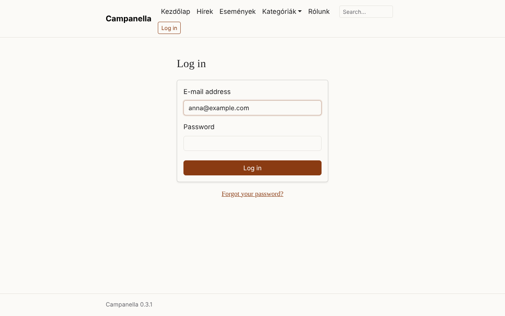
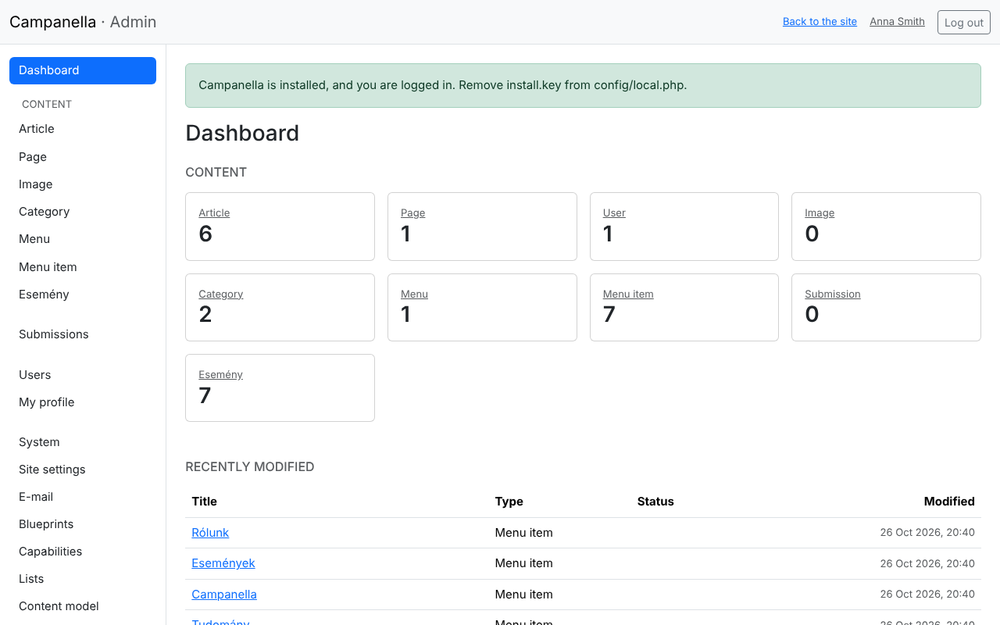
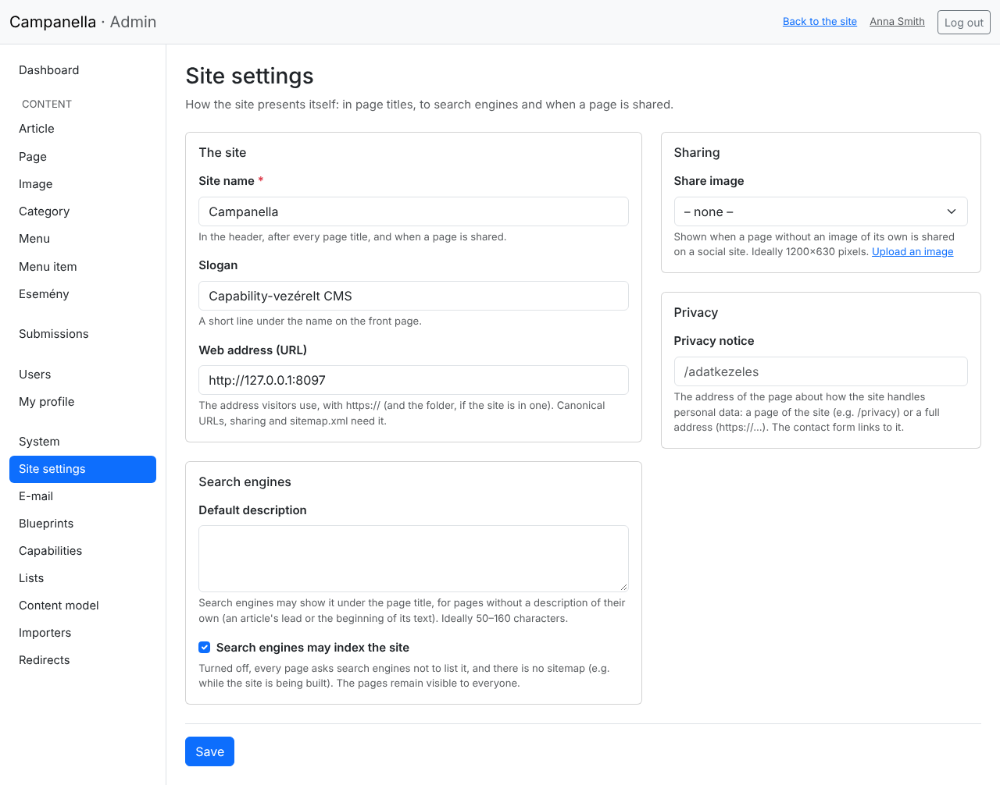
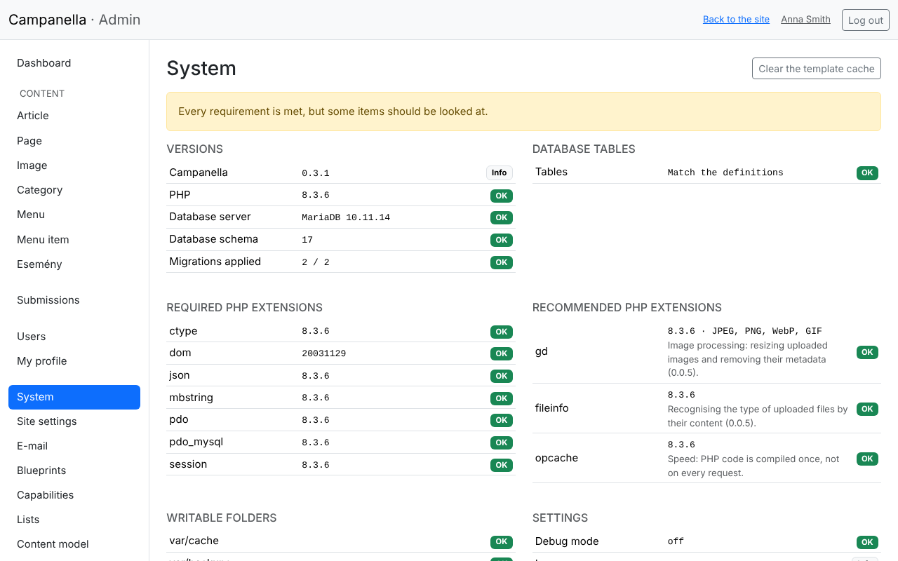
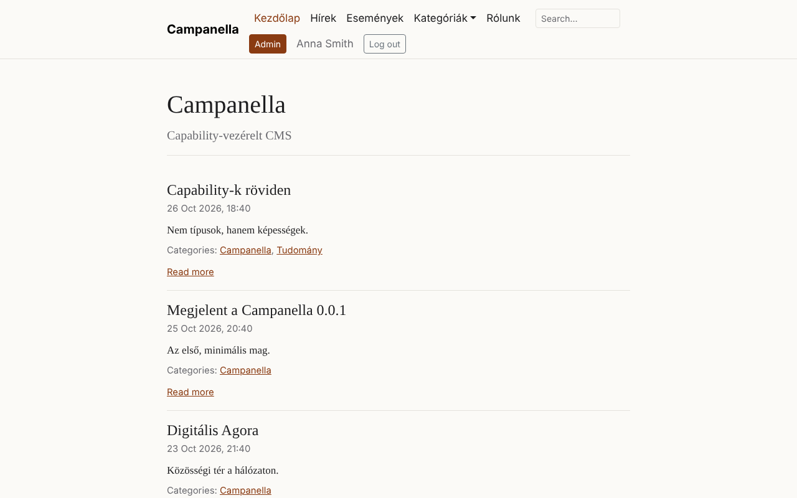

# 2. First steps

After installing, a few things are worth doing at once: getting to know the
admin, setting the site's name and address, and looking at the System page.

## Logging in and out

The admin is at `/admin`, e.g. `https://example.com/admin`. If you are not
logged in, Campanella takes you to the login page (`/login`):

You log in with your e-mail address and password. If you forgot your
password, **Forgot your password?** sends you a link by e-mail to set a new
one. It appears only once e-mail is set up (see chapter 8).

Good to know about logging in:

- A wrong password's message does not say whether the e-mail address or the
  password was wrong, so nobody can try out who has an account.
- After 5 wrong attempts, that account cannot be logged in to from the same
  address for 15 minutes.
- A login lasts at most 12 hours, and ends after 2 hours without activity;
  then you log in again.

Log out with the **Log out** button at the top right. On a shared or someone
else's computer, always log out.

## The admin

The menu on the left:

| Item | What it is for |
|---|---|
| **Dashboard** | An overview: how many items of each kind of content there are, and what changed lately. |
| **Content** | The lists of the kinds of content: **Article**, **Page**, **Image**, **Category**, **Menu**, **Menu item**, and your own kinds of content (**Esemény** in the sample content). Here you create, edit and publish content (chapters 3–5 and 11). |
| **Submissions** | The messages from the contact form (chapter 7). For administrators only. |
| **Users** | Managing the accounts (chapter 6). For administrators only. |
| **My profile** | Your own name and password, and where you are logged in. |
| **System** | The site's state, the **Site settings**, setting up **E-mail** and its log. **Blueprints** (the kinds of content), **Lists** and **Content model** are for your own kinds of content (chapter 11); **Capabilities** shows their building blocks. **Importers** bring in content from spreadsheets (chapter 12), **Redirects** lead on from old addresses (chapter 3). |

At the top, **Back to the site** takes you to the public site, and your name
to your profile.

Editors (the `editor` role) see less: they manage content, but not the
Submissions, the Users or the System page.

## The site's settings

Under **System → Site settings** you set how the site presents itself: in
page titles, to search engines, and when shared.

**The site**

- **Site name:** in the header and in every page's title (also on the
  browser's tab).
- **Slogan:** a short line under the name on the front page; may be empty.
- **Web address (URL):** the address where visitors reach the site, with
  `https://`, e.g. `https://example.com`. The installer filled in the address
  you opened it at: check it, and change it here if the domain or HTTPS
  changes later. Without it, share links, the sitemap and the forgotten
  password do not work.

**Search engines**

- **Default description:** search engines may show it under a page's title
  when the page has no description of its own. One or two sentences about the
  site, 50–160 characters.
- **Search engines may index the site:** turn it off while the site is being
  built. Every page then asks search engines not to list it, but visitors
  still see it. Turn it on again when you are done.

**Sharing**

- **Share image:** shown when someone shares your site on a social site and
  the page has no image of its own. Ideally 1200×630 pixels. Upload it first
  in the **Image** list (chapter 5), then choose it here.

**Privacy**

- **Privacy notice:** the page that says how you handle visitors' personal
  data; the contact form links to it. See chapter 7.

Finally, click **Save**.

## The System page

The **System** page shows whether everything is right with the host and the
settings. Look at it after installing, and after every upgrade.

Every row has a status:

| Status | Meaning |
|---|---|
| **OK** | Nothing to do. |
| **Info** | For your information; nothing to do. |
| **Warning** | It works, but is worth fixing; what to do is under the row. |
| **Error** | Something does not work; what to do is under the row. |

Common warnings on a fresh installation:

| Row | What it means, what to do |
|---|---|
| **Connection: HTTP** | The site does not run on an encrypted connection. Turn HTTPS on at the host. If the host provides HTTPS through a proxy and the row still says HTTP, ask the host; the setting is described in the [deployment guide](../../deployment.md#behind-a-proxy). |
| **Largest image file** | PHP allows smaller uploads than Campanella would take. To upload larger images, raise `upload_max_filesize` and `post_max_size` in the host's PHP settings (e.g. to 16M and 20M). |
| **Sending: not set up** (under E-mail) | The site cannot send e-mail. See chapter 8. |
| **Privacy notice: not linked** | See above, and chapter 7. |

After an upgrade, the **Search index** row may say that some older pages are
not in the search yet: **Add them to the search** puts them there (if there
are many, press it again until the row goes).

**Debug mode** must always say "off". If it says "on", fix it at once in
`config/local.php` (`'debug' => false`).

The **Clear the template cache** button at the top right is rarely needed:
when after an upgrade the site still shows the old look.

## The public site

With the sample content installed, the public site already has something to
show:

While you are logged in, the header shows the **Admin** button, your name and
**Log out**. Visitors see none of these, nor the drafts.

With the **Search…** field of the header, visitors can search the site's
published content (chapter 3).

---

Previous: [1. Installation](01-installation.md) · Next: [3. Content](03-content.md) ·
[Contents](README.md)
