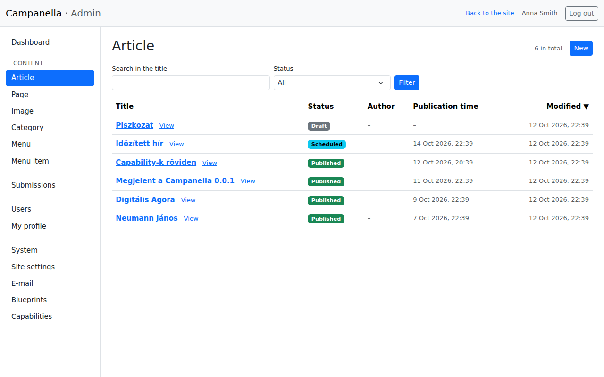
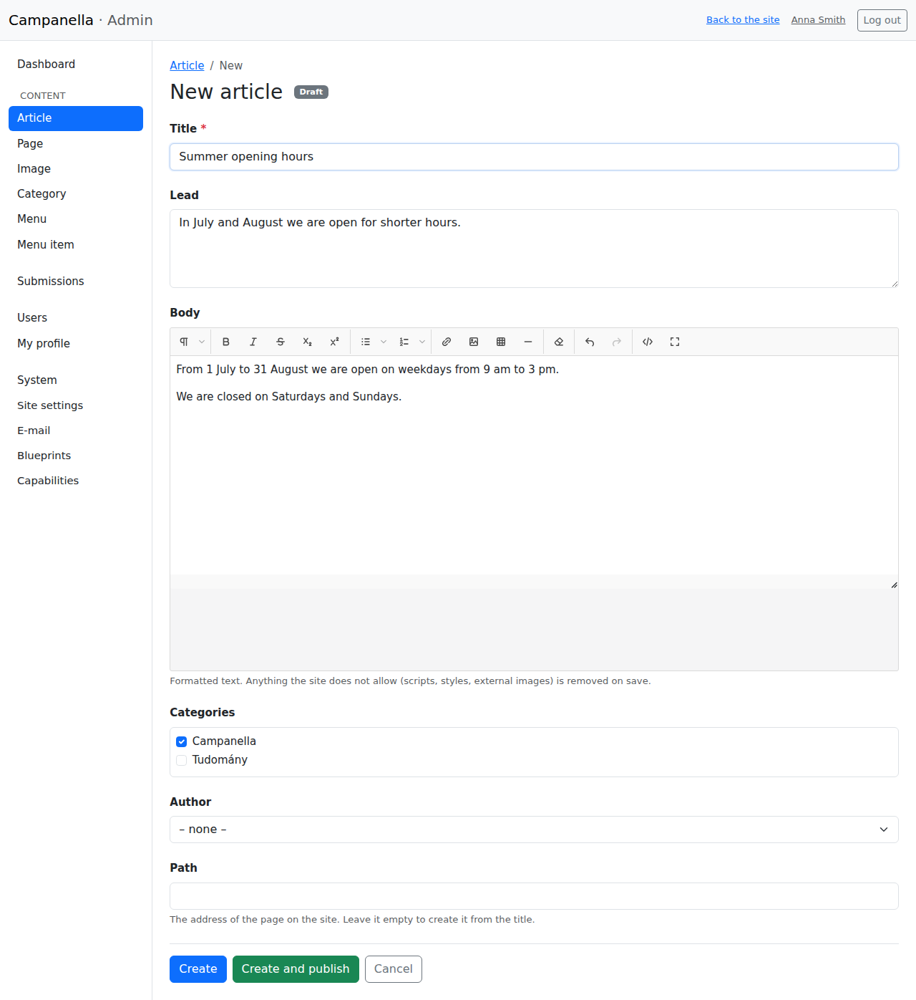
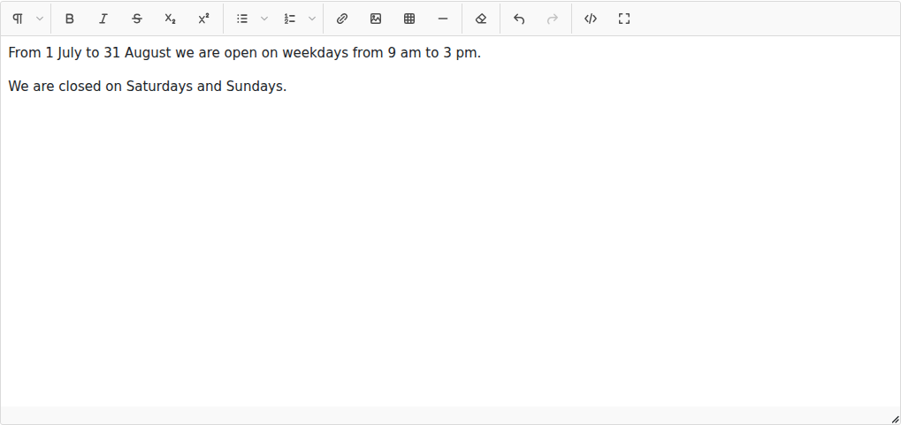
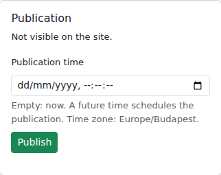
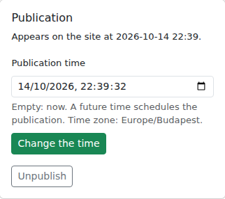
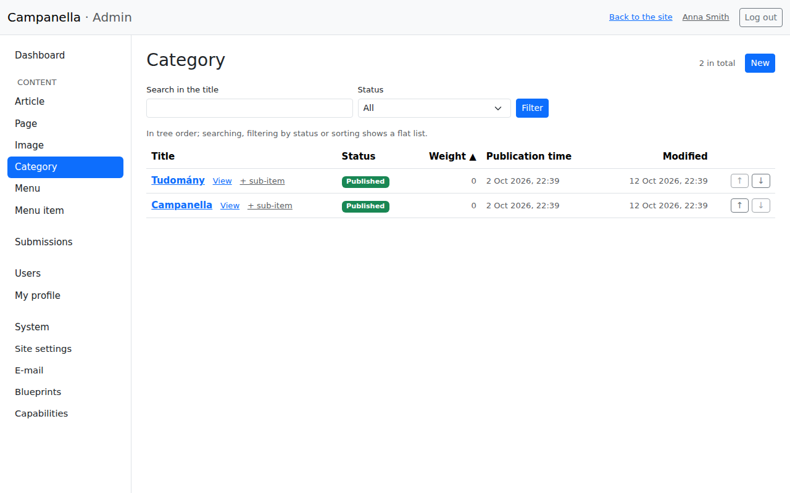
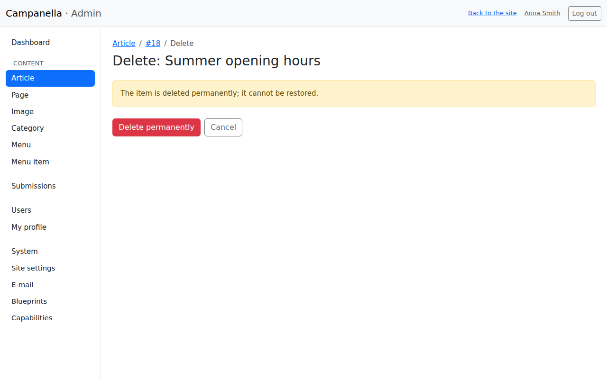

# 3. Content

You manage the site's content in the **Content** part of the admin. This
chapter is about articles, pages and categories: writing them, publishing
them now or later, changing and deleting them.

## Article, page, category: what is the difference?

| Kind | What it is for | Where it appears |
|---|---|---|
| **Article** | News, posts, announcements: things with a date, followed by newer ones. | On the front page and in the news list, newest first; at its own address; on its categories' pages. |
| **Page** | Lasting content: About us, Contact details, Privacy notice. | Only at its own address. Visitors reach it from the menu (chapter 4). |
| **Category** | Groups articles, with subcategories if you like. | On its own page, with its articles. |

## The list

In the menu on the left, **Article** (or **Page**, **Category**) opens the
list of that content:

- **Search in the title** and the **Status** filter find what you look for;
  **Filter** applies them.
- Clicking a column heading sorts the list.
- Clicking a title opens its edit page; **View** shows it on the site (a draft
  too, but only to you).
- **New** at the top right creates a new one.

The **Status** column tells where an item is:

| Status | Meaning |
|---|---|
| **Draft** | Not visible on the site yet. Only logged-in editors see it. |
| **Scheduled** | Published, but it appears at a later time (see below). |
| **Published** | Visible on the site. |

## Writing a new article

After **New** this form appears:

- **Title:** required. The article's title, and its address is made from it.
- **Lead:** one or two sentences about the article. It is shown under the
  title on the front page and in lists, and search engines get it as the
  page's description.
- **Body:** the article itself, written with the editor (see below).
- **Categories:** tick the ones it belongs to: several, or none.
- **Author:** left empty, you become the author.
- **Path:** the article's address on the site, e.g. `/summer-opening-hours`.
  Left empty, it is made from the title. If you change it later, links to the
  old address (on other sites, in search engines) stop working, so try not to
  change it once published.

At the bottom there are two buttons:

- **Create:** saves it as a draft. Nobody sees it yet; you can carry on later.
- **Create and publish:** saves it and makes it visible at once.

### The editor

The toolbar's buttons from left to right:

| Button | What it does |
|---|---|
| ¶ | The kind of paragraph: normal text, **headings** (levels 2–4), a quote, code. The article's title is level 1, so headings inside the article start at level 2. |
| **B**, *I*, strikethrough, subscript, superscript | Text styles. |
| Bulleted and numbered list | Lists; the small arrow chooses the bullet or number style. |
| Chain | A link: select the text, click it, and enter the address. |
| Image | Uploads an image into the text (chapter 5). |
| Table, horizontal line | Inserts a table, or a dividing line. |
| Eraser | Removes the formatting of the selected text. |
| Undo, redo | Takes back the last change, or does it again. |
| `</>` | The text's HTML code (for the experienced). |
| Square | Editing in full screen. |

Good to know:

- **Pasting from Word or a web page:** the editor removes the unneeded
  formatting. Images copied from another site are not kept: upload them
  instead (chapter 5).
- **On saving**, Campanella filters every text, and removes anything that is
  not safe or does not fit the site's look (scripts, custom styles, colours,
  fonts). A saved text may therefore be a little plainer than what you
  pasted. This is on purpose: it keeps the site consistent and safe.

## Publishing

After saving, the **Publication** box on the right of the edit page shows
where the article is, and publishes it:

- **Now:** leave **Publication time** empty, and click **Publish**.
- **Later (scheduled):** enter a time in the future, and click **Publish**.
  Until then the article is not visible; at that time it appears by itself.
  The time is in the site's time zone (shown at the bottom of the box, e.g.
  Europe/Budapest).

For a scheduled article the box looks like this:

- **Change the time** sets another time.
- **Unpublish** turns it back into a draft: it disappears from the site (if it
  was there already), but is not deleted.

If you changed something in the form without saving it, the box warns you:
the publication buttons only publish, they do not save your changes. Save
them first with **Save**.

Changes to a published article show on the site as soon as you click
**Save**.

## Pages

Pages work the same way, but they have no lead, categories or author, and do
not appear on the front page. You usually add a new page to the menu too, or
visitors will not find it (chapter 4).

The privacy notice is best written as a page too, e.g. with the path
`/privacy` (chapter 7).

## Categories

Categories form a tree: a category can have subcategories.

- **+ sub-item** creates a subcategory under that category. On the edit page,
  the **Parent** field moves it.
- The **↑** and **↓** arrows at the end of the row change the order. The
  **Weight** column shows it: smaller comes first.
- A category's page shows its articles, together with those of its
  subcategories.
- A category with subcategories cannot be deleted: its delete page lists
  them; delete or move them first.

## Deleting

**Delete** on the edit page asks first:

After **Delete permanently** the item **cannot be restored**. To only hide
it from the site, unpublish it instead (**Unpublish**): it stays, and you can
publish it again later.

Editors cannot delete; that is for administrators.

## Removing the sample content

If you asked for sample content when installing, delete or rewrite it before
the site goes public: the articles (Neumann János, Digitális Agora …), the
**Tudomány** and **Campanella** categories, the **Rólunk** page, and the main
menu's items pointing to them (chapter 4).

---

Previous: [2. First steps](02-first-steps.md) · Next:
[4. Menus](04-menus.md) · [Contents](README.md)
