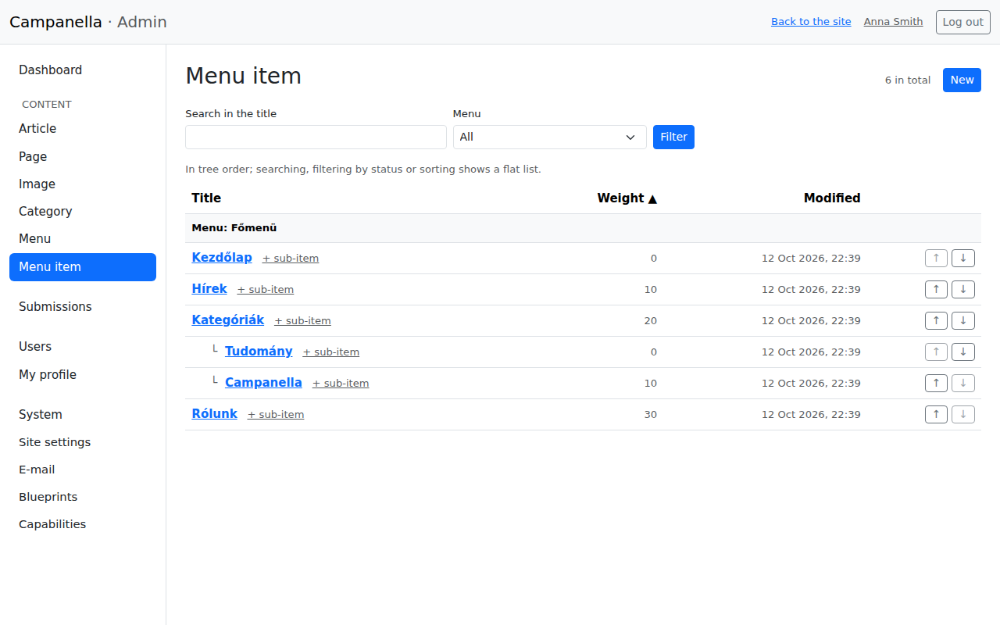
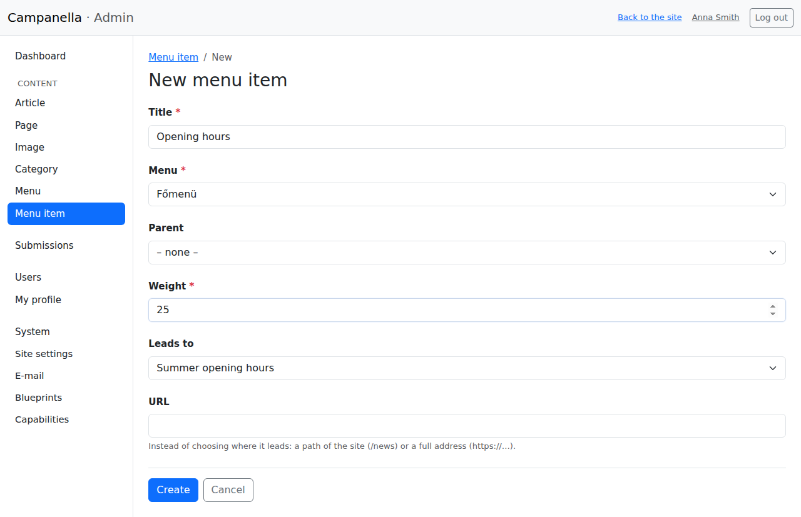
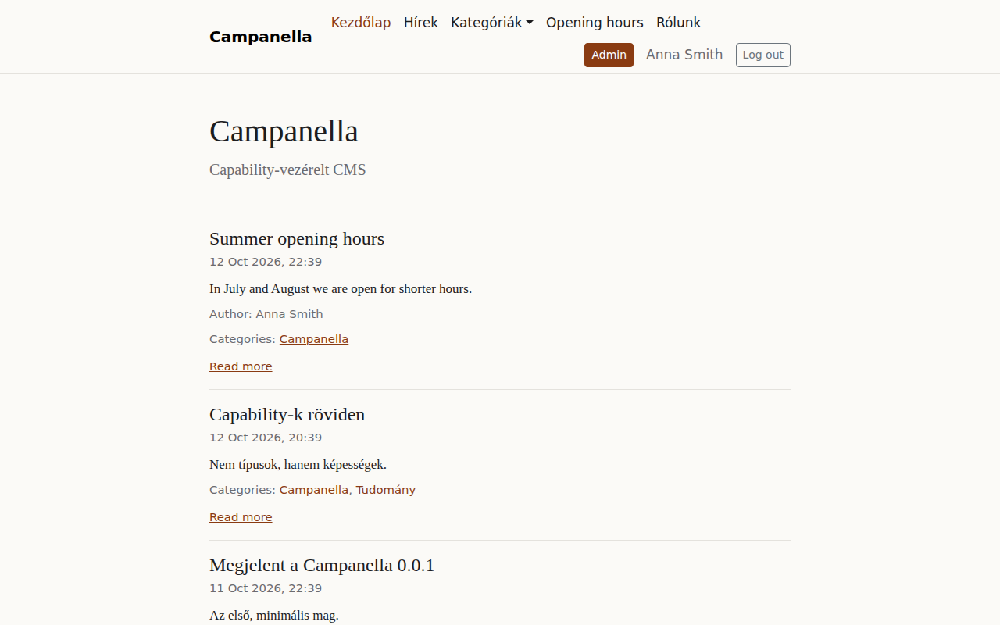

# 4. Menus

You edit the menu at the top of the site (the **main menu**) in the admin:
what is in it, in what order, and what goes into a drop-down.

## Menus and menu items

- The **Menu** list shows the menus. After installing there is one, named
  **Főmenü** (main menu): the site's header shows it. Do not delete it, and do
  not change its machine name (`main`).
- The **Menu item** list shows the menus' items, as a tree:

This is the sample content's main menu: under **Kategóriák** there are two
items (**Tudomány**, **Campanella**). On the site, Kategóriák becomes a
drop-down with these two.

If there are several menus, the **Menu** filter chooses whose items you see.

## A new menu item

Click **New** in the **Menu item** list (or **+ sub-item** next to an item for
an item under it):

- **Title:** the text shown in the menu; keep it short.
- **Menu:** which menu it goes into (the main menu).
- **Parent:** to put it under another item, in a drop-down, choose that item
  here. Empty: the menu's top level.
- **Weight:** the order; a smaller number comes first. In the example,
  Kategóriák has 20 and Rólunk 30, so an item weighing 25 goes between them.
- **Leads to:** an article, page or category of the site. Chosen here, the
  item leads to the right place even if the target's path changes later.
- **URL:** if you do not choose from the list above, enter the address here:
  a path of the site (e.g. `/hirek`) or a full address of another site
  (`https://…`).

After **Create** the item appears on the site at once:

## Order and moving

- In the list, the **↑** and **↓** arrows move an item one place up or down
  among its siblings.
- To put an item under another parent, use **Parent** on its edit page.
- Deleting a menu item only takes the link out of the menu: the article or
  page it led to stays. An item with items under it cannot be deleted: its
  delete page lists them; delete or move them first.

## When the menu does not look as you want

| What you see | Cause, what to do |
|---|---|
| An item does not appear | It leads to a draft article or page: visitors cannot see it, so not the item either (nor the items under it). Publish the target. |
| The menu is too long | The header is narrow: put items into drop-downs (Parent). |
| The site's menu does not change | The main menu's machine name is not `main`, or you are editing another menu. |

---

Previous: [3. Content](03-content.md) · Next:
[5. Images](05-images.md) · [Contents](README.md)
