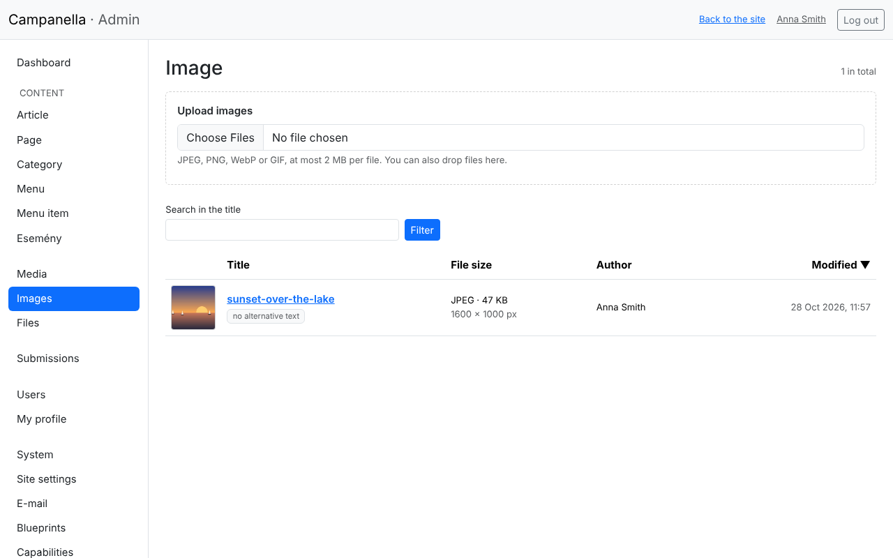
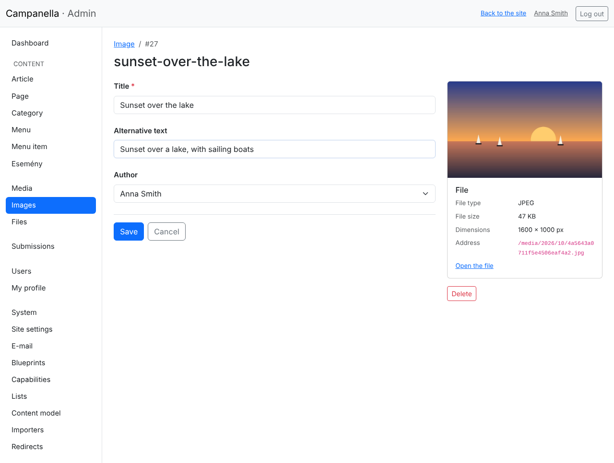
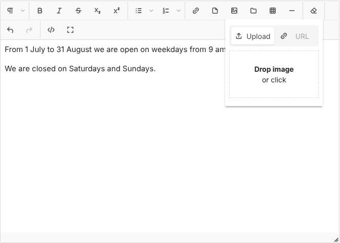
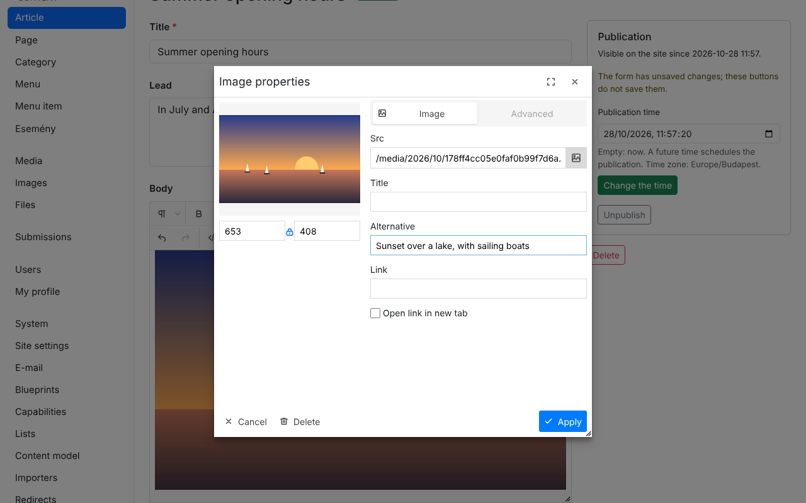
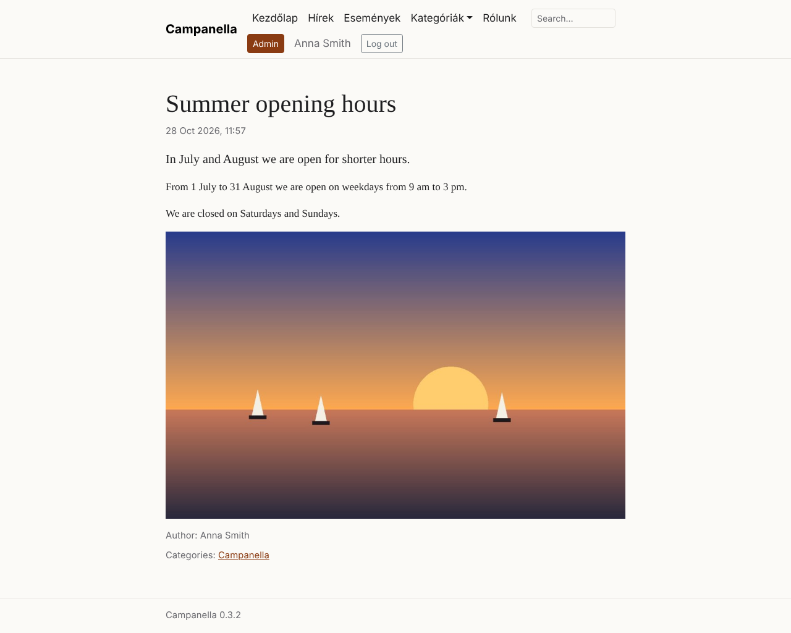
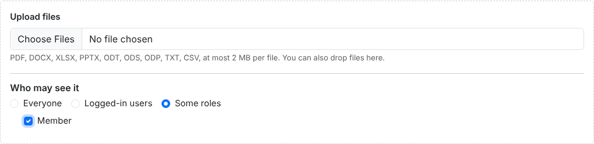
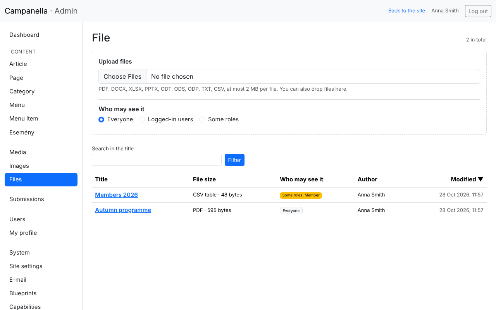
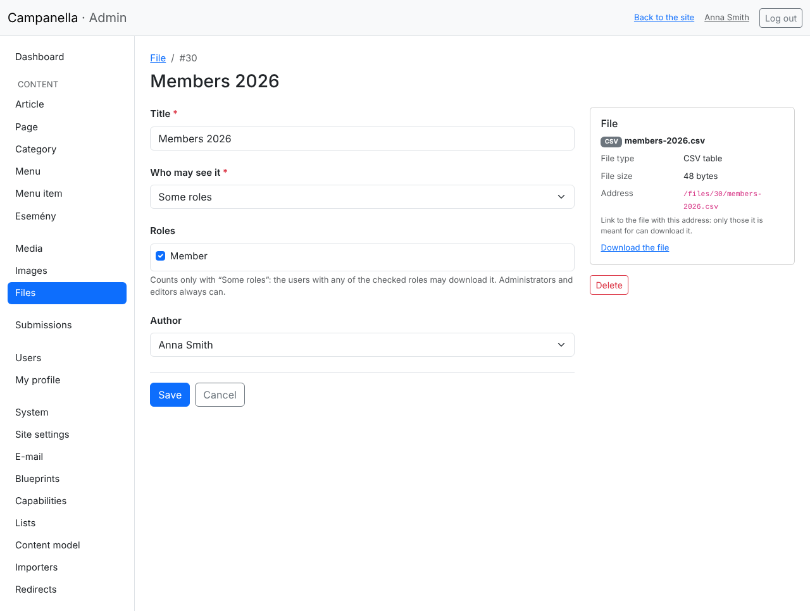
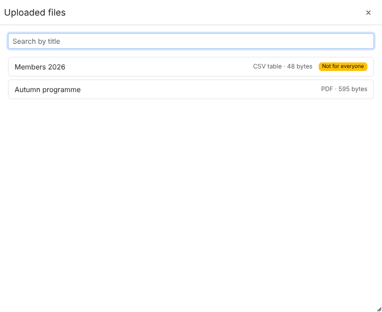
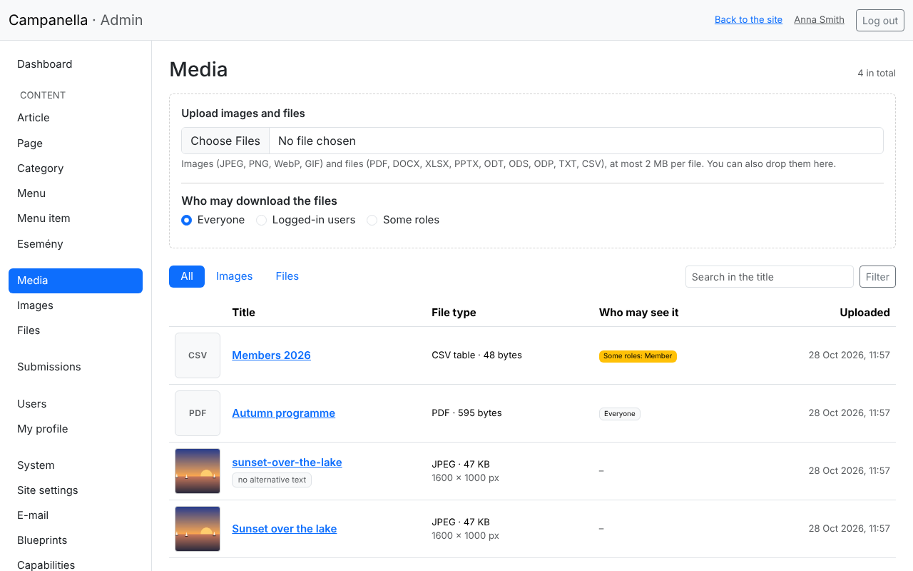

# 5. Images and files

Campanella keeps the images and the files to download (documents,
spreadsheets) itself: you upload them, and use them in texts. This chapter
shows how. Both are under **Media** in the menu on the left: **Images** and
**Files** are their own lists, Media shows them together
([below](#the-media-library)).

## Uploading in the Images list

**Images** opens the list of uploaded images, with the upload box at the top:



- Click the file chooser and choose one or more images, or drag them from
  your computer onto the box. Uploading starts at once, and each image is
  reported.
- Accepted formats: **JPEG, PNG, WebP and GIF**. Under the box you see how
  large a file may be. If your camera's or phone's pictures are larger, the
  limit can be raised in the host's PHP settings (chapter 2, the System page),
  or make them smaller before uploading.
- An image may have at most 25 megapixels (e.g. 6000×4000 pixels).

On upload, Campanella:

- checks that the file really is an image (not just by its extension),
- encodes it again, and on the way **removes its metadata**: e.g. the GPS
  coordinates a phone records, which would tell where the picture was taken,
- makes **smaller copies** of it (320, 640, 1024 and 1600 pixels wide). The
  site always sends the one that fits the visitor's screen, so it loads
  quickly on a phone too.

An image's title is its file name at first. In the list, **no alternative
text** marks the images that have no description yet.

## An image's details

Clicking an image's title opens its edit page:



- **Title:** how you find the image in the admin; worth changing from the
  file name to something meaningful.
- **Alternative text:** a short description of what the image shows. Screen
  readers read it out to blind and partially sighted visitors, search engines
  learn from it what the image is about, and it shows when the image does not
  load. Describe what the picture shows in one sentence (not "an image").
- On the right: the image, and its details: type, size, its address on the
  site.

## An image in a text

In the editor of articles and pages, the **image** button uploads an image
straight into the text, where the cursor is:



On the **Upload** tab, click the box and choose the image, or drop it there.
The image is uploaded as in the Image list (it appears there too), and put
into the text. Dragging or pasting an image into the editor uploads it too.

**To insert an image uploaded before,** use the **folder** button next to it
(*Choose an uploaded image*): the window shows the newest images, you can
search them by title, and a click puts one where the cursor is, with the
alternative text it already has.

**Give it an alternative text in the text too:** double-click the image in
the editor, fill in **Alternative**, then **Apply**:



Here, **Link** also turns the image into a link. The settings of the
**Advanced** tab (margins, styles) are removed when saving: the site's look
decides where the image goes.

After saving, the article looks like this on the site:



## Files

Files to download (a programme, an application form, a list of members) are
uploaded on the **Files** list. Accepted: **PDF, Word (DOCX), Excel (XLSX),
PowerPoint (PPTX), OpenDocument (ODT, ODS, ODP), text (TXT) and CSV**, of at
most 20 MB (if the host's PHP allows less, the box says so).



- Choose one or more files, or drag them onto the box: uploading starts at
  once.
- Before uploading, set **who may download them** (what is marked in the box
  holds for the next uploads):
  - **Everyone:** any visitor of the site;
  - **Logged-in users:** only those who are logged in;
  - **Some roles:** only the logged-in users with one of the checked roles
    (e.g. *Member*). It is offered if the site has roles of its own
    ([below](#roles-of-the-sites-own)).
- Administrators and editors can download every file.

On upload Campanella looks at **the file's content**, not its name: a renamed
file comes in as what it really is, or not at all. **A file with macros or
scripts** (e.g. a `.docm`, a macro-enabled Excel workbook, an OpenDocument
file with scripts) is refused, even if it is named `.docx`: save it without
them. Web pages (HTML), SVG and programs cannot be uploaded either. ZIP can be
allowed by the site's owner, but only if everyone who uploads is trusted: what
is inside cannot be checked.

The list shows the files' types and sizes, and who may see them:



A file's title is its file name at first, and its **download name** the same
without accents and spaces (`Autumn programme.pdf` → `autumn-programme.pdf`):
the name a visitor downloads it with.

### A file's details, and who may see it

Clicking a file's title opens its edit page:



- **Title:** how it shows in the lists and in the file picker.
- **Who may see it:** as on uploading. With *Some roles*, check under
  **Roles** whom it is for.
- On the right, the file's type, size and **address**: link to it from
  anywhere with it. The site always sends it as a download (the browser does
  not open it as a page), and only to those who may see it: to anyone else it
  answers as if it did not exist ("Page not found").

### Roles of the site's own

Besides administrator and editor, the site's owner can set roles of its own
in `config/local.php`, e.g. a *Member* role:

```php
'users' => ['roles' => ['member']],
```

Then this role can be checked when editing a user (chapter 6), and a file can
be for the members only. The role does not let anyone into the admin: a
member logs in on the site only, and can download what is meant for them.

### A file in a text

The editor's **file** button (*Link to an uploaded file*) shows the uploaded
files. Select the words that should become the link (e.g. "Download the
programme"), click the button, then the file:



The selected words become a link to the file. With nothing selected, the
file's title is inserted as the link. *Not for everyone* marks the restricted
files: such a file's link leads other visitors nowhere, so put it on a page
read only by those it is meant for.

## The media library

**Media** in the menu on the left shows the images and the files together,
the newest first:



- At the top there is one upload box: an image goes among the Images,
  anything else among the Files (*Who may download the files* is for the
  files).
- **All**, **Images** and **Files** narrow it, and you can search by title.

## The share image

The image shown when someone shares your site on a social site is chosen
under **System → Site settings** (chapter 2). Ideally it is 1200×630 pixels.

## Deleting an image or a file

On an image's edit page, **Delete** first shows **which texts show the
image**. If you delete it anyway, those texts show a broken image (or only
its alternative text) in its place, so take it out of them first, or replace
it. Deleting removes the file and its smaller copies too, and they cannot be
restored.

Deleting a file shows the same way which texts link to it: after deleting,
those links lead nowhere.

---

Previous: [4. Menus](04-menus.md) · Next:
[6. Users and your own account](06-users.md) · [Contents](README.md)
