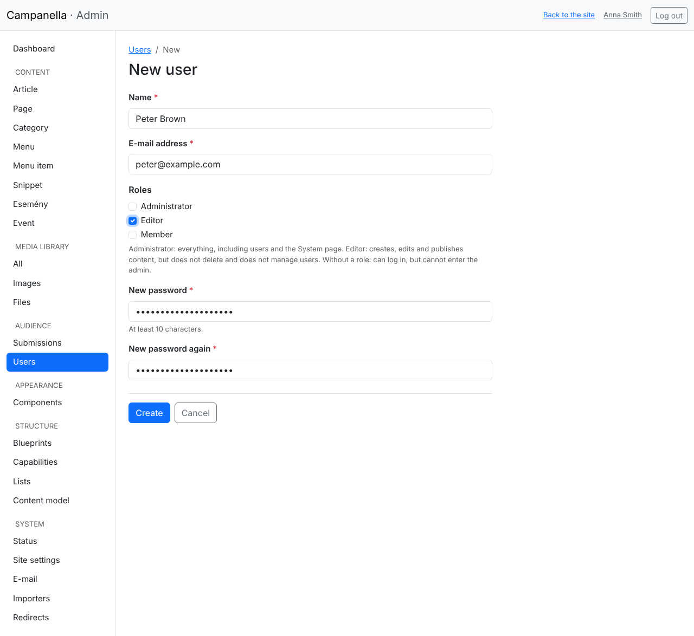
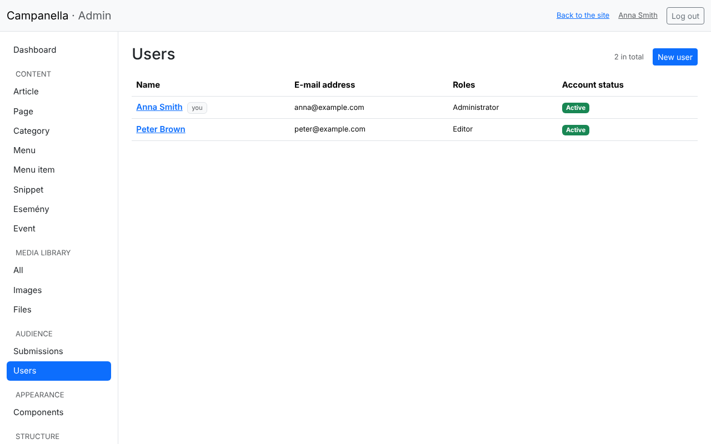
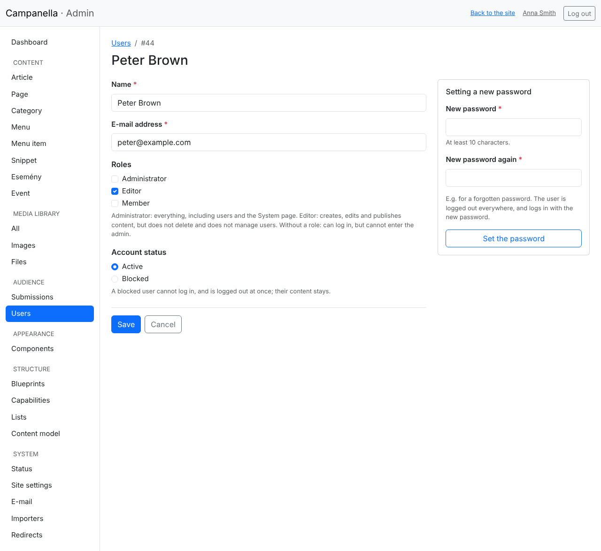
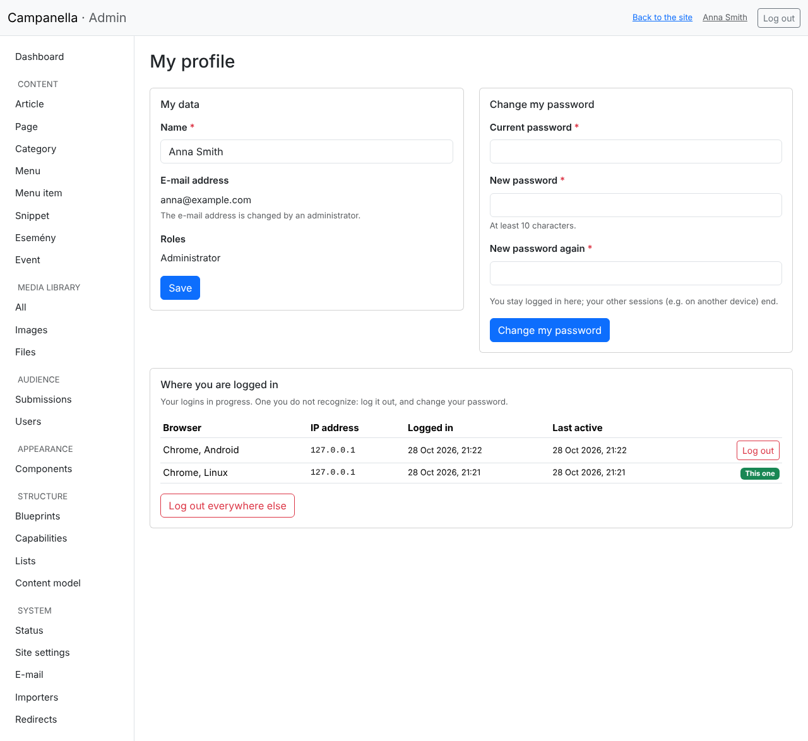
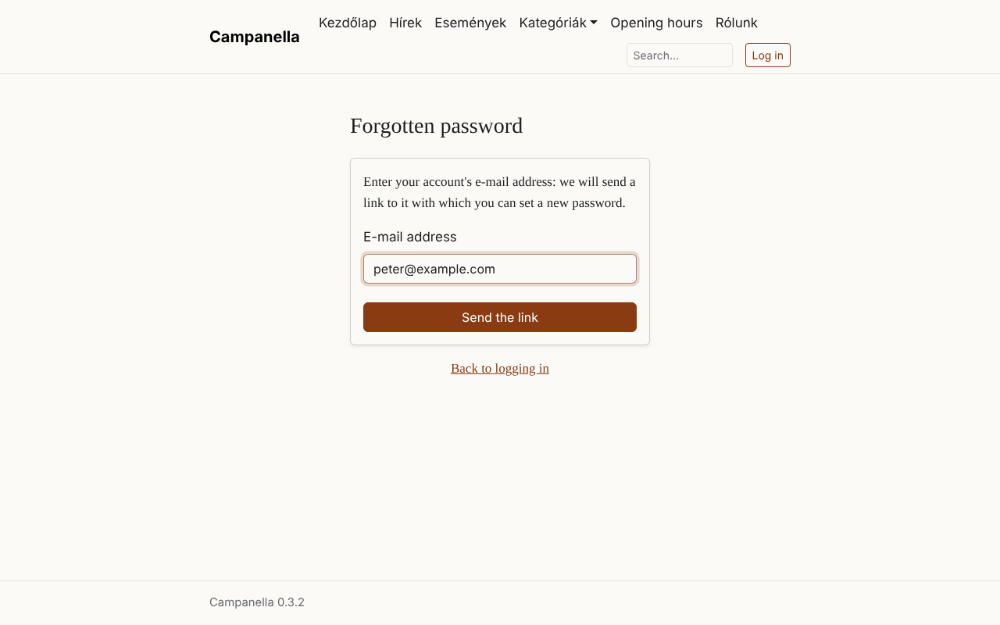
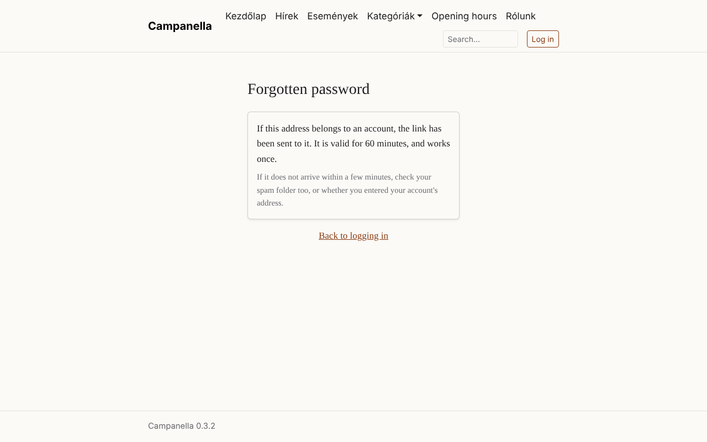
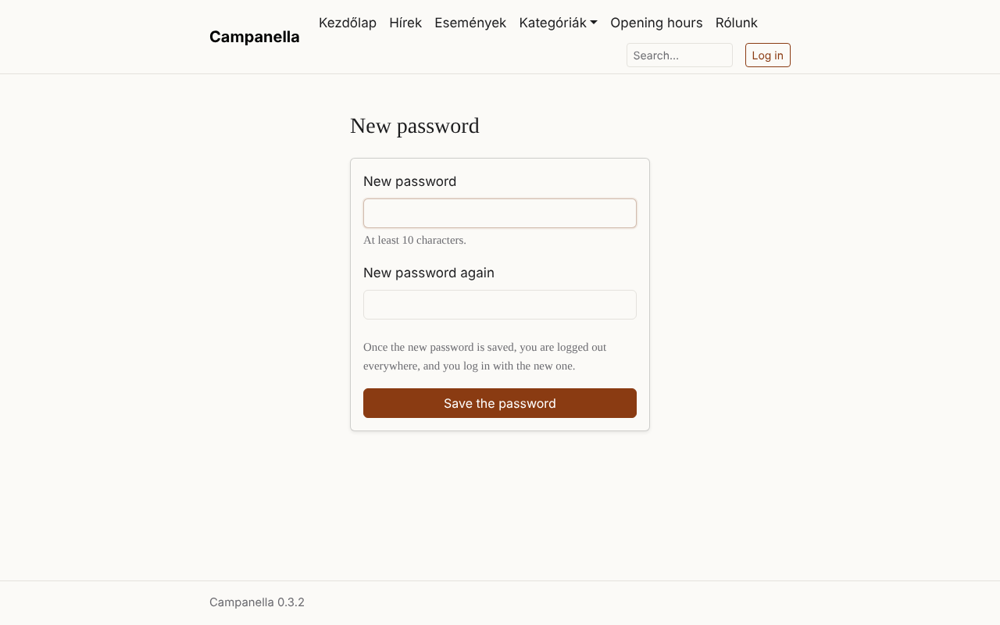

# 6. Users and your own account

This chapter shows how to give others access to the admin, how to manage the
accounts, and what you can do with your own: changing your password, your
logins, a forgotten password.

## Roles

| Role | What it may do |
|---|---|
| **Administrator** | Everything: content, users, Submissions, the System page and the settings. |
| **Editor** | Creates, edits and publishes content. Does not delete, does not see the Submissions, does not manage users, and does not see the System page. |
| *No role* | Can log in, but cannot enter the admin. |
| *The site's own roles* (e.g. **Member**) | As with no role, and can download the files meant for them. The site's owner sets them (chapter 5, [Roles of the site's own](05-images.md#roles-of-the-sites-own)). |

Have only as many administrators as needed: for someone who only writes, the
editor role is enough.

## A new user

**New** in the **Users** list:



- **Name** and **E-mail address:** they log in with the e-mail address.
- **Roles:** tick the one needed (see above).
- **New password**, twice: at least 10 characters.

Campanella **sends no e-mail** to the new user, and sends the password to
nobody. Two good ways:

1. **They set their own password (recommended):** enter a long, random
   password that you tell nobody, and ask them to set one for themselves with
   **Forgot your password?** on the login page. Then only they know their
   password. This needs e-mail to be set up (chapter 8).
2. If that does not work, tell them the password safely (in person, by
   phone), and ask them to change it on their profile after logging in (their name at the top right).

## The list of users, and editing an account



Clicking a name opens the account's edit page:



- Here you change their name, **e-mail address** and **roles**. Only an
  administrator can change an e-mail address; users cannot on their own
  profile.
- **Account status:** while **Blocked**, the user cannot log in, and is logged
  out at once if logged in. Their content stays, and they stay its author.
  Set to **Active** again later, they can log in with their old password.
- **Setting a new password** (on the right): for someone who forgot their
  password and cannot reset it themselves. The user is logged out on every
  device, and logs in with the new password.

Users **cannot be deleted**, only blocked: so their articles keep their
author. Two safeguards:

- Nobody can block themselves.
- The last active administrator cannot be blocked, nor lose the administrator
  role: there is always someone who can manage the site.

**If someone else may have got into an account:** set a new password for it.
That ends all its logins, and only the new password logs in again. When a
colleague leaves, block their account.

## Your own profile

On **My profile** (click your name at the top right):



- **My data:** your name. An administrator can change your e-mail address.
- **Change my password:** with your current password, and the new one twice.
  You stay logged in in this browser, and are logged out on your other
  devices. After 5 wrong current passwords, wait 15 minutes.

### Where you are logged in

The **Where you are logged in** table shows every login of yours in
progress: the browser and system, the IP address, when you logged in, and
when you were last active. **This one** marks the current one.

- **Log out** ends another login: on that device you are logged out at the
  next click.
- **Log out everywhere else** ends every login but this one. If you forgot to
  log out on a shared computer, this makes up for it.

If you see a login you do not recognise, log it out, and change your password
at once.

## A forgotten password

If you cannot log in because you forgot your password, click **Forgot your
password?** on the login page, and enter your e-mail address:



The answer is always the same, whether there is such an account or not: so
nobody can try out who has an account on the site.



If the address belongs to an active account, this e-mail arrives within a few
minutes:

```text
Subject: Set a new password: Campanella

Hello Peter Brown,

Someone (hopefully you) asked for a new password for your Campanella
account. You can set it with this link:

https://example.com/password-reset?token=…

The link is valid for 60 minutes, and works once.

If it was not you, there is nothing to do: your password does not change.
```

The link leads to the new password's page:



After saving, you are logged out everywhere, and log in with the new
password.

Good to know:

- The link is valid for **60 minutes** and works **once**. A newer request
  voids the earlier one.
- At most 3 requests an hour can be sent for one e-mail address.
- A blocked account gets no link.
- If it does not arrive: look in the spam folder, and check the address you
  entered. An administrator sees in the **E-mail** log whether it was sent
  (chapter 8), and can set a new password for you.
- The forgotten password works only once e-mail is set up and the site's
  address is given under **Site settings**. Until then the link does not even
  appear.

---

Previous: [5. Images and files](05-images.md) · Next:
[7. The contact form and privacy](07-contact-form.md) · [Contents](README.md)
