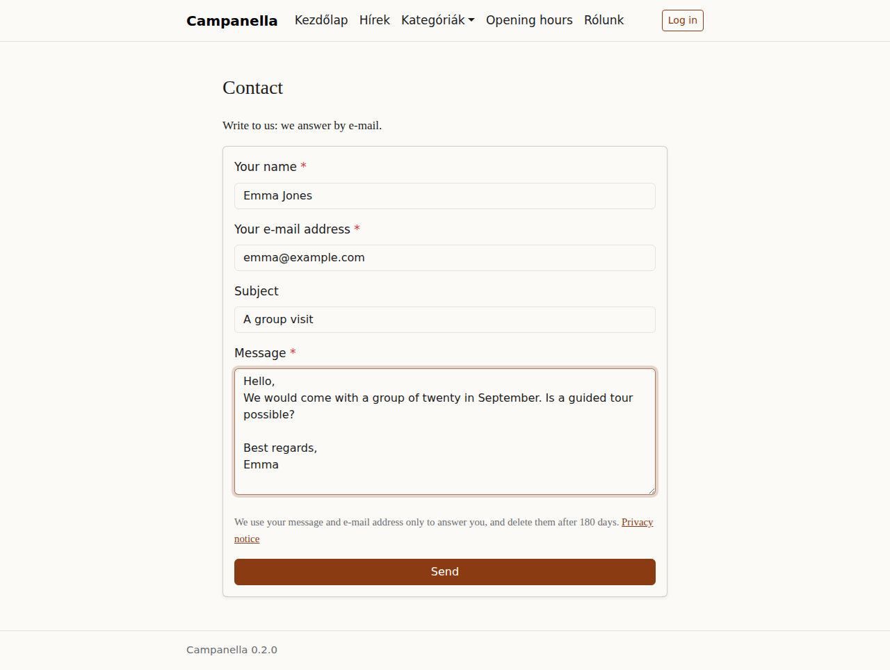
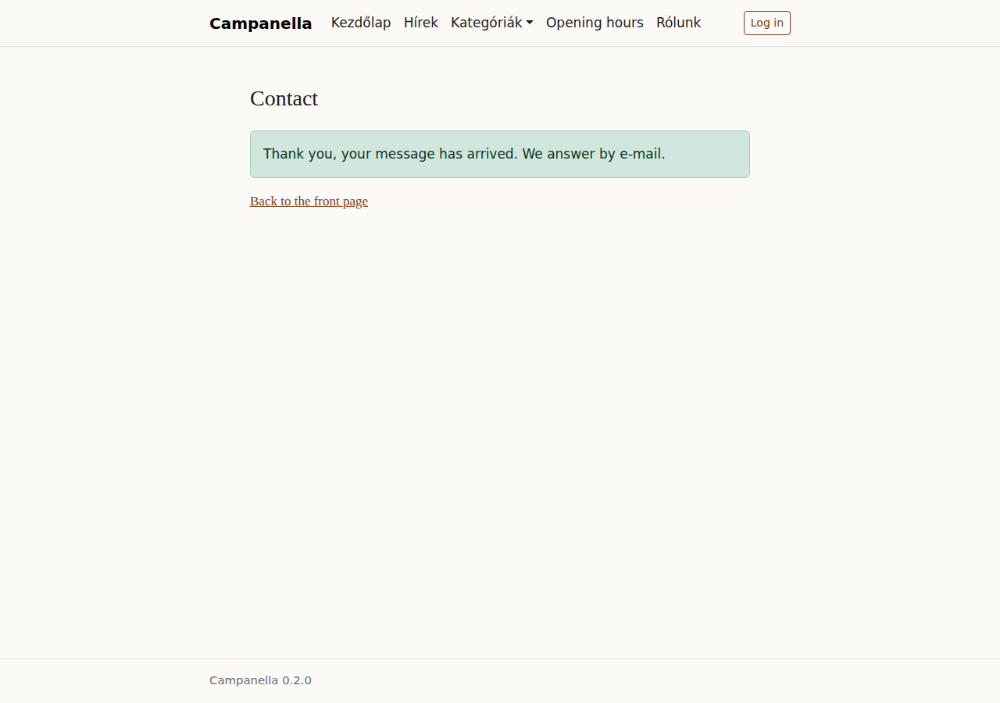
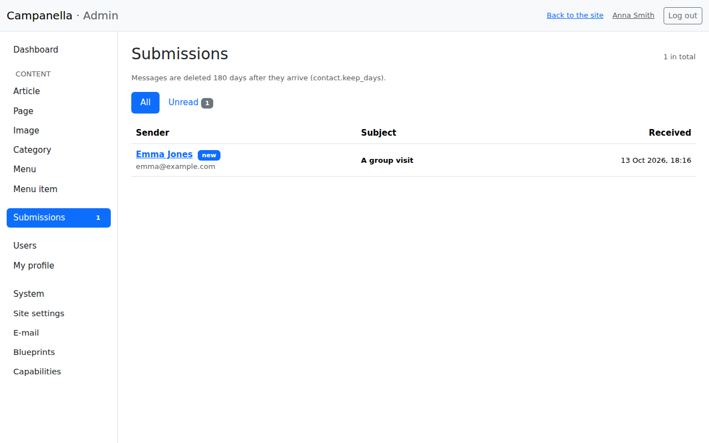
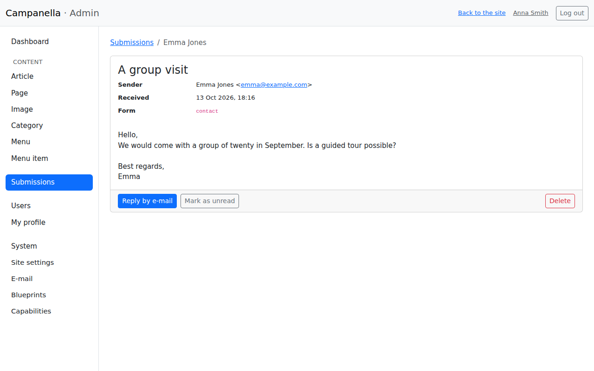
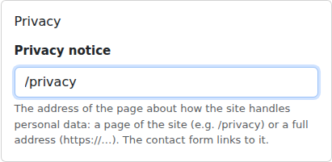

# 7. The contact form and privacy

Visitors can write to you through a contact form. The messages arrive under
**Submissions** in the admin, and you get an e-mail about each. This chapter
also lists the personal data Campanella handles, so you can write your
privacy notice.

## The form

The form is at `/contact`, e.g. `https://example.com/contact`, and is on after
installing. For visitors to find it, add it to the main menu with an item
whose **URL** is `/contact` (chapter 4).

The visitor enters their name, e-mail address, a subject (optional) and the
message. Under the form a short note says what their data is used for and
when it is deleted; once you give your privacy notice's address (see below),
a link leads to it.

After sending, they see this:

Campanella sends no copy to the visitor: otherwise anyone could have your
site send mail to any address.

### Protection against unwanted messages

Campanella protects the form against bots and floods by itself:

- a hidden field only bots fill in (such a message is not saved, but the bot
  is told "sent"),
- a form sent within 3 seconds of opening it is taken for a bot's, and asked
  again,
- at most 5 messages an hour from one (IP) address, and 3 from one sender's
  e-mail address,
- at most 50 notification e-mails an hour; beyond that the messages still all
  arrive under Submissions.

Nothing to set up for this.

## Reading the messages

A number next to **Submissions** in the menu on the left shows the new
messages. The list:

- **new** marks the unread messages; the **Unread** tab lists only those.
- Messages are **deleted by themselves 180 days** after they arrived. To keep
  something, copy it, or answer it by e-mail (your answer stays in your own
  mailbox).

Clicking a message shows it, and marks it read:

- **Reply by e-mail:** opens your e-mail program with the sender's address.
- **Mark as unread:** to deal with it later.
- **Delete:** deletes the message for good.

Only administrators see the messages, editors do not.

### The e-mail about each message

Every active administrator gets an e-mail about every new message (once
e-mail is set up, chapter 8). Its subject holds nothing the visitor wrote; its
text holds the whole message, with a link to the admin. **Replying to this
e-mail** sends your reply to the visitor, not to the site.

## The privacy notice

If your site handles personal data (the contact form does: names and e-mail
addresses), a privacy notice must say what data, what for, for how long, and
who can see it.

1. Write it as a page (**Page → New**), e.g. titled **Privacy notice** with
   the path `/privacy`, and publish it.
2. Under **System → Site settings**, in the **Privacy** box, enter its path,
   and save:

   

3. Add it to the menu too, so it can be reached from anywhere.

From then on the contact form links to it, and the System page no longer
warns about it.

### What personal data does Campanella keep?

This list helps you write the notice. **It is not legal advice:** you are
responsible for the notice's content; ask an expert if in doubt.

| Data | About whom | For how long | Who sees it |
|---|---|---|---|
| The contact form's messages: name, e-mail address, subject, message | Visitors who write | 180 days, then deleted by themselves | Administrators; in the recipients' mailboxes too, by e-mail (you delete them there) |
| User accounts: name, e-mail address, a hash of the password (never the password itself) | Editors and administrators | As long as the account exists | Administrators |
| Logins: IP address, browser, the time of logging in and of the last activity | Logged-in users | While the login lasts (at most 12 hours) | The user themselves, on My profile |
| The log of e-mails sent: recipient, subject, time (never the text) | The recipients | 90 days | Administrators |
| Counters against abuse: a hash of the IP address and the e-mail address (made with a secret key, so the address cannot be recovered from it) | Those who use the login, the forgotten password or the contact form | From 15 minutes to 1 hour | Nobody: only needed for the limits |

Also:

- **Campanella does not store the IP address** of a message's sender with
  the message.
- **Cookies:** one session cookie (`campanella_session`), only for logging in
  and for the forms (login, forgotten password, contact form), needed for
  them to work safely. Other pages set no cookie. There are no statistics, no
  ads, and no outside service (fonts, maps, social buttons) collecting
  visitors' data.
- **Your host** may log visits (e.g. IP addresses) in the web server's log:
  ask your host.

---

Previous: [6. Users and your own account](06-users.md) · Next:
[8. E-mail](08-e-mail.md) · [Contents](README.md)
