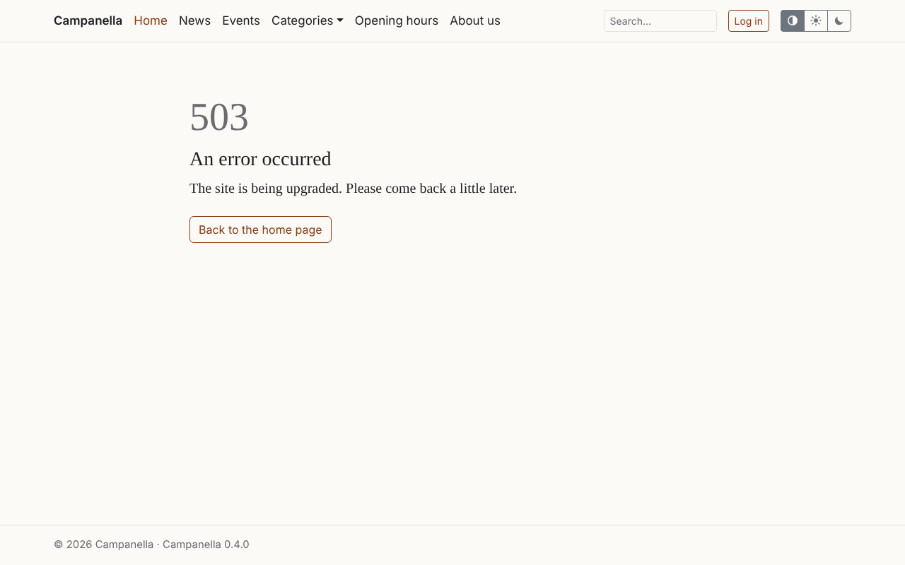
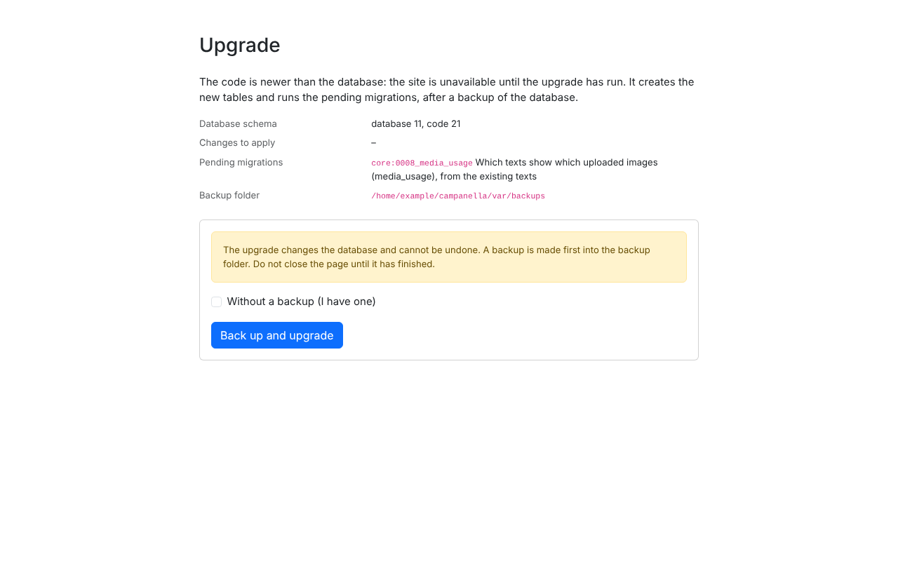
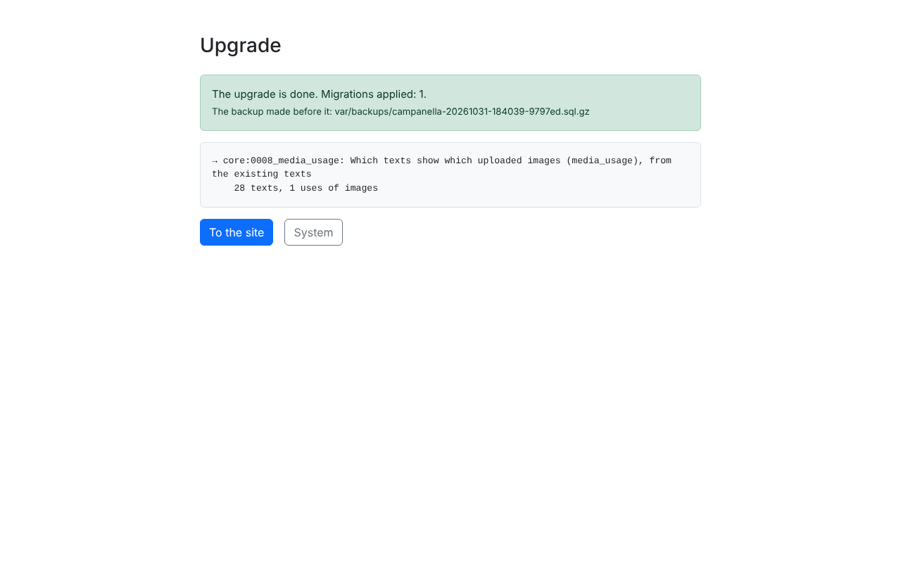

# 9. Backups and upgrades

A site's data can be lost: through a failed upgrade, something deleted by
mistake, the host's hardware failing, or a break-in. This chapter is about
what to back up and how, and how to upgrade Campanella to a newer version.

## What to back up

| What | Where it is | Why |
|---|---|---|
| **The database** | On the host's database server | All the content, users, settings and messages. |
| **The uploaded images** | The `public/media/` folder | The images' files (the database holds only their details). |
| **The uploaded files** | The `var/files/` folder | The files to download (since 0.3.2). The files for members only are here too: keep the backup as safe as the site. |
| **The settings file** | `config/local.php` | The database and e-mail settings. |
| *Your own theme, if any* | `themes/` | If someone made a custom look for the site. |

The program's other files need no backup: they can always be downloaded again
from the releases page.

## How to back up

Use at least one of these, and **keep the backup somewhere else too**, not
only on the host: if the host is lost, the backups kept on it go with it.

1. **The host's own backups.** Many hosts back up daily and keep the backups
   for a few days. Ask your host what they back up (the database too?), for
   how long they keep it, and how a backup is restored.
2. **phpMyAdmin.** In the host's control panel, phpMyAdmin's **Export** saves
   the database into a file. Download the images and `config/local.php` with
   the file manager.
3. **Campanella's backups.** Before every upgrade, Campanella backs up the
   database by itself into the `var/backups/` folder
   (`campanella-<date>.sql.gz`). Visitors cannot reach this folder; you can
   download it with the file manager. With a command line, the
   `php bin/campanella db:backup` command makes one at any time, and the
   host's scheduled tasks (cron) can run it daily.

Old backups are not deleted from `var/backups/` by themselves: from time to
time, delete the ones you no longer need.

**Try a restore too**, once, while nothing is wrong: a backup is only worth
something if it can be restored.

### Restoring

1. Restore the database from the backup file with phpMyAdmin's **Import**
   (phpMyAdmin accepts the `.sql.gz` file compressed too). The backup drops
   the tables and creates them again as they were.
2. Put the `public/media/` and `var/files/` folders back with the file manager.

Whatever happened since the backup (new content, messages) is lost by the
restore.

## Upgrading to a newer version

### When to upgrade

New versions appear on the
[GitHub releases page](https://github.com/szhajagos/campanella/releases). To
be told about them, follow this page's feed
(`https://github.com/szhajagos/campanella/releases.atom`) in a feed reader.

- **Patch versions** (e.g. 0.2.0 → 0.2.1): bug fixes, security fixes, small
  improvements. Campanella promises that these change nothing your site
  relies on ([compatibility promise](../../compatibility.md)). Always worth
  installing; security fixes as soon as possible.
- **New versions** (e.g. 0.3 → 0.4): new features, and there may be changes.
  Read the release notes first, as there may be something for you to do.

### Step by step

1. **Back up** (see above). Campanella backs up before upgrading too, but have
   a backup of your own as well, with the images.
2. **Download** the new `campanella-<version>.zip`, and unpack it on your
   computer.
3. **Upload it**, replacing the program's folders: `bin/`, `config/` (except
   `local.php`!), `lang/`, `public/` (except `public/media/`!), `resources/`
   (since 0.3.7), `src/`, `templates/`, `vendor/`, and the files at the top level. **Do not delete
   or overwrite:** `config/local.php`, the `public/media/` folder, the `var/`
   folder, and the `themes/` folder, if any.
4. **Open the site.** If the new version changes the database too, visitors
   see this until the upgrade has run:

   

5. **Log in** (logging in works during the upgrade too), and open the
   `/admin/upgrade` page (the admin leads there too):

   

   The page shows what will happen. Click **Back up and upgrade**, and **do
   not close the page** until it has finished (usually a few seconds).

   

6. **Look at the System page:** that it shows the new version, and no error.
   If the site still shows the old look, **Clear the template cache**, and
   reloading in the browser (Ctrl+F5), help.

If the new version does not change the database (common for patch versions),
the site works right after uploading, and the upgrade page says there is
nothing to upgrade.

**If you cannot log in**, because logging in does not work before the
upgrade: put an upgrade key of at least 20 characters into
`config/local.php` (`'upgrade' => ['key' => '…']`), open the `/admin/upgrade`
page, enter the key, and **remove the key** after the upgrade.

### If something went wrong

The state before the upgrade can be restored: upload the old version's files
again, and restore the database from the backup made before the upgrade (the
upgrade page shows its name). The developers'
[upgrade guide](../../upgrading.md#going-back) has the details.

What to do when upgrading from 0.3.x, 0.2.x or 0.1.x to 0.4 is collected in the
[upgrade guide](../../upgrading.md) too.

---

Previous: [8. E-mail](08-e-mail.md) · Next:
[10. When something does not work](10-troubleshooting.md) ·
[Contents](README.md)
