# 11. Your own kinds of content: an activity calendar

Besides articles, pages and categories, you can make kinds of content of your
own, without programming, in the admin: activities, products, staff members or
rooms to let, each with fields of its own. This chapter takes you through an
example step by step: a club's **activity calendar**, where visitors see the
upcoming activities and can filter them by kind, date and ticket price.

The steps:

1. [The kind of content](#the-kind-of-content): its name and capabilities.
2. [Its fields](#the-fields): when it starts, its kind, venue, price, booking.
3. [The list in the admin](#the-list-in-the-admin): its columns and filters.
4. [The first activities](#the-first-activities).
5. [The calendar for visitors](#the-calendar-for-visitors): a list of the
   upcoming activities, with an address and filters of its own, and a menu item.
6. [Carrying it to another site](#carrying-it-to-another-site), e.g. from a
   test site to the live one.

You do all this as an administrator; then editors write the activities just as
they write articles.

**A ready example in the sample content.** If you asked for sample content when
installing, you already have a similar kind of content, **Event**, with the
list **Upcoming events** (`/events`, **Events** in the main menu; on a site
installed before 0.3.7 they are in Hungarian: **Esemény**, `/esemenyek`). You can look at how
it is set up, or delete it (see [the end of the chapter](#deleting)). In this
chapter we make a new one, called **Activity**.

## The kind of content

In Campanella the kinds of content are called **Blueprints**. A Blueprint says
what an item is made of: its **capabilities** (whether it has a title, a text,
a page of its own, whether it must be published), and its **own fields**.

The **Structure → Blueprints** page lists them all: those defined in code
(article, page …), which cannot be changed here, and those made in the admin,
with an **Edit** button. **New Blueprint** at the top right starts a new one:

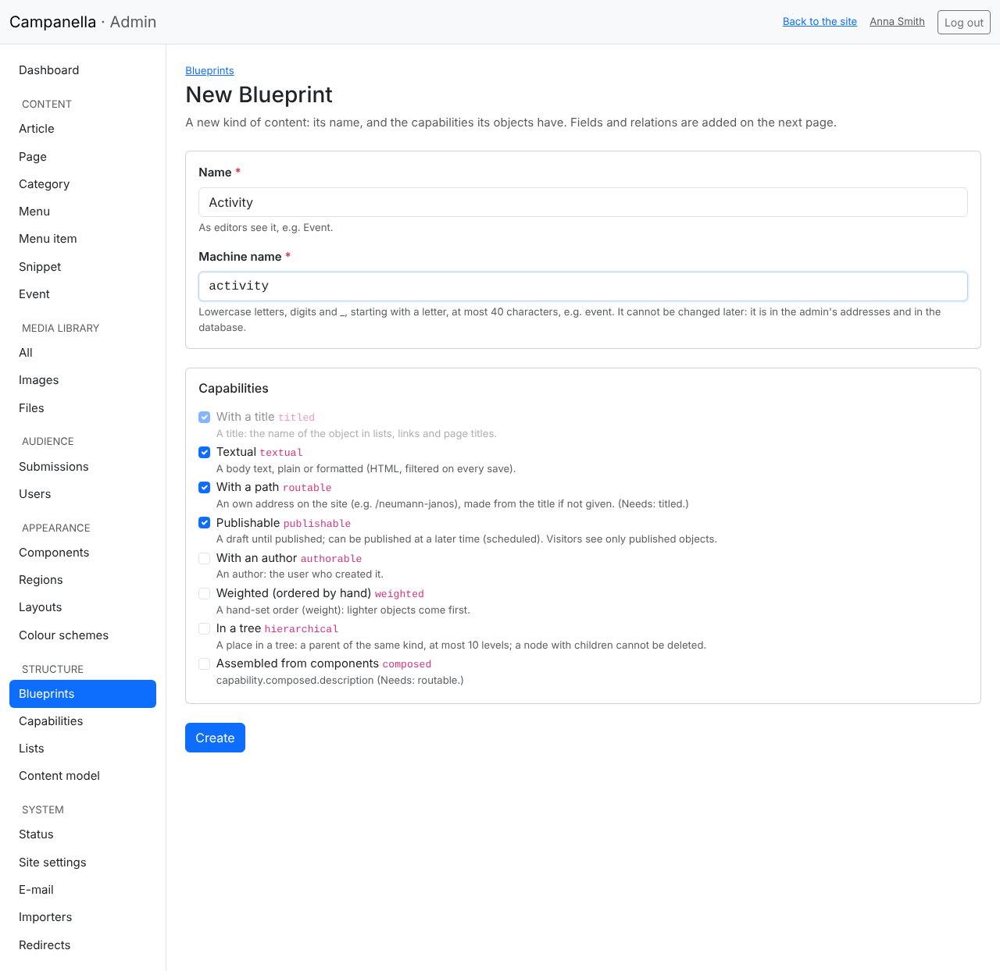

- **Name:** as editors see it, in the admin's menu too: *Activity*.
- **Machine name:** lowercase letters, digits and underscores, starting with a
  letter: `activity`. It is in the admin's addresses (`/admin/activity`) and in the
  database, so **it cannot be changed later**.
- **Capabilities:** what every activity can do.

| Capability | What it gives | For the calendar |
|---|---|---|
| **With a title** | A title, in lists and on top of its page. | Always there. |
| **Textual** | A body text, with the editor. | Yes: the activity's description. |
| **With a path** | A page of its own on the site, e.g. `/choir-concert`. | Yes: every activity gets a page. |
| **Publishable** | Drafts, publishing, scheduling, as for articles. | Yes. |
| **With an author** | Which user wrote it. | Not needed. |
| **Weighted (ordered by hand)** | An order set by hand. | Not needed: they are ordered by date. |
| **In a tree** | Parents and children, as the categories have. | Not needed. |

After **Create** the Blueprint's page opens, and **Activity** appears in the menu
on the left. A capability can be added or removed later too (at the bottom of
the page, **Name and capabilities**): a removed one's data is kept.

## The fields

On the Blueprint's page, **New field** in the **Fields** box adds a field. The
calendar needs these five:

| Name | Machine name | Type | Required | Filter and sort by it |
|---|---|---|---|---|
| Starts | `starts` | Date and time | yes | yes |
| Kind | `kind` | Choice | yes | yes |
| Venue | `venue` | Text (one line) | | |
| Ticket price | `price` | Decimal number, 2 decimals | | yes |
| Booking required | `booking` | Yes/no | | yes |

The form, with the **Kind** field:

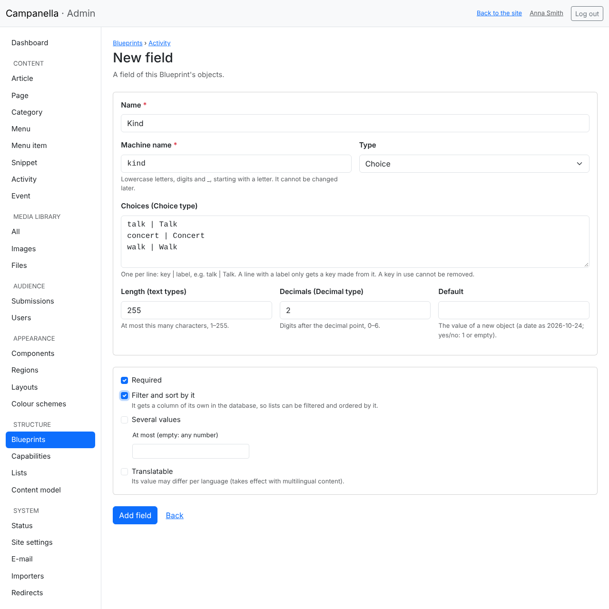

- **Name, Machine name:** as for the Blueprint. The machine name cannot be
  changed later here either.
- **Type:**

  | Type | What for |
  |---|---|
  | Text (one line) | A short text, at most 255 characters (**Length** can set fewer). |
  | Long text | Several lines, without formatting. |
  | Formatted text | A text with the editor. |
  | Whole number, Decimal number | Numbers. For a decimal, **Decimals** says how many digits follow the decimal point (2 for a price in pounds or euros). |
  | Yes/no | A tick box. |
  | Date, Date and time | A day, or a day and a time. |
  | E-mail address, Web address | A checked address. |
  | Choice | One of the values given here, from a drop-down. |

- **Choices** (for the Choice type only): one per line, as `key | label`, e.g.
  `concert | Concert`. Editors and visitors see the label; the site stores the
  key, which is also what the addresses show (with the filters). A line with a
  label only gets a key made from it.
- **Default:** a new item starts with it (it can be left empty).
- **Required:** it cannot be empty when saved.
- **Filter and sort by it:** the field gets a column of its own in the
  database. **A list needs this to choose, order or let visitors filter by the
  field.** Tick it for the fields that need it: the start, the kind, the price,
  the booking. The venue does not.
- **Several values:** an item can have several (e.g. several tags). **At most**
  can limit their number.
- **Translatable:** takes effect with multilingual content; leave it empty for
  now.

After **Add field** the field is there at once. If there are activities already,
Campanella makes a backup of the database first.

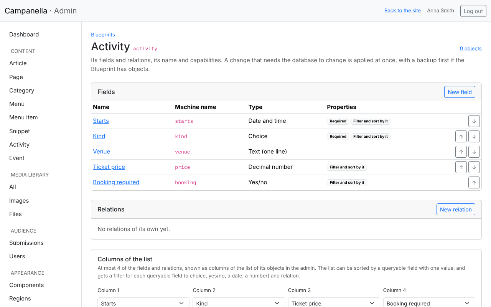

The order of the fields is that of the form and of the page too: **↑** and
**↓** change it. Clicking a field's name lets you change:

- its name, its default, its choices (new ones can be added; a key that an
  item uses cannot be removed);
- its type, but only to a "wider" one: one line to long text, whole number to
  decimal number, date to date and time, an e-mail address, web address or choice to
  text. What would lose data, the admin does not allow;
- **Required**: if some values are empty, it asks for a default first, and
  fills them with it;
- **Filter and sort by it** and **Several values**: the values move along. If
  several values become one, only the first stays, so this must be confirmed.

A field that a list uses (in a condition, the order, a column or a filter)
cannot be deleted or made unfilterable until the list is changed: the admin
names the list.

Deleting a field is at the bottom of its page: the activities' values of it are
deleted for good (with a backup first here too).

**Relations.** In the **Relations** box, activities can be linked to other
content, e.g. a **Venue** relation to a category or a page: then an editor
chooses the venue instead of typing it, and a list can be filtered by it. In
the example, the venue stays plain text.

## The list in the admin

The admin's **Activity** list shows the title, the status and the dates at first.
The **Columns of the list** box on the Blueprint's page adds at most four of
its own fields or relations:

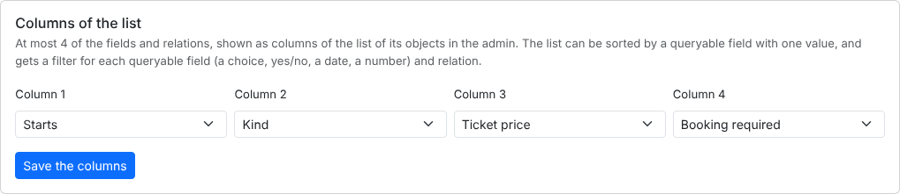

After **Save the columns**, the admin's list looks like this:

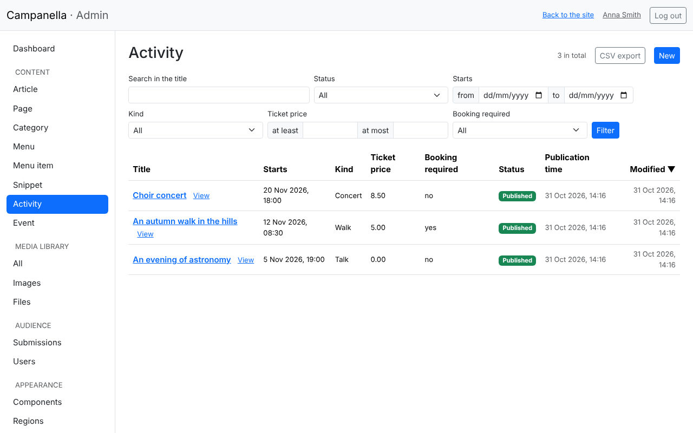

- Clicking the heading of a filterable column with one value sorts by it (here:
  the start, the price).
- The filterable fields get a filter above the list by their type: a choice or
  yes/no a drop-down, a date or a number a range (**from–to**, **at
  least–at most**), a relation its possible items.

## The first activities

**Activity → New** in the menu on the left writes an activity. Its own fields follow
the title on the form, in the Blueprint's order:

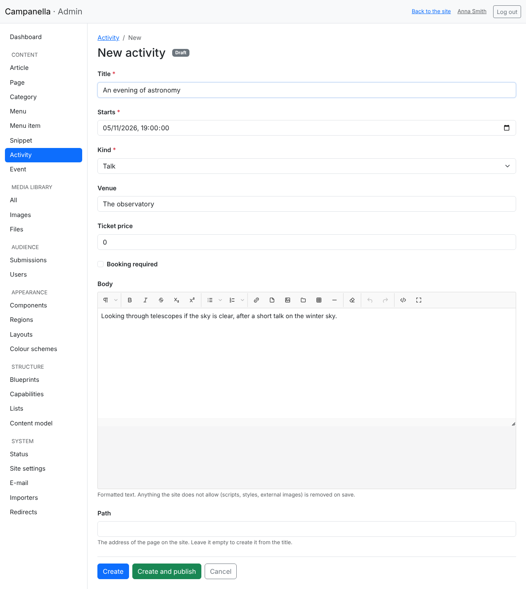

Everything else works as for articles (chapter 3): save it as a draft or
publish it at once, schedule it; the activity gets a page of its own at its path,
which shows its fields below its description.

## The calendar for visitors

The activities' own pages are not a calendar yet: a list is needed that shows the
upcoming activities in order. It is made on the **Structure → Lists** page, with
**New list**:

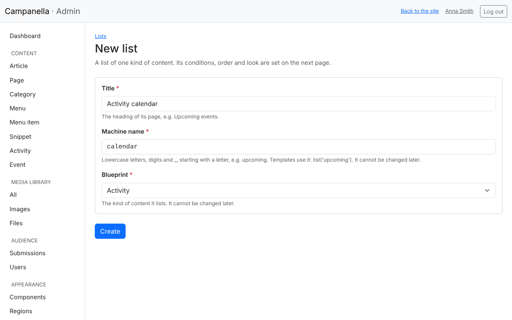

- **Title:** the heading of the list's page: *Activity calendar*.
- **Machine name:** `calendar`. A template can refer to it by this.
- **Blueprint:** *Activity*. It cannot be changed later.

After **Create**, the list's settings follow:

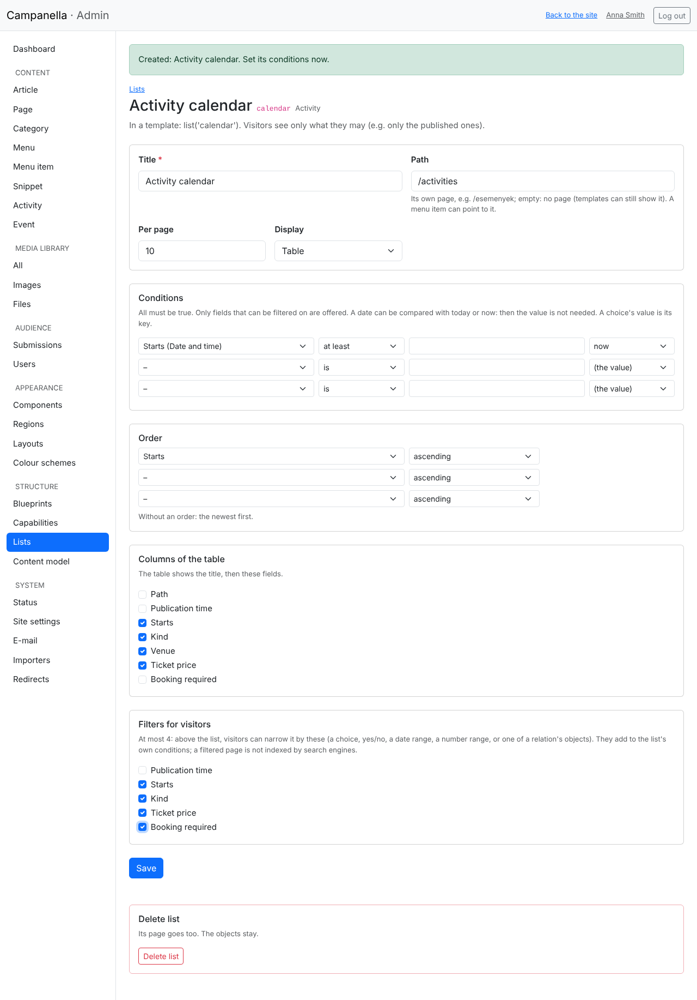

- **Path:** the list's own address on the site: `/activities`. Empty, the list has
  no page (a template can still show it).
- **Per page:** how many activities a page shows (at most 100); the rest go to
  the next pages.
- **Display:** **Short cards** (the title and the start of the text, as in the
  news list) or **Table** (the chosen fields in columns). A table suits a
  calendar.
- **Conditions:** which activities are in the list. All must be true. Here:
  *Starts* – *at least* – **now**: only the activities that have not started yet.
  Dates can be compared with **today** and **now**, worked out again on every
  visit, so the list keeps itself up to date. For a choice field the value is
  the key (e.g. `concert`).
- **Order:** *Starts*, *ascending*: the next one first.
- **Columns of the table:** these fields follow the title.
- **Filters for visitors:** at most four fields or relations visitors can
  narrow the list by. They are added to the list's own conditions.

The list shows only the published activities, not the drafts or the scheduled ones
(not to you either, logged in).

After **Save**, the list's page is there at once (**Its page** at the top
right takes you there):

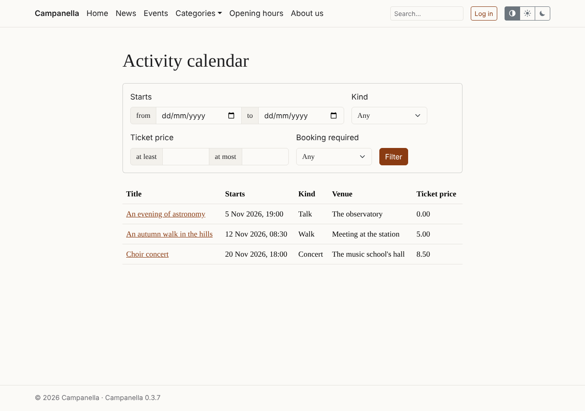

With the filters, a visitor can look at the walks only, for instance:

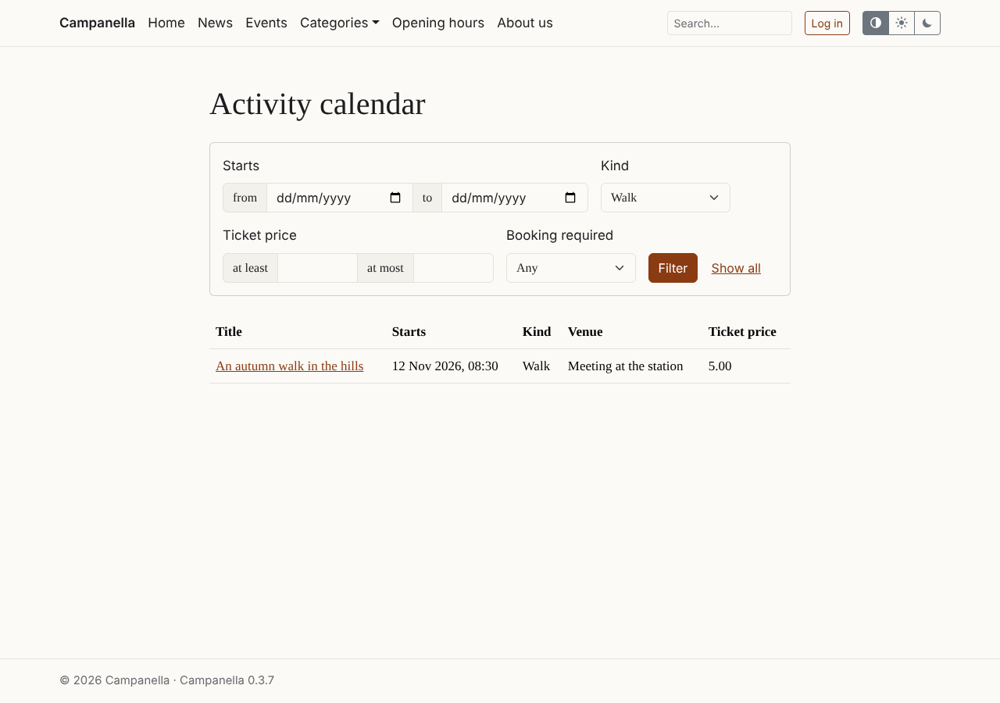

- The filtered page's address holds the filter (e.g. `/activities?f[kind]=walk`),
  so it can be sent or bookmarked. Turning the pages keeps it.
- Search engines do not list the filtered pages, only the list's own one.
- **Show all** removes the filter.

**In the menu**, a new menu item puts it there (chapter 4): **URL**: `/activities`.
The sample content's **Events** item points to its `/events` list the
same way.

**The list's name in templates.** A theme of your own (a developer's work) can
show the list on any page by its machine name, e.g. the next three activities on
the front page. That needs no path.

## Carrying it to another site

If you made the kind of content and the list on a test site, you do not need
to set it all up again on the live one. On the **Structure → Content model** page:

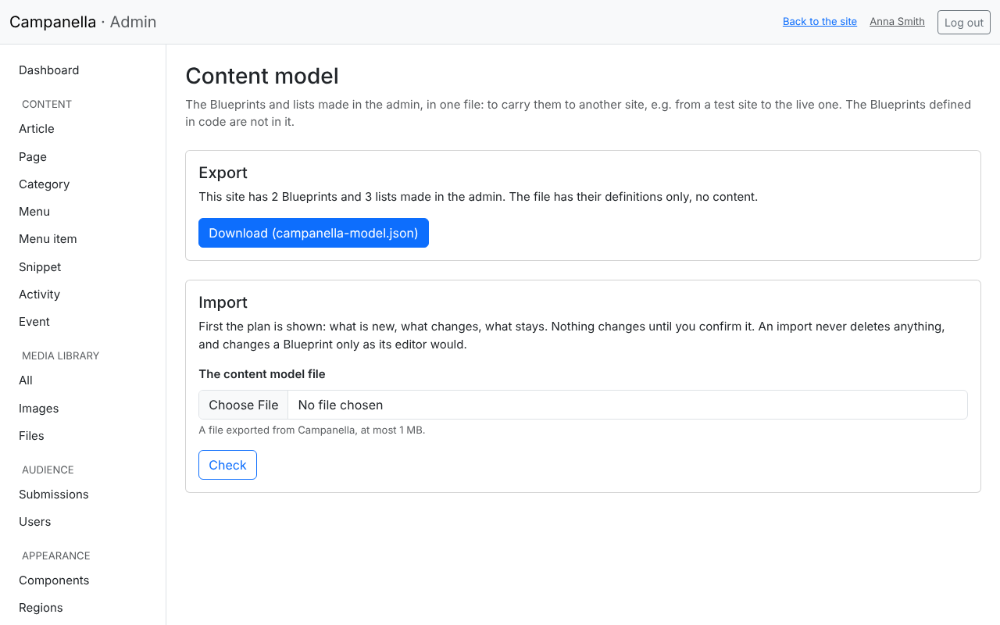

1. On the test site, **Download** in the **Export** box gives a file
   (`campanella-model.json`): the settings of every Blueprint and list made in
   the admin. **No content (activities, articles) is in it.**
2. On the live site, choose the file in the **Import** box, and click
   **Check**. Campanella only shows what it would do first:

   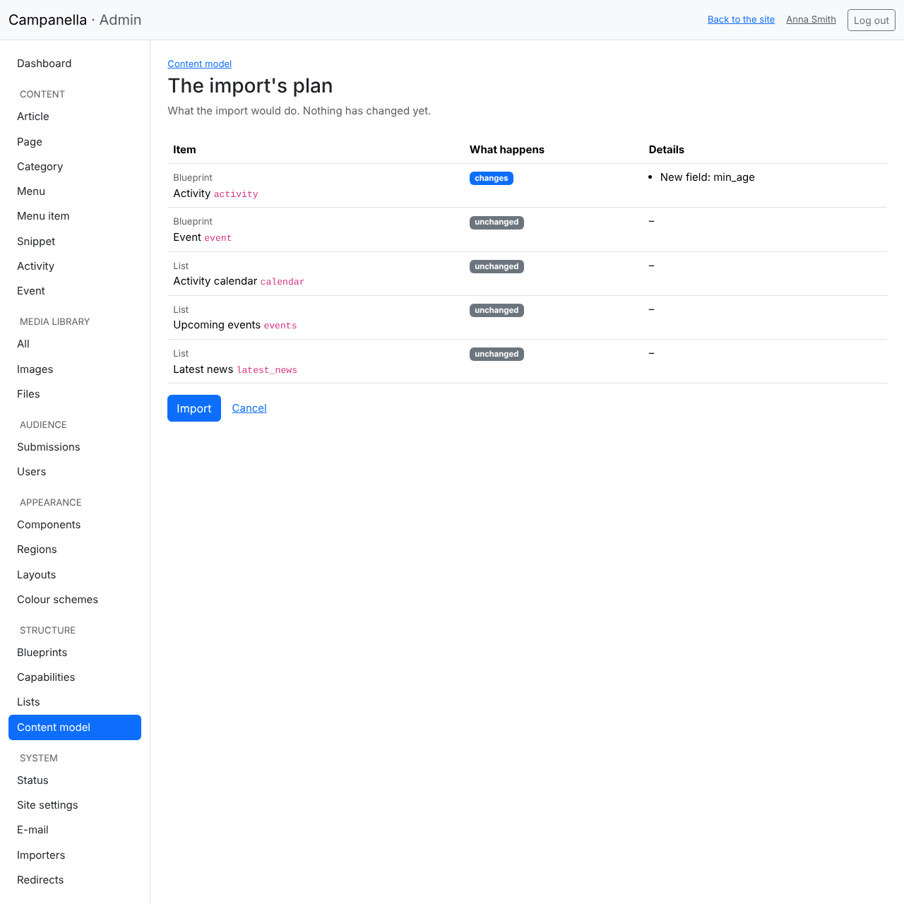

   Here the Activity would get a new field (*min_age*); the rest does not change.
   **Nothing changes until you click Import.**
3. **Import** carries out the plan. If the database changes and there are
   items already, a backup is made first.

An import **never deletes**: a field the live site has but the file does not
stays. It changes a Blueprint only as its editor would allow (see the fields
above); a file that asks for more is shown as an error in the plan, and then
nothing is imported.

## Deleting

- **A list** is deleted at the bottom of its settings (**Delete list**). Its
  page goes, the activities stay. Delete the menu item pointing to it too.
- **A Blueprint** can only be deleted if it has no items, no list is built on
  it, and no other Blueprint's relation points to it: delete the activities first
  (in the Activity list), then the list, then the Blueprint (at the bottom of its
  page, **Delete Blueprint**).

The sample content's Event goes the same way: its events, the **Upcoming
events** list, the **Event** Blueprint, and the **Events** item of the
main menu.

## Limits and tips

| | |
|---|---|
| A Blueprint's own columns in the admin | at most 4 |
| A list's filters | at most 4 |
| A list's conditions, order | at most 10 conditions, 3 sort keys |
| A list per page | at most 100 items |
| Choices of a field | at most 200 |

- **Plan first, then build.** Machine names cannot be changed later, and a
  type only widened: think the fields through on paper first.
- **Make filterable only what you will filter or sort by.** The other fields
  are on the form and the page too.
- **Try things on a test site**, and carry the finished model over with the
  export.

---

Previous: [10. When something does not work](10-troubleshooting.md) · Next:
[12. Importing from a spreadsheet](12-importing.md) · [Contents](README.md)
