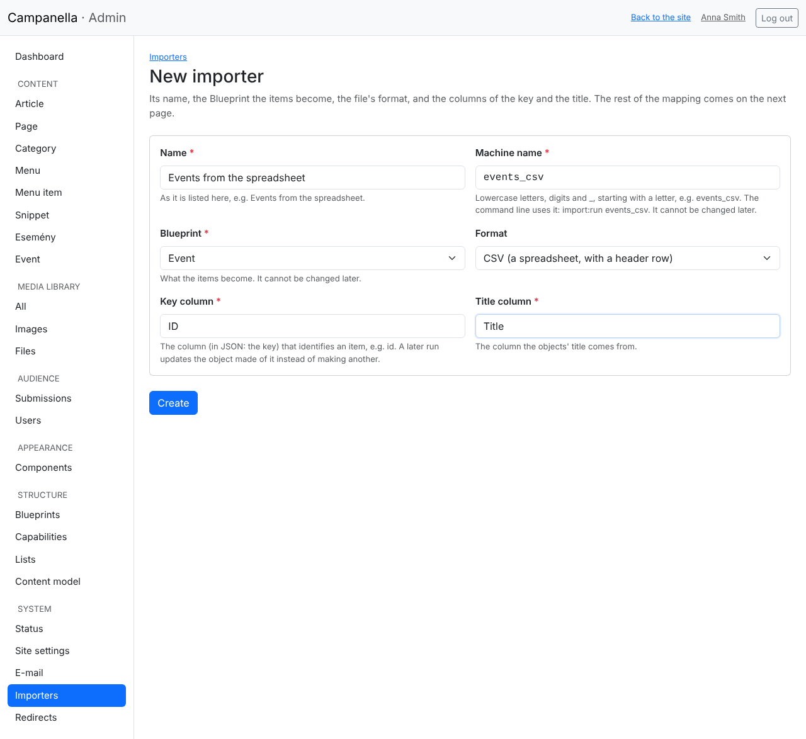
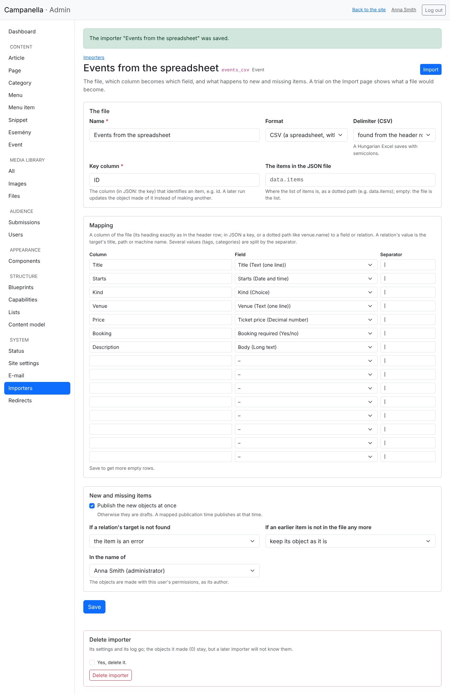
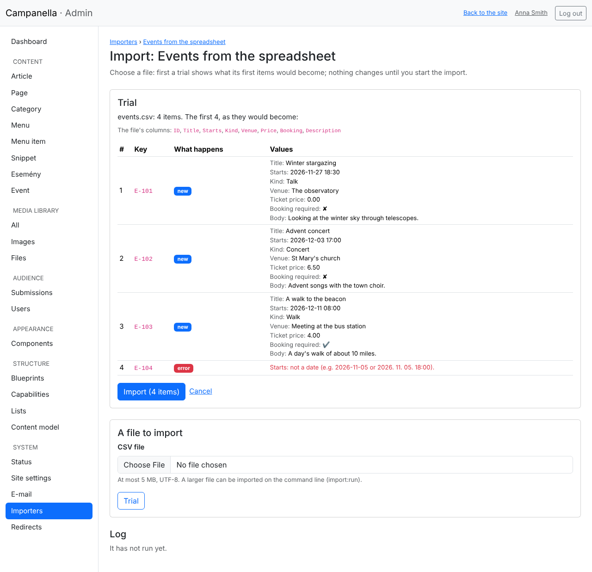
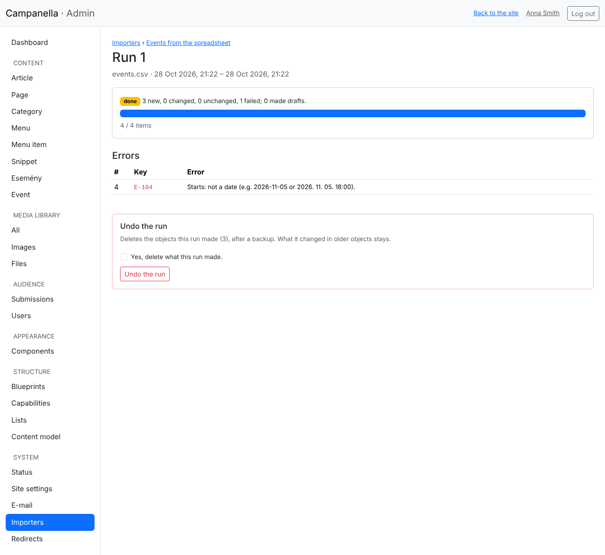
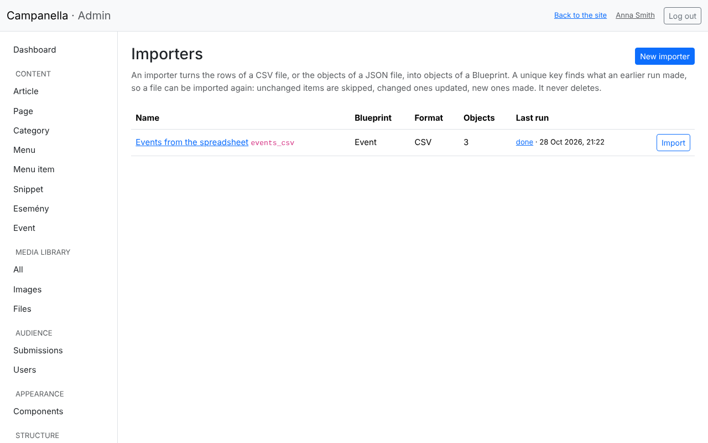

# 12. Importing from a spreadsheet

If the content already exists somewhere, in an Excel spreadsheet or in another
system's export, you do not need to type it in: an **importer** makes the
site's items from the rows of the file. The same file (or a newer version of
it) can be imported again later: what did not change is skipped, what changed
is updated, what is new is made.

This chapter goes on with chapter 11's event calendar: the events come from a
spreadsheet. Importers are set up and run by an administrator.

## What can be imported?

- **A CSV file:** every spreadsheet program saves one (in Excel: *File → Save
  As → CSV UTF-8*). Its first row is the header, with the columns' names. The
  delimiter (semicolon, comma or tab) is found by itself.
- **A JSON file:** another system's export, with a list of objects.

The file must be **UTF-8** (otherwise accented letters would break; the
importer says so). The admin takes a file of at most 5 MB; a larger one can be
imported on the command line (see the end of the chapter).

One row becomes one item: an event, an article, a product. The items become
items of one kind of content (a Blueprint); users, images and menu items cannot
be imported this way.

**A tip: start with the export.** Every list of the admin has a **CSV export**
button at its top right, which downloads its items (with its search and
filters) in a CSV file of the form an importer reads:


Its columns are the fields' machine names (`title`, `starts` …). To edit the
events in a spreadsheet, download it, change or add to it, and import it back.

## The spreadsheet

In the example, the spreadsheet is this (semicolons between the values):

```
ID;Title;Starts;Kind;Venue;Price;Booking;Description
E-101;Winter stargazing;2026-11-25 18:30;Talk;The observatory;0;no;Looking at the winter sky.
E-102;Advent concert;2026-12-01 17:00;Concert;St Mary's church;6.50;no;Advent songs.
```

- **The ID** is different in every row, and does not change later. It tells the
  importer whether a row means an event imported before. A plain number will
  do, as long as it is unique.
- **A date:** `2026-11-25` (or `2026.11.25.`); with a time: `2026-11-25 18:30`.
  The time is in the site's time zone; `2026-11-25T18:30:00+00:00` gives one
  of its own.
- **A number:** with a decimal point or comma, spaces allowed (`1 234.5`).
- **Yes/no:** `yes` or `no` (or `1`, `0`, `x`).
- **A choice:** its label (`Concert`) or its key (`concert`).
- **Several values** (tags, categories): in one cell, with a separator:
  `music|children`.
- **A relation** (e.g. a category): the target's **title** (or path). If there
  is none, the importer's setting decides what happens (below).
- **Formatted text:** as HTML, or as plain text, which becomes paragraphs.
  Everything is filtered on saving here too, as in the admin.

## A new importer

On the **System → Importers** page, **New importer**:



- **Name:** as it is listed.
- **Machine name:** `events_csv`. The command line uses it; it cannot be
  changed later.
- **Blueprint:** what the rows become, here *Event*.
- **Format:** CSV or JSON.
- **Key column:** the ID's column, exactly as in the header: `ID`.
- **Title column:** the column the events' titles come from: `Title`.

## Which column becomes what

After **Create**, the importer's settings follow. In **Mapping**, each row maps
a column's name (on the left) to a field (on the right):



- Write the column's name exactly as in the header row (upper and lower case
  count).
- A field can be mapped once. What is not mapped does not change.
- **Publication time** can be mapped too: then the item appears at that time.
- When the empty rows run out, save: new ones appear.

Below it:

- **Publish the new objects at once:** otherwise they are drafts, published one
  by one.
- **If a relation's target is not found** (e.g. no category of that title): the
  item is an error (the safe choice), it is imported without that link, or the
  target is made (a new category with the value as its title).
- **If an earlier item is not in the file any more:** keep its object as it is,
  or make it a draft (so it leaves the site, but is not deleted). An importer
  **never deletes**.
- **In the name of:** the items are made with this user's permissions, as its
  author. An importer does not run in the name of a blocked user.

## A trial, and the import

**Import** at the top right (or in the list) takes you to the import page.
Choose the file, and click **Trial**. It **changes nothing** yet, only shows
what its first ten rows would become:



- **New** rows become new events, **changes** rows update an event imported
  before, **unchanged** rows are skipped.
- **Error** rows are skipped, with the reason next to them: here the fourth
  row's start ("next week") is not a date.
- If a mapped column is not in the file, a warning on top says so (a mistyped
  column name, for one).

If all is well, **Import** starts it. The import goes on step by step while its
page is open (a large file too, without loading the server); at the end, its
log:



- How many items were new, changed, unchanged or failed, and how many became
  drafts.
- The errors by row, with the row's number and key: correct them in the
  spreadsheet, and import it again. The rows already in order are then skipped
  as unchanged.
- **Undo the run** (after a backup) deletes the events this run made. What it
  changed in older events stays.

If you close the page meanwhile, the run stops where it is; opening its page
again (from the log) goes on with it. **Stop** ends it: what it did stays.

The list of importers shows their last runs too:



## A regular import on the command line

If a file is updated regularly (e.g. another system saves it every night), the
host's scheduled tasks (cron) can run the importer:

```
php bin/campanella import:run events_csv /path/to/events.csv --yes
```

Without `--yes` it only prints the trial. The command line takes a file of any
size, and `php bin/campanella import:undo <run number> --yes` undoes a run. An
import never starts on a visitor's request: the visitors' pages do not slow
down because of it.

## When something goes wrong

| What you see | Cause, what to do |
|---|---|
| "The file is not UTF-8 text" | Save the spreadsheet as *CSV UTF-8*. |
| "The file has no column called …" | The column's name is written differently in the header (a space, an accent, upper or lower case). Correct it in the mapping or in the spreadsheet. |
| Every row is "new", though you imported it before | The ID column changed, or another importer imported it. An importer knows its own earlier runs. |
| "…: no object named "…"" | The relation's target (e.g. a category) does not exist by that title. Make it, correct the name, or let the importer make it. |
| A cell starts with `'` in the export | The CSV export puts an apostrophe before a text that starts with `=`, `+`, `-` or `@`, so the spreadsheet does not run it as a formula. |

---

Previous: [11. Your own kinds of content](11-own-content-types.md) · Next:
[13. Components](13-components.md) · [Contents](README.md)
