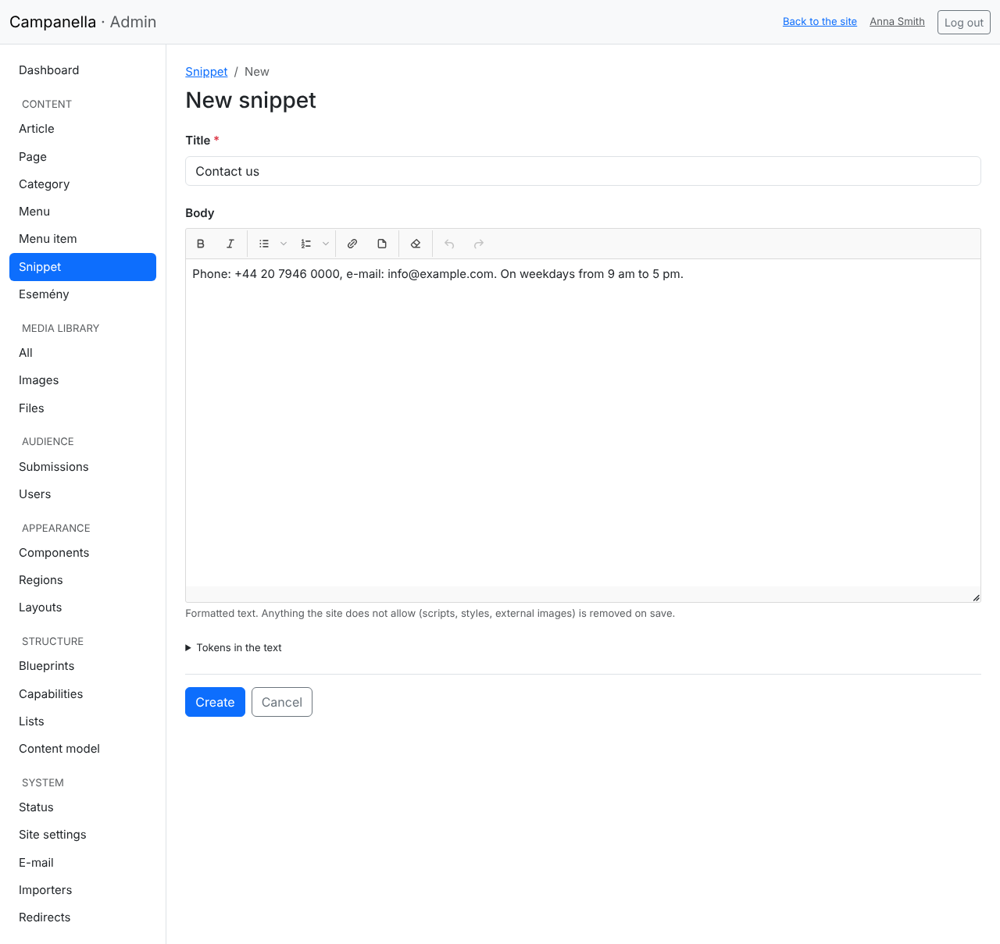
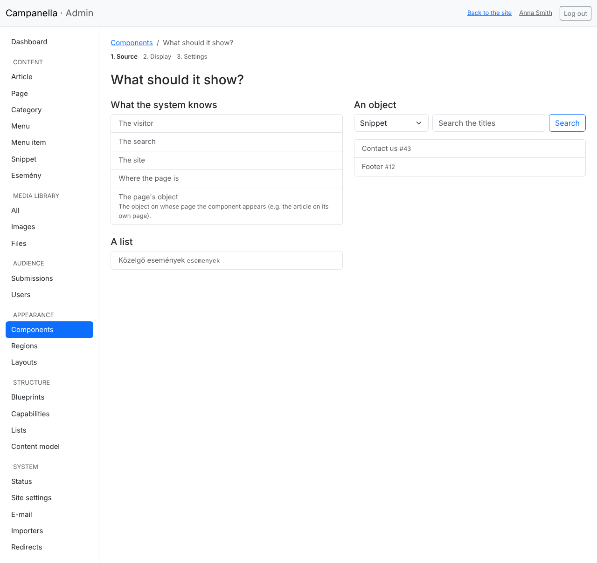
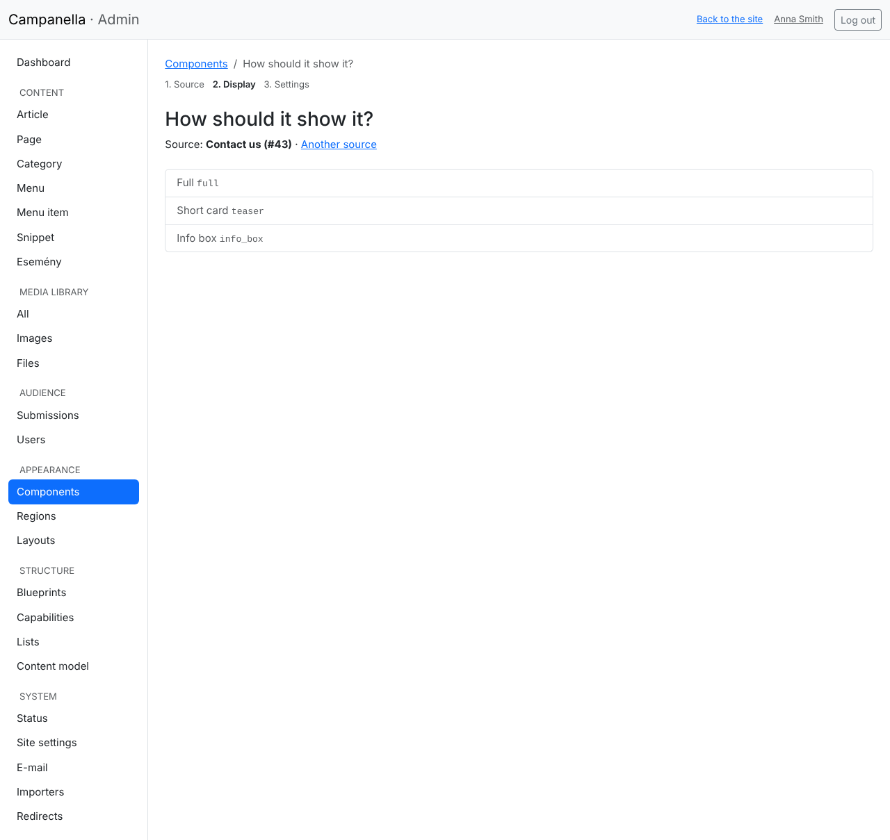
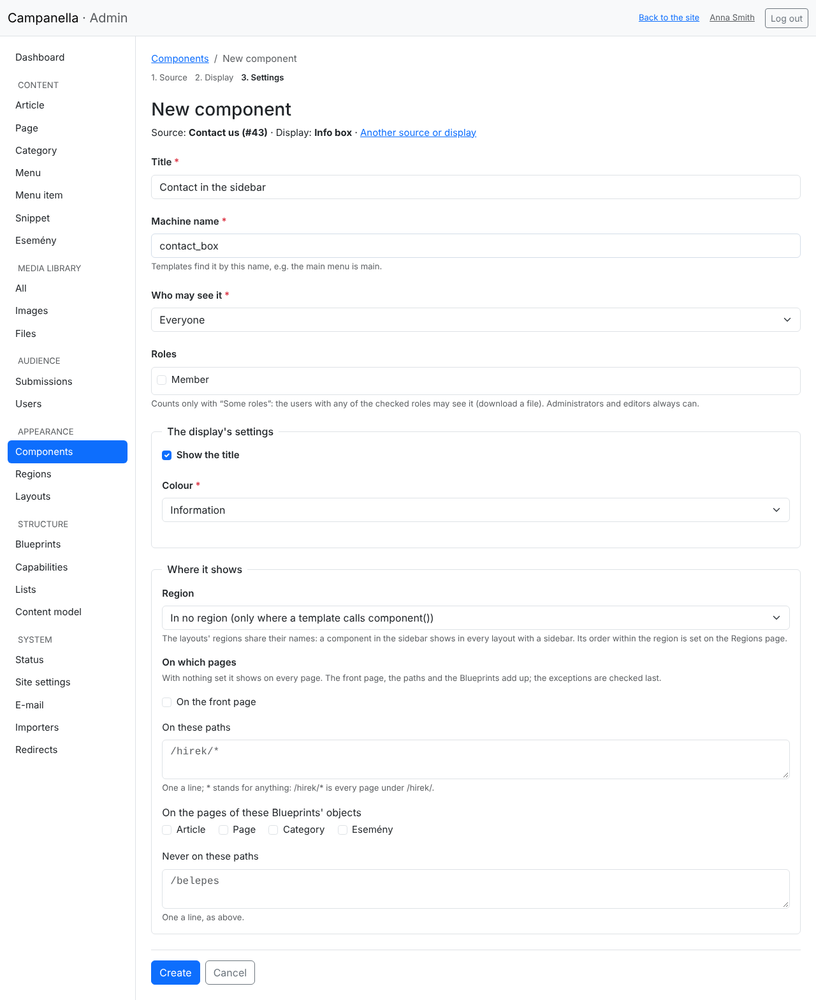
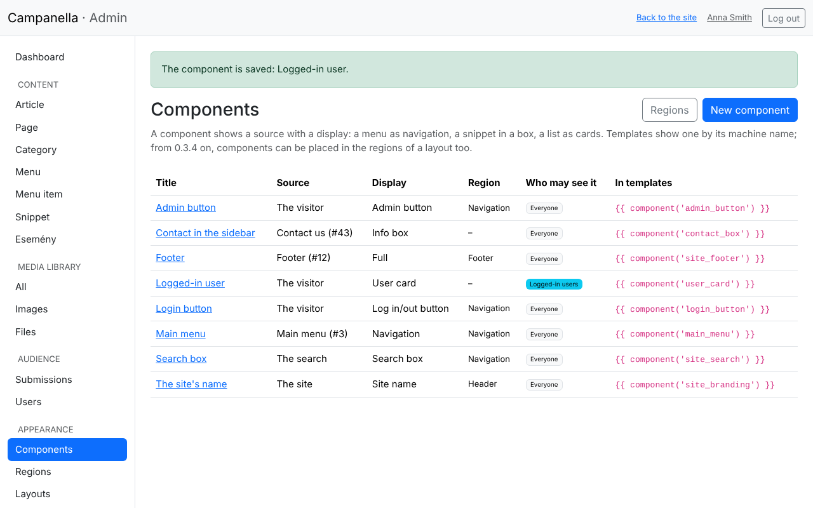

# 13. Components

A **component** shows something on the site: a menu as navigation, a short
text (e.g. how to reach you) in a box, the newest items of a list as cards, or
a login button to the visitor. Every component has three parts:

- **the source:** what it shows (a snippet, a menu, a list, the visitor …);
- **the display:** how it shows it (in a box, as navigation, as cards …);
- **the display's settings:** e.g. the box's colour, or how many items a list
  shows.

Only administrators make and change components: what appears on the site is a
right above an editor's. Editors change what a component shows (the snippet,
the menu).

> **Where does a component appear?** In a **region** of the layout (the
> header, the navigation, the sidebar, the footer …): you choose it in its
> form, and set its order on the **Appearance → Regions** page (chapter 14). Or
> where the theme's template calls it by its **machine name** (below).

## Snippets: the short texts

A short text that a component shows (opening hours, contact details, a
notice) is a **snippet**. It is a kind of content with a title and a formatted
text, but no page of its own: it only shows where a component shows it.

**Content → Snippet → New** writes one, as an article:



## A new component, in three steps

On **Appearance → Components**, with **New component**.

**1. What should it show?**



| Source | What it is for |
|---|---|
| **The visitor** | The login button, the admin button (only for those who may enter the admin), the login form, or the logged-in user's card. |
| **The search** | A search box. |
| **The site** | The site's name and slogan. |
| **Where the page is** | The breadcrumbs: the front page, the categories, the page itself. |
| **The page's object** | The one on whose page the component appears: e.g. the article on its own page. |
| **A list** | A list made on **Structure → Lists** (chapter 11), e.g. the upcoming events. |
| **An object** | A snippet, a menu, an image, a file, a page …: choose the kind of content, and search its title. |

**2. How should it show it?** Only the displays that can show the source are
offered: navigation for a menu, a download for a file, cards and a table for a
list.



| Display | What it shows |
|---|---|
| **Full**, **Short card** | A piece of content in full, or in short, with its title and lead. |
| **Link** | A link to its page. |
| **Info box** | Its title and text in a coloured frame: right for snippets. |
| **Navigation** | A menu as a horizontal bar or a vertical list. |
| **Image**, **Download** | An image, or a file's download link with its type and size. |
| **Cards**, **Table** | A list's first items. |
| **Log in/out button**, **Admin button**, **Login form**, **User card** | For the visitor. |
| **Search box**, **Site name**, **Breadcrumbs** | The search, the site's name, where the page is. |

**3. The component's details and the settings**



- **Title:** only shown in the admin, so you find it.
- **Machine name:** lowercase letters, digits and underscores (e.g.
  `contact_box`). Templates call it by this name. It cannot be the same as a
  menu's.
- **Who sees it:** everyone, logged-in users only, or some roles (chapter 5).
  To whom it is not meant for, the component does not show.
- **The display's settings:** they depend on the display. For an info box the
  title and the colour, for a list the number of items and of columns.
- **Where it shows** (since 0.3.4): the **region**, and on which pages: the
  front page, some paths, the pages of some content types, except a few paths.
  See [chapter 14](14-layouts.md#where-it-shows).

**Create** saves it. Later, click its title in the list to change it; **Another
source or display** goes through the steps again.

## The list of components



The list shows what each component shows and how, to whom, and how a template
calls it. If a component **does not work**, a red mark is beside it, with the
reason: e.g. the menu it showed was deleted. Nothing shows in its place on the
site then; give it another source, or delete it.

Deleting a component does not delete what it showed (the snippet, the menu
stays).

## A component in a template

A component in no region shows where the theme's template calls it by its
machine name. Whoever makes the theme does it in one line:

```twig
{{ component('contact_box') }}
```

If there is no such component, or the visitor may not see it, its place stays
empty: the page does not break. For those who make themes:
[PHP API, chapter 28](../../php-api/28-displays.md).

---

Previous: [12. Importing from a spreadsheet](12-importing.md) ·
Next: [14. Layouts and regions](14-layouts.md) ·
[Contents](README.md)
