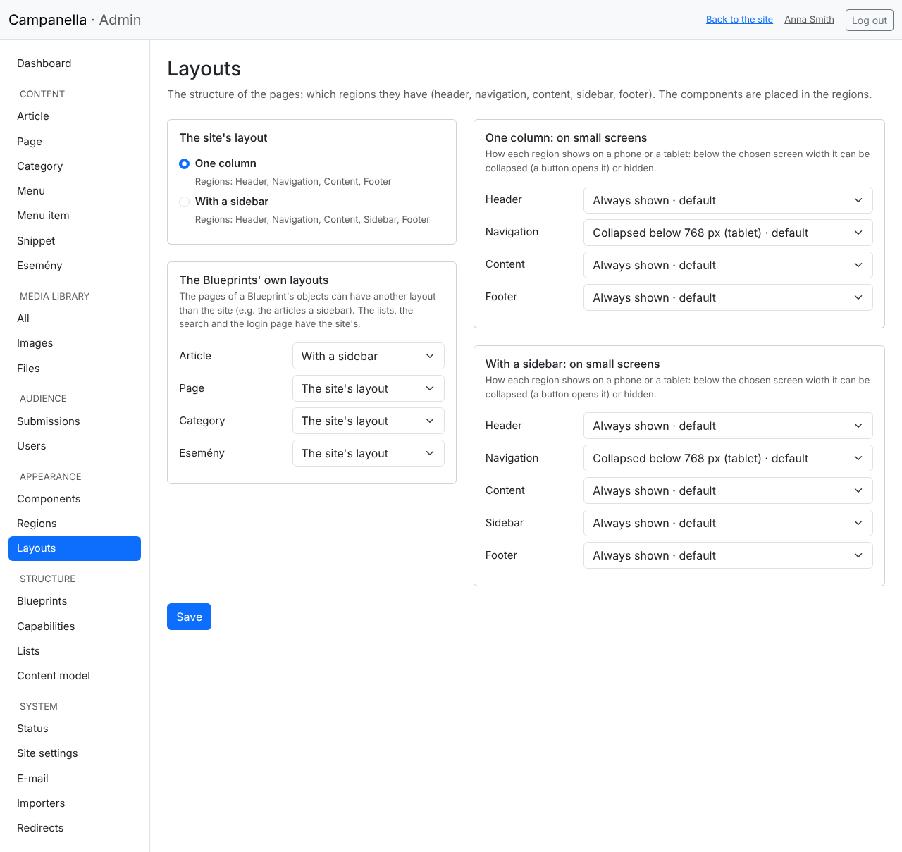
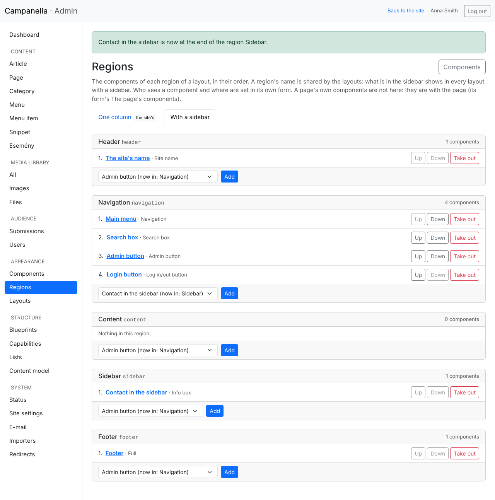
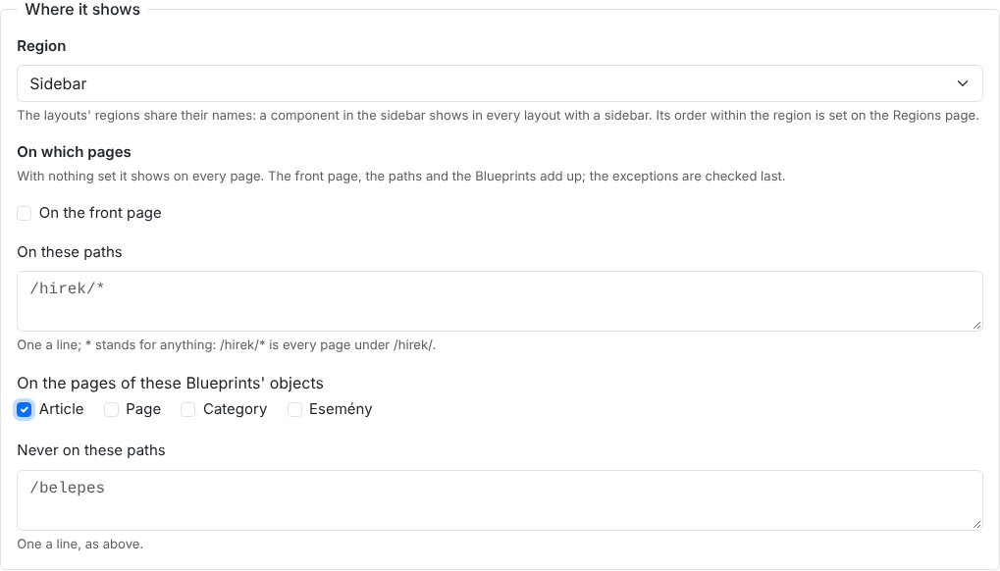
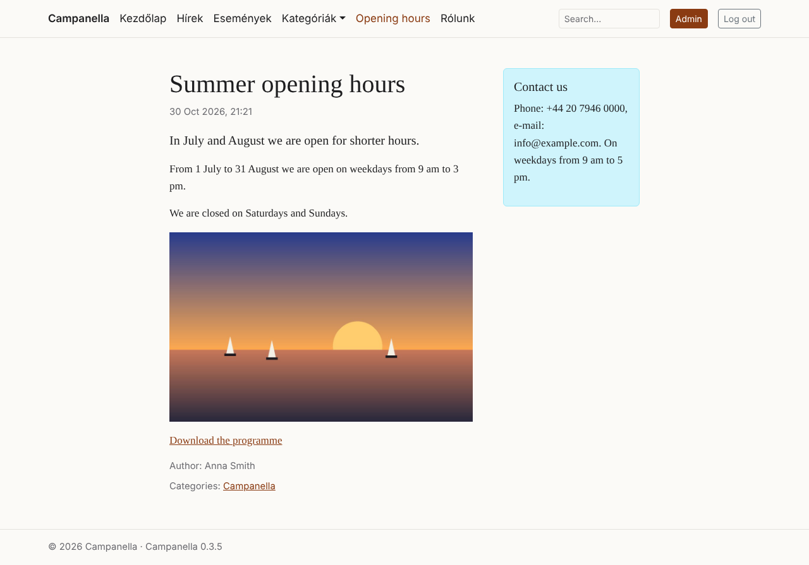

# 14. Layouts and regions

A page's **layout** is its structure: which parts, **regions**, it has, and
where they are. **Components** go into the regions (chapter 13), one below the
other, in their order. Campanella has two layouts:

| Layout | Its regions |
|---|---|
| **One column** (the default) | Header, Navigation, Content, Footer |
| **With a sidebar** | The same, and a **Sidebar** beside the content (below it on smaller screens) |

Themes can bring more layouts; they are chosen in the admin the same way. The
page's own content (the article, the list, the search's results) is always at
the start of the **Content** region; what you put there shows below it.

## The header and the footer

Since 0.3.4 the site's header and footer are made of components too. The
installation and the upgrade to 0.3.4 make them, as the header looked until then:

| Region | Component | What it shows |
|---|---|---|
| Header | **The site's name** | The site's name, as a link to the front page. |
| Navigation | **Main menu** | The main menu (chapter 4). |
| | **Search box** | The search (chapter 3). |
| | **Admin button** | Only to those who may enter the admin. |
| | **Login button** | Logging in; logging out once logged in. |
| Footer | **Footer** | A snippet: © 2026 Campanella · Campanella 0.3.4. |

You change them as any component: click their title in the **Appearance →
Components** list. The footer's text is the *Footer* snippet, in the **Content →
Snippet** list. The **tokens** in square brackets in it are replaced by their
values when it is shown:

| Token | What it becomes |
|---|---|
| `[site:name]` | The site's name (**System → Site settings**). |
| `[site:slogan]` | The site's slogan. |
| `[site:url]` | The site's address. |
| `[date:year]` | The current year. |
| `[campanella:version]` | Campanella's version. |

Below a snippet's editor, open **Tokens in the text** to see them.

> If you take everything out of a region, that part stays empty: an empty
> footer is not shown. The components stay in the **Components** list; you can
> put them back any time.

## Choosing the layout

On the **Appearance → Layouts** page:

- **The site's layout:** every page without one of its own gets it.
- **The Blueprints' own layouts:** the pages of a content type (e.g. the
  articles) can have another layout than the site. Here the articles get **With
  a sidebar**. The lists, the search and the login page have the site's.
- **On small screens:** for each region, how it shows on a phone or a tablet.
  **Always shown**; **collapsed** below a width (a button opens it, as the
  navigation); or **hidden** below a width. The *default* is the layout's own.

**Save** makes them count on the site.

## The regions and the components' order

On the **Appearance → Regions** page you see a layout's regions, each with its
components, in their order. The tabs switch between the layouts.

- **Up**, **Down:** the component's place in the region. In the navigation, for
  example, the menu comes first, then the search, then the buttons.
- **Take out:** the component leaves the region, but it is kept (in the
  Components list).
- **Add:** at the bottom of a region, choose a component; it goes to the
  region's end. If it was in another region, the list says so ("now in:
  Header"), and it moves from there.

A region's name is shared by the layouts: what is in the **Sidebar** shows in
every layout with a sidebar, what is in the **Header** in all of them.

## Where it shows

In a component's form, under **Where it shows** (chapter 13):

- **Region:** which one. *In no region:* it only shows where the theme's
  template calls it by its machine name.
- **On which pages:** with nothing set, everywhere.
  - **On the front page:** on the front page.
  - **On these paths:** one a line, starting with `/`. `*` stands for
    anything: `/hirek/*` is every page under `/hirek/` (not `/hirek` itself).
  - **On the pages of these Blueprints' objects:** e.g. every article's page.
  - **Never on these paths:** the exceptions, one a line too.

  The front page, the paths and the Blueprints add up: a page matching one of
  them is enough. The exceptions always decide. **Who** sees it is said by the
  component's **Who sees it** field (everyone, logged-in users, some roles).

Here the *Contact us* box went into the sidebar, on the articles' pages only:

## If something does not show as expected

| What you see | Why, and what to do |
|---|---|
| A component does not show | It is in no region (its form), the page does not match its conditions (**On which pages**), or the visitor may not see it (**Who sees it**). The page's layout may also have no such region (e.g. a sidebar in the *One column* layout). |
| The sidebar is empty, not shown | The page's layout is *One column*: on **Appearance → Layouts** give the page's content type *With a sidebar*. |
| The header lost its menu | The *Main menu* component was taken out of its region: put it back into the Navigation on the **Regions** page. If it was deleted, make a new one: the source is the *Főmenü*, the display *Navigation*. |
| The footer shows an old text | The footer is the *Footer* snippet: change that. |
| A part is missing on a phone | The region is hidden on small screens: on **Appearance → Layouts** set it to *Always shown* or *collapsed*. |

For theme makers: [PHP API, chapter 29](../../php-api/29-layouts.md).

---

Previous: [13. Components](13-components.md) ·
Next: [15. Pages assembled from components](15-pages.md) · [Contents](README.md)
