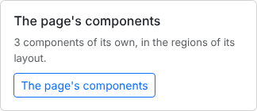
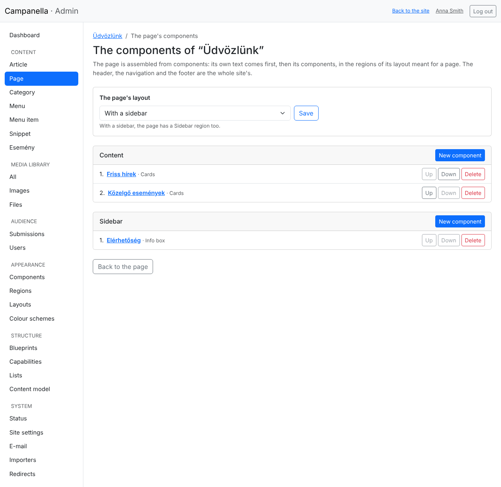
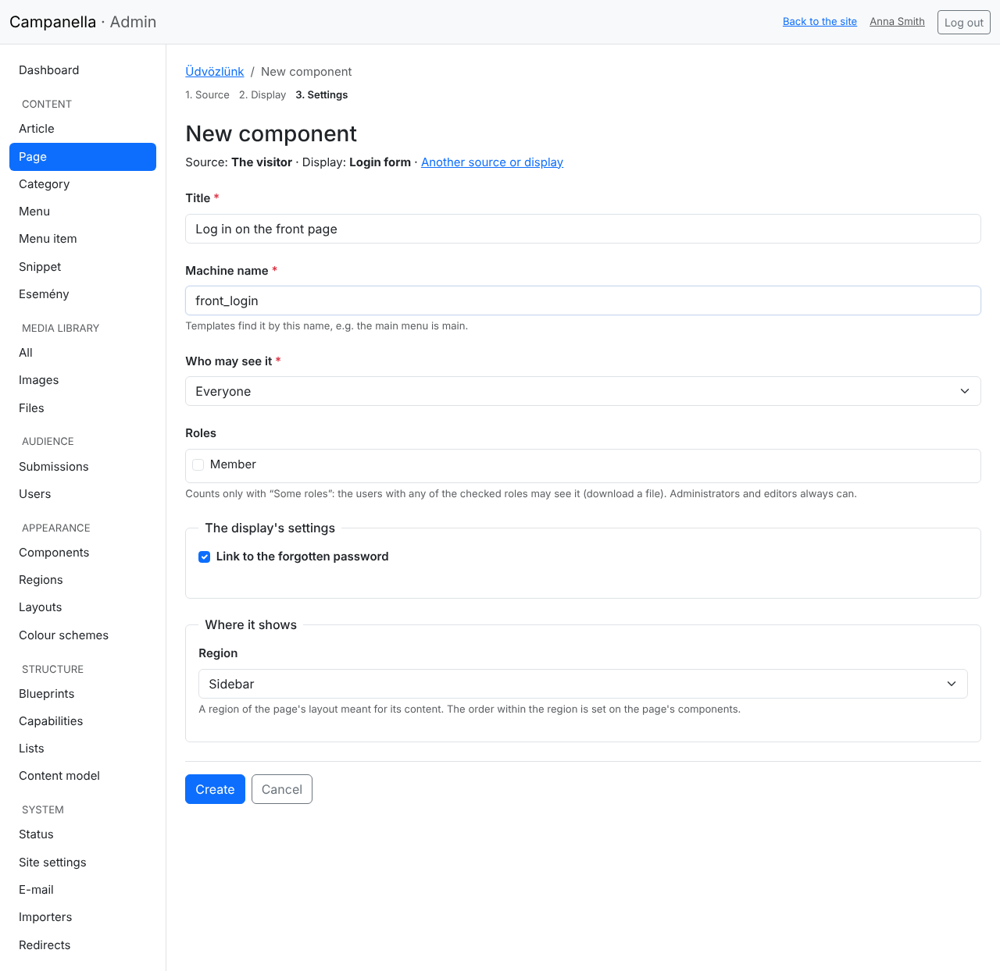
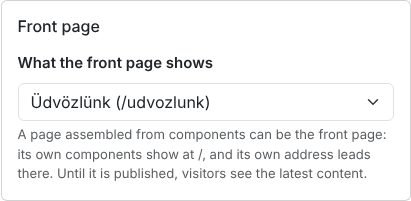
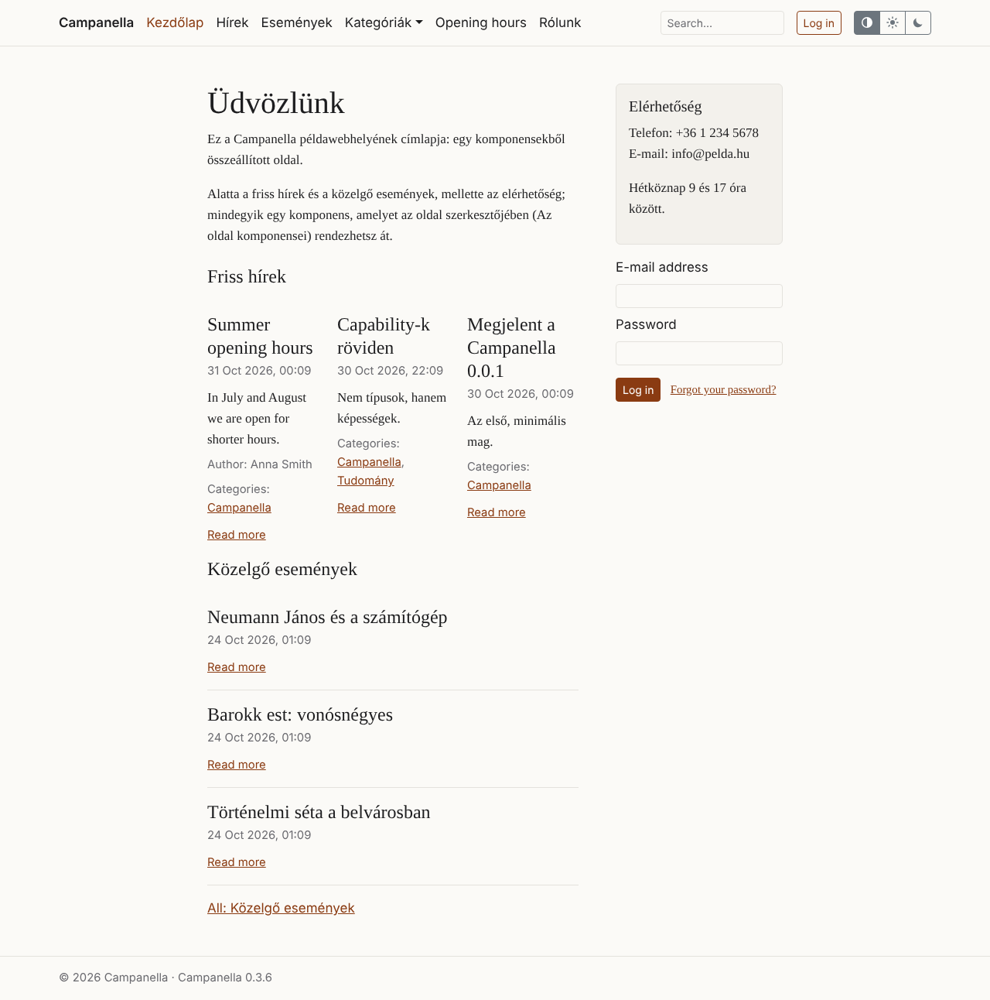

# 15. Pages assembled from components

A **page** (e.g. *About us*, or the front page) can be more than text: its own
**components** can go below and beside its text, e.g. the latest news as cards,
the upcoming events, a contact box or a login form. They show on that page
only, and **editors** can arrange them too, not only the administrators.

How do they differ from the components of chapter 14?

| | The site's components (chapter 14) | A page's own components |
|---|---|---|
| Where do they show? | On every page (or where their conditions say), in the header, the navigation, the footer, the sidebar … | On their page only, after its text |
| In which region? | Any | Only those meant for a page's content: **Content**, and in a layout with a sidebar, **Sidebar** |
| Who handles them? | The administrators (**Appearance → Regions**) | Everyone who may edit the page, editors too (from the page's form) |

## The page's components

On a page's form, at the right, the **The page's components** card says how
many components of its own it has:

Its **The page's components** button opens the page's own components:

- **The page's layout:** *as its content type's* (set on **Appearance →
  Layouts**, chapter 14), or one of its own. In the **With a sidebar** layout
  the page has a **Sidebar** region too.
- **The regions:** each with the page's components, in their order. **Up**,
  **Down:** their order; **Delete:** deletes the component (what it showed,
  e.g. a snippet, stays).
- Click a component's title to open its form: its title, who sees it, and its
  display's settings (e.g. how many cards, in how many columns).

## A new component for a page

With a region's **New component** button, in the same three steps as in
chapter 13: what to show, how, and its settings.

Under **Where it shows** you only choose the region (among those of the page's
layout meant for its content); there are no conditions, since the component
shows on its page only. **Create** takes you back to the page's components,
and the new one goes to the region's end.

> **As an editor** you handle a page's components, not the site's: the
> **Appearance** menu is not shown, and a site component's form does not open.
> You cannot choose content you may not see as a source either.

## The front page

The front page (the site's `/`) shows the **latest content** by default. A page
assembled from components can be the front page too: choose it on **System →
Site settings**, under **Front page**.

- At `/`, the page shows, with its own components and layout.
- The page's own address (e.g. `/udvozlunk`) leads to `/`, so it has one
  address; search engines see it so too.
- While the page is a **draft**, visitors see the latest content; you (logged
  in) see the page already.

The sample content's front page is such a page: below its text the latest news
and the upcoming events, beside it the contact box, now with the login form:

## If something does not show as expected

| What you see | Why, and what to do |
|---|---|
| There is no **The page's components** card | The content type is not assembled from components: the built-in **Page** is; for a content type of your own, add the *Assembled from components* capability on **Structure → Blueprints** (chapter 11). |
| There is no **Sidebar** region | The page's layout is *One column*: choose **With a sidebar**. |
| A component does not show, and the list warns | The page's layout has no such region (e.g. a sidebar after changing the layout): open the component and choose another region. |
| The front page shows the latest content | The chosen page is still a draft, or no page is chosen in the **Site settings**. |

For theme makers: [PHP API, chapter 29](../../php-api/29-layouts.md#a-pages-own-components).

---

Previous: [14. Layouts and regions](14-layouts.md) ·
Next: [16. Colour schemes and the colour mode](16-colour-schemes.md) · [Contents](README.md)
