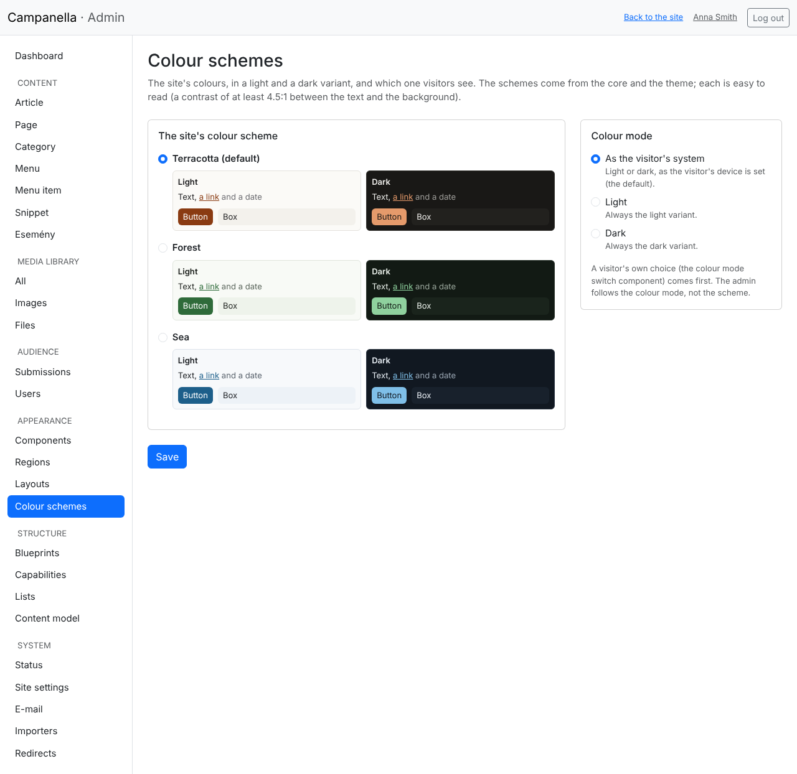
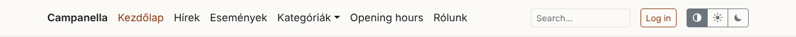
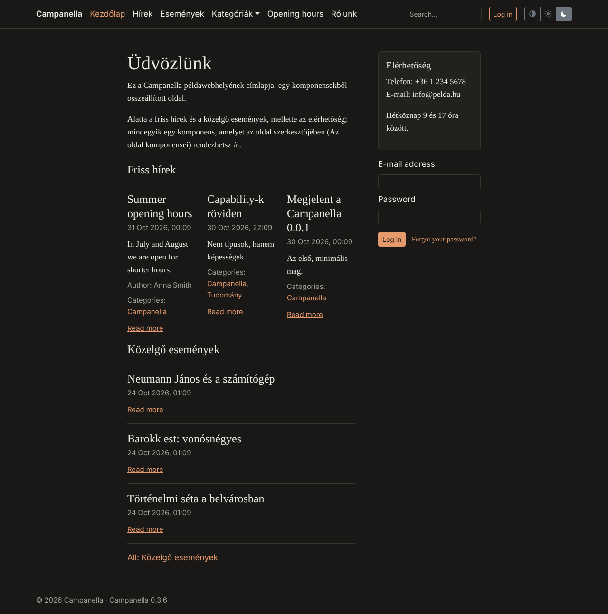

# 16. Colour schemes and the colour mode

The site's colours come from a **colour scheme**: each has a light and a dark
variant. The **colour mode** decides which one visitors see: the one their
device's setting asks for (the default), or always the light or always the dark
one. A visitor can choose too, with a **colour mode switch**, if the site has
one.

## Choosing the colour scheme and the colour mode

On **Appearance → Colour schemes** (for administrators only):

- **The site's colour scheme:** Campanella brings three (*Terracotta*, the
  default, *Forest* and *Sea*), a theme more (marked *from the theme*). Beside
  each, its two variants in small: a text, a link, a date, a button and a box in
  the scheme's colours.
- **Colour mode:**

  | Choice | What the visitor sees |
  |---|---|
  | **As the visitor's system** (the default) | Light or dark, as their device (phone, computer) is set |
  | **Light** | Always the light variant |
  | **Dark** | Always the dark variant |

After **Save** the site shows in the new colours at once.

Every scheme is easy to read: the text, the links and the buttons' labels have
a contrast of at least 4.5:1 to their background in both variants (the WCAG 2.2
AA level of accessibility). A theme's scheme that is hard to read is not
offered.

> **The admin** follows the colour mode (dark in dark mode) but not the scheme:
> it keeps its neutral colours, whichever scheme you choose.

## The visitor's colour mode switch

The colour mode switch is a component (chapter 13): three buttons: the half-filled circle
*as the system*, the sun *light*, the moon *dark*.

- The visitor's choice is kept on their device (for a year), without logging
  in; it comes before the site's setting.
- A click changes the page at once; it works without JavaScript too.

In the sample content the switch is at the end of the navigation. On
**Appearance → Regions** you can move it (e.g. to the footer) or delete it, as
any component. On a site without one (e.g. after an upgrade), make one:
**Appearance → Components → New component**, as the source **The visitor**, as
the display **Colour mode switch**; in its settings you can ask for labels
beside the symbols, and under **Where it shows** choose the **Navigation**
region.

The sample content's front page in dark mode:

## If something does not show as expected

| What you see | Why, and what to do |
|---|---|
| The site is dark, though the colour mode is *Light* | The visitor's own choice (the switch) comes first: click the sun or the half-filled circle. |
| A theme's scheme is not listed, and a warning is above | The scheme is left out; the warning says why (e.g. hard to read). The theme's maker can fix it. |
| *The saved colour scheme is gone* | E.g. the theme changed: the site uses the default one meanwhile. Choose one and save. |
| The colours do not change with the scheme | The theme uses its own base template: its maker can turn the schemes on as [chapter 31 of the PHP API](../../php-api/31-appearance.md#existing-themes) says. |

For theme makers: [PHP API, chapter 31](../../php-api/31-appearance.md).

---

Previous: [15. Pages assembled from components](15-pages.md) · [Contents](README.md)
