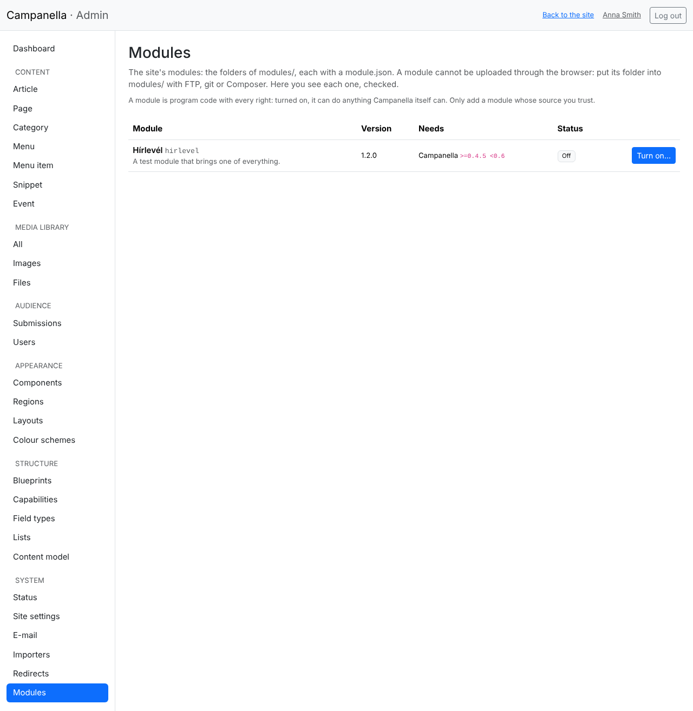
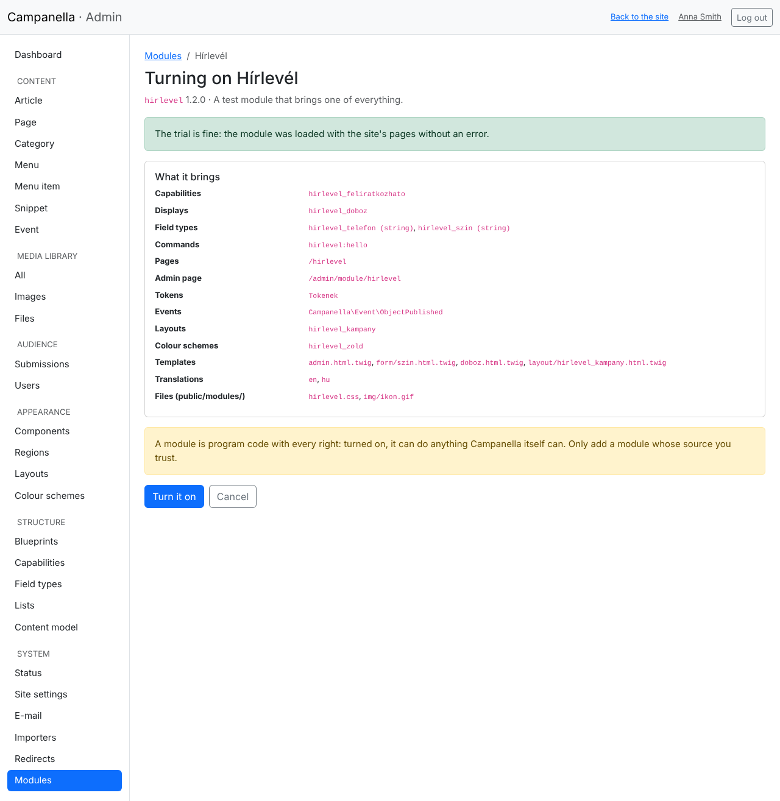
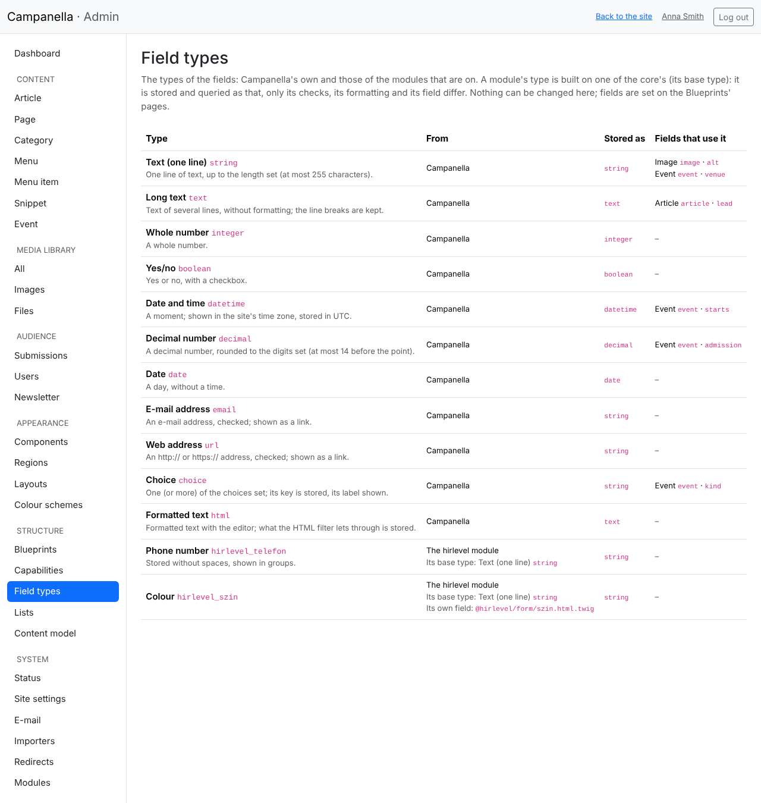

# 17. Modules

A **module** brings new things to the site: e.g. a newsletter, an events
calendar or a new display for the components. A Campanella module is a folder,
put into the `modules/` folder.

> **Important:** a module is program code with every right. Turned on, it can
> do anything Campanella itself can: read and change all of the data. Only add
> a module whose maker and source you trust.

## Adding a module

A module **cannot be uploaded through the browser**. This is on purpose: so a
stolen admin password cannot put program code onto the server either.

1. Unpack the module on your computer. You get a folder (e.g. `newsletter`)
   with a `module.json` file in it.
2. Copy the folder with FTP (or your host's file manager) into the site's
   `modules/` folder: `modules/newsletter/module.json`.
3. Open **System → Modules** (for administrators only).



The list shows every module with its version, the Campanella versions and the
other modules it works with, and where it stands:

| Status | Means |
|---|---|
| **Off** | It can be turned on. |
| **On** | It works. |
| **Cannot be used** | Something is wrong with it: the reason is below (e.g. it is not for this Campanella version, or a module it needs is missing). |
| **On, but not loaded** | `config/local.php` turns it off, or a module it needs does not work. It comes back by itself once that is gone. |

## Turning a module on

**Turn on…** tries the module first:



- whether every file of it can be read, and what it brings does not clash with
  a part of Campanella or of another module;
- whether its templates compile;
- whether a few pages of the site are made without an error with it.

If anything is wrong, the page says what, and the module **is not turned on**.
If all is fine, it lists what the module brings (capabilities, displays, pages,
tables …): **Turn it on** turns it on.

If the module has tables of its own, **a backup** of the database is made first
(into `var/backups/`) when it is turned on, and only then are its tables made.

## Turning a module off

**Turn off** turns the module off; **its data is kept**, and turned on again it
goes on where it was. It cannot be turned off while

- another module that is on needs it;
- the site uses it: a content type its capability, a component its display, or
  the site its layout or colour scheme. The page lists what to change first.

## A module's field types

A module can bring **field types** of its own, a phone number for example,
stored in one form and shown grouped. They can be chosen for a content type's
fields (chapter 11), after the site's own types.

**Structure → Field types** lists the eleven built-in types and those of the
modules that are on: where each comes from, what it is built on (its *base
type*), how it is stored, and which fields of which content types use it.



Every type of a module is built on a built-in type, and a field is stored with
it. So if you turn the module off or remove it, the field's content is kept and
the field goes on working as its base type (as plain text, say); a box at the
bottom of the page lists such fields. The module cannot be turned off while a
field uses its type: first change the field to its base type (the **Type** list
when you edit the field); its content is kept then too.

## A newer version of a module

Upload the new version in place of the old folder. If the new version changes
its tables too, the site shows its upgrade page to visitors, as for an
upgrade of Campanella, until you run the upgrade (**/admin/upgrade**, chapter
9); a backup is made first.

## When the site does not start because of a module

A broken module usually does not stop the site: it is left out, and the
Modules page says why. If it does stop it all the same, turn it off in
`config/local.php` (with the name of the module's folder):

```php
'modules' => ['disabled' => ['newsletter']],
```

This always wins over the admin's setting, and the modules that need it are
not loaded either. With a command line:
`php bin/campanella module:disable newsletter`.

## Removing a module's data

Beside a module that is off, **Remove its data…** (if the module supports it)
removes its tables and settings for good. A backup is made first, and you type
the module's name to confirm. Then you can delete its folder from `modules/`.

## On the command line

| Command | |
|---|---|
| `php bin/campanella module:list` | The modules and where each stands |
| `php bin/campanella module:enable newsletter` | Tries it and turns it on |
| `php bin/campanella module:disable newsletter` | Turns it off |
| `php bin/campanella module:uninstall newsletter --yes` | Removes the data of a module that is off |

## If something does not work as expected

| What you see | Why, and what to do |
|---|---|
| The module is not in the list | Its folder is not right under `modules/`, or its name is not all small letters, digits and underscores. Its `module.json` must be at the top of the folder. |
| *Not for this Campanella version* | Look for a newer (or older) version of the module that works with the site's version. |
| *The module's files cannot be copied into public/modules/* | The web server must be able to write into `public/modules/`: set the write permission in your host's file manager. |
| Turning it on ends with a blank or error page | The module stopped PHP during the trial: it was not turned on. Tell the module's maker; the error log (on the host) says why. |

For module makers: [PHP API, chapter 32](../../php-api/32-modules.md).

---

Previous: [16. Colour schemes and the colour mode](16-colour-schemes.md) ·
[Contents](README.md)
