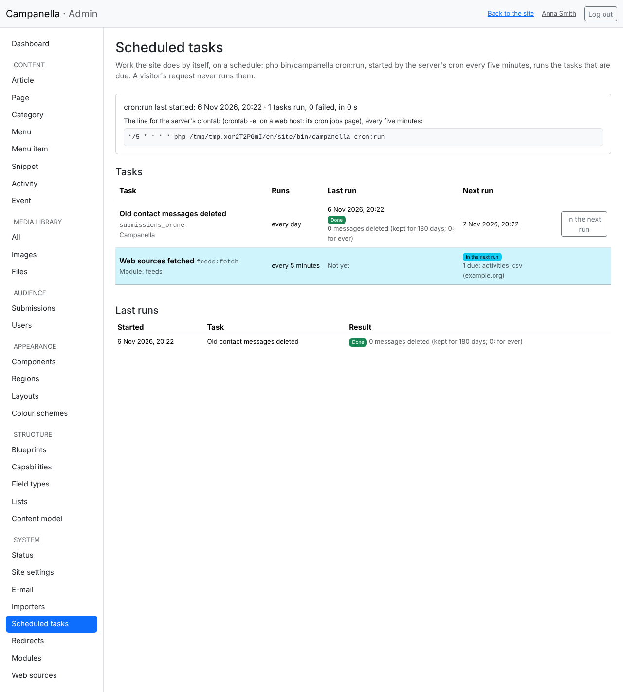
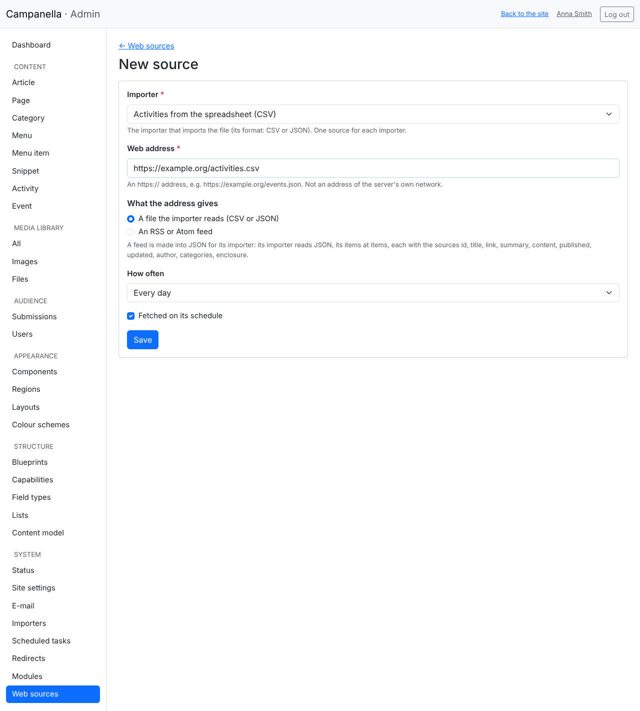
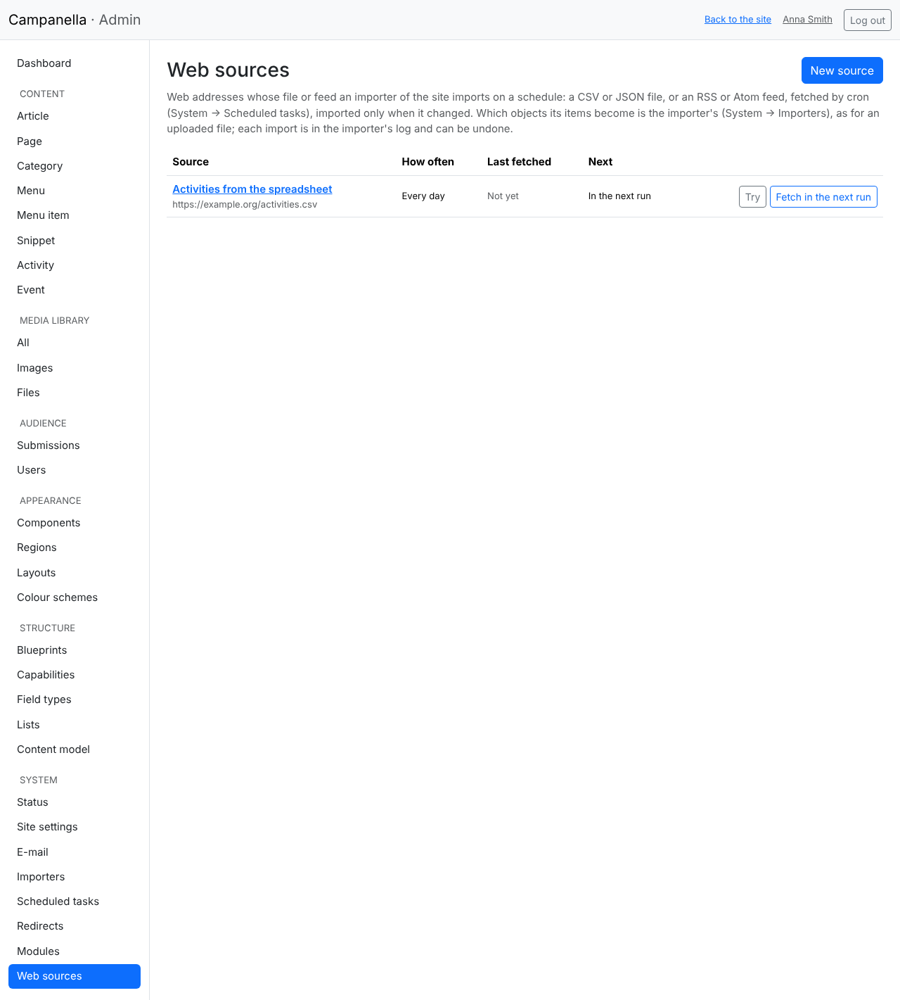

# 18. Scheduled tasks and web sources

Some work the site does by itself, on a schedule: it deletes old contact
messages, say, or fetches another site's calendar of events. These are
**scheduled tasks**. With the **Web sources** module (`feeds`) the site can
import content from a web address regularly: a CSV or JSON file, or an RSS or
Atom feed.

## Setting up cron

One command runs the scheduled tasks:

```
php bin/campanella cron:run
```

The server's **cron** starts it every five minutes. Cron is the server's
timer; a visitor's request never starts a scheduled task, so the pages are not
slowed down by them. The exact line, with your site's own path, is on
**System → Scheduled tasks** (see below); it looks like this:

```
*/5 * * * * php /var/www/campanella/bin/campanella cron:run
```

- **On a web host:** look for "Cron Jobs" or "Scheduled tasks" in the host's
  control panel. The timing: every 5th minute (`*/5 * * * *`), the command: the
  line above from `php` on. If the host has several PHP versions, the full path
  of PHP 8.3 may be needed instead of `php` (the host's help says which).
- **On your own server:** add the line above as the web server's user (e.g.
  `sudo crontab -u www-data -e`).
- **In Docker:** Campanella's `compose.yaml` has a `cron` service that runs the
  command every five minutes; it starts with `docker compose up -d`. If your
  own Docker site's `compose.yaml` is older, copy the `cron` service from it.

Only one `cron:run` runs at a time, for at most four minutes: what does not fit
goes on in the next run.

## The System → Scheduled tasks page



- **At the top:** when `cron:run` last started, how long it took and how many
  tasks ran. If it has not run for more than 30 minutes (or never), a yellow
  warning shows: cron is not set up, or it does not run. Below it, the line to
  copy into the crontab.
- **The tasks:** for each, where it comes from (Campanella or a module), how
  often it runs, when it last ran and how that went, and when it is due next.
  The tasks due in the next run are highlighted, with what they will do (which
  web source comes next, say).
- **In the next run:** makes a task due. Even then it does not run in the
  admin's page, but with cron, within five minutes.
- **At the bottom:** the last 100 runs, with their error messages.

## Web sources

### Turning it on

The Web sources module comes with Campanella, turned off. Turn it on under
**System → Modules**, with the *Feeds* row's **Turn on…** button (chapter 17).
Then **Web sources** shows in the **System** menu.

A web source always feeds an **importer**: the file fetched is imported by an
importer exactly as an uploaded file is (chapter 12). So make the importer
first: it says which column of the file goes into which field.

### A new source



- **Importer:** the one that imports the file. An importer has one source.
- **Web address:** an `https://` address. An address of the server's own
  network (`localhost`, `192.168.…`) cannot be given: so even with an admin's
  password, the server cannot be used to reach its internal network.
- **What the address gives:** a file the importer reads as it is (CSV or
  JSON), or an **RSS or Atom feed** (see below).
- **How often:** every 15 minutes, every hour, every 6 hours or every day.
- **Fetched on its schedule:** turned off, the source stays but is not
  fetched.

### The list of sources



- **Try:** fetches the file now and shows what its first items would become,
  changing nothing. Worth doing first, after saving.
- **Fetch in the next run:** the source is fetched and imported within five
  minutes, whatever its interval.
- A file is imported again only when it **changed**: if the server says it has
  not, or its content is the same, the source shows "Not changed".
- Every import is in the importer's **log** (System → Importers), and can be
  **undone** there.
- If fetching a source **fails three times in a row**, it is tried less often
  (at most daily), shown in red. After the first success it is back to its
  interval.
- Deleting a source keeps what it imported.

### RSS and Atom feeds

From a feed, the module gives the importer the same data for every item,
whether RSS or Atom:

| Source | What it holds |
|---|---|
| `id` | the item's unique key (make it the importer's key) |
| `title` | the title |
| `link` | the item's address on the original site |
| `summary` | the short description (HTML) |
| `content` | the full text (HTML), or the short description if there is none |
| `published` | when it was published |
| `updated` | when it was changed |
| `author` | the author |
| `categories` | a list of its categories |
| `enclosure` | the address of its attached file (an image, a sound) |

Set up the importer like this:

- **Format:** JSON; **The items in the JSON file:** `items`.
- **Key column:** `id`; **Title column:** `title`.
- The other fields, e.g. `content` → Body, `published` → Publication time,
  `categories` → a relation to tags.
- **If an earlier item is not in the file any more:** *keep its object as it
  is*. A feed only ever has its latest few items, so "make it a draft" would
  unpublish the older ones at every fetch; the module warns about it.

The HTML is cleaned when it is saved, like any other text imported or typed.

## If it does not work

- **"cron does not seem to be set up":** check that cron runs (the host's cron
  log) and that the command uses the right PHP and path. You can try it by hand:
  `php bin/campanella cron:run`.
- **"The address is in the server's own network":** the source points to an
  internal address, or its name resolves to one. Campanella refuses this on
  purpose.
- **"Only https:// addresses can be fetched":** if the source has no
  `https://` address, `fetch.allow_http` in `config/local.php` lets in `http://`
  addresses too (see `config/local.php.dist`). An `http://` file can be changed
  by anyone on the way, so use it only if there is no other way.
- **"PHP's curl extension is needed":** ask your host to turn on PHP's `curl`
  extension.
