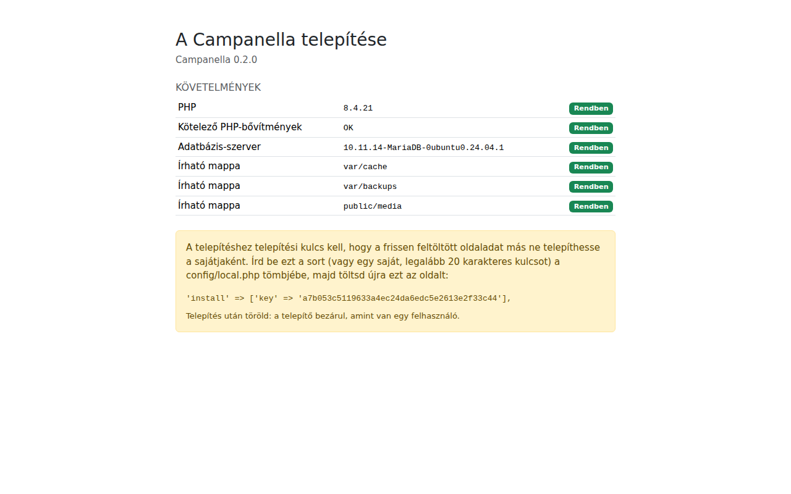
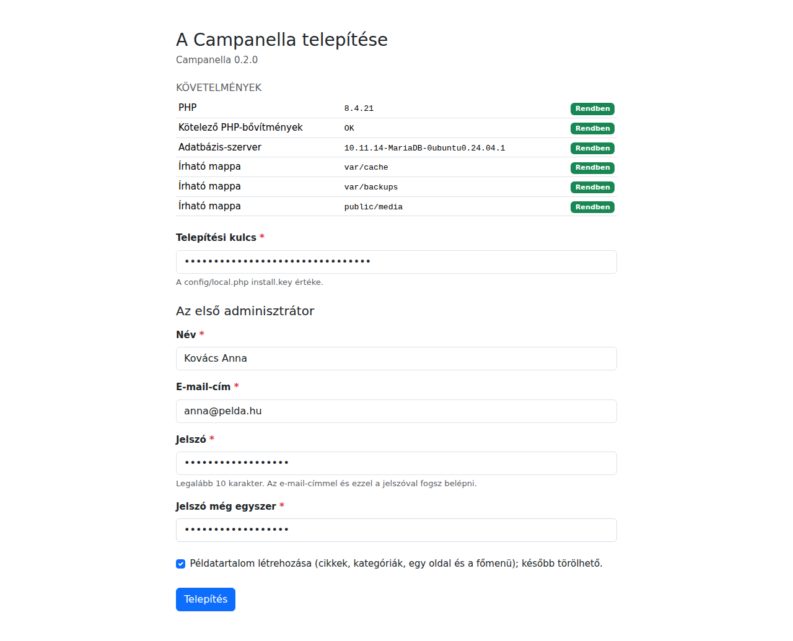

# 1. Telepítés

Ez a fejezet végigvezet azon, hogyan kerül fel a Campanella egy webtárhelyre,
és hogyan telepíted a böngészőből. Parancssor nem kell hozzá: elég egy
fájlkezelő (FTP vagy a tárhely saját fájlkezelője) és a tárhely
adminisztrációs felülete.

## Mire lesz szükséged?

- **Egy webtárhely** PHP 8.3 vagy újabb verzióval. A szükséges PHP-bővítmények
  (`pdo_mysql`, `mbstring`, `dom`, `ctype`, `json`, `session`, és a
  képfeltöltéshez `gd`) a legtöbb tárhelyen be vannak kapcsolva. A telepítő
  meg is nézi őket.
- **Egy adatbázis:** MariaDB 10.6 vagy MySQL 8.0, vagy ezeknél újabb. Kell hozzá
  az adatbázis neve, a felhasználó neve és a jelszava, valamint a szerver címe
  (ez a legtöbbször `localhost`). Ezeket a tárhely felületén találod, vagy ott
  hozhatsz létre egy új adatbázist.
- **A Campanella csomagja:** a
  [GitHub kiadási oldaláról](https://github.com/szhajagos/campanella/releases)
  a legújabb `campanella-<verzió>.zip`. Ebben minden benne van, amire az
  oldalnak szüksége van (a `vendor/` mappa is), mást nem kell letöltened.
- **Egy domain, HTTPS-sel.** A legtöbb tárhely ingyenes tanúsítványt ad
  (Let's Encrypt). Érdemes bekapcsolni, mielőtt telepítesz (lásd lent).

## 1. A fájlok feltöltése

Csomagold ki a zipet a saját gépeden. Egy `campanella-<verzió>` nevű mappát
kapsz. Ennek a **tartalmát** kell feltöltened, és az a fontos, hogy a
mappák együtt maradjanak: a `public/` mappa mellett ott kell lennie a
`config/`, `src/`, `vendor/` és a többi mappának is.

A tárhelyek kétféleképpen szokták megadni, melyik mappát lássák a
látogatók (ez a *webgyökér*):

| Ha a tárhelyed… | Akkor… |
|---|---|
| megengedi, hogy a webgyökeret te állítsd be | Töltsd fel a mappát például `campanella` néven, és állítsd a webgyökeret a benne lévő `public` mappára. Ez a biztonságosabb megoldás. |
| egy kötött mappát használ webgyökérként (pl. `public_html` vagy `www`) | Töltsd fel a csomag teljes tartalmát ebbe a mappába. A csomag `.htaccess` fájlja minden kérést a `public/` mappába irányít, a többi mappát pedig elzárja a látogatók elől. Ehhez az Apache `mod_rewrite` modulja kell, ez szinte minden tárhelyen működik. |

**Ne csak a `public/` mappa tartalmát töltsd fel!** Akkor a rendszer nem
találja a többi mappát, és „The vendor folder is missing” hibaoldalt mutat.

A `.htaccess` kezdetű fájlok rejtett fájlok: ha a fájlkezelőd nem mutatja
őket, kapcsold be a rejtett fájlok megjelenítését, és ellenőrizd, hogy
felkerültek.

## 2. A beállítási fájl

A `config` mappában van egy `local.php.dist` nevű fájl. Készíts róla egy
másolatot `local.php` néven (a fájlkezelőben: másolás, majd átnevezés), és
nyisd meg szerkesztésre. Írd be az adatbázis adatait:

```php
'database' => [
    'host' => 'localhost',
    'name' => 'az_adatbazis_neve',
    'user' => 'az_adatbazis_felhasznaloja',
    'password' => 'az adatbázis jelszava',
    'prefix' => 'cc_',
],
```

A `prefix` a táblák nevének eleje. Maradhat `cc_`, de ha egy adatbázisban több
oldal is van, mindegyiknek más legyen.

A `'debug' => false` sort hagyd így: a hibakereső mód minden látogatónak
megmutatná a hibák részleteit, ezért nyilvános oldalon soha ne kapcsold be.

## 3. A telepítő

Nyisd meg a böngészőben az oldaladat úgy, hogy a cím végére `/install`
kerül, például `https://pelda.hu/install`.

**Fontos:** a telepítőt azon a címen nyisd meg, amelyen az oldalnak
működnie kell, `https://`-sel. A Campanella ezt jegyzi meg az oldal
webcímeként (később a beállításokban módosíthatod).

### A telepítési kulcs

Az első alkalommal ezt látod:



A **Követelmények** táblázat megmutatja, hogy a tárhely megfelel-e. Mindegyik
sornak „Rendben”-nek kell lennie. Ha valamelyik „Hiba”:

| Sor | Mit tegyél? |
|---|---|
| PHP | A tárhely felületén válassz PHP 8.3-at vagy újabbat. |
| Kötelező PHP-bővítmények | A hiányzó bővítményt kapcsold be a tárhely PHP-beállításaiban, vagy kérd a tárhelyszolgáltatótól. |
| Adatbázis-szerver | A `config/local.php` adatbázis-adatai nem jók, vagy az adatbázis nem létezik. Ellenőrizd őket a tárhely felületén. |
| Írható mappa | A PHP nem tud írni a mappába. Adj rá írási jogot a fájlkezelőben (általában 755 vagy 775). |

A sárga doboz a **telepítési kulcsot** kéri. Erre azért van szükség, mert a
frissen feltöltött oldalt bárki megtalálhatná, és a kulcs nélkül ő
telepíthetné a sajátjaként. Másold ki a dobozban lévő sort (egy véletlen
kulcs, minden betöltéskor más), és írd be a `config/local.php` tömbjébe,
például a `'debug' => false,` sor alá:

```php
'install' => ['key' => '0560664264d537d1dda97fde163efd4b9bdb244e'],
```

Mentsd el a fájlt, és töltsd újra a telepítő oldalát.

### Az első adminisztrátor

Most már az űrlap is megjelenik:



1. **Telepítési kulcs:** ugyanaz, amit a `local.php`-be írtál.
2. **Név, e-mail-cím, jelszó:** az első adminisztrátor fiókja, vagyis a
   tiéd. Az e-mail-címmel és a jelszóval fogsz belépni. A jelszó legalább 10
   karakter legyen. Egy hosszú, máshol nem használt jelszó a legjobb, például
   egy jelszókezelőből.
3. **Példatartalom:** ha bejelölöd, a Campanella létrehoz néhány cikket, két
   kategóriát, egy „Rólunk” oldalt és a főmenüt. Az első ismerkedéshez
   hasznos, később egyenként törölheted.
4. Kattints a **Telepítés** gombra.

A telepítés néhány másodperc. Utána a Campanella be is léptet, és az admin
irányítópultjára visz:


### A kulcs törlése

Ahogy a zöld üzenet is kéri, **töröld az `'install' => […]` sort a
`config/local.php`-ből**. A telepítő már akkor is bezárul, ha bent marad (amint
van egy felhasználó, a `/install` oldal nem található), de egy kulcsnak
nincs keresnivalója a beállításokban, ha már nem kell.

## Ha valami nem sikerül

| Amit látsz | Az ok és a megoldás |
|---|---|
| „The vendor folder is missing” | Nem került fel minden mappa, vagy csak a `public/` tartalma került a webgyökérbe. Lásd [a fájlok feltöltését](#1-a-fájlok-feltöltése). |
| „A Campanella még nincs telepítve” a kezdőlapon | Ez a telepítés előtt rendben van: nyisd meg a `/install` oldalt. |
| A `/install` oldal „nem található” | Már van felhasználó, tehát az oldal telepítve van. Lépj be a `/login` oldalon. |
| „Hibás telepítési kulcs” | Az űrlapba írt kulcs nem egyezik a `local.php`-ben lévővel. Ötszöri hiba után 15 percig várnod kell. |
| Üres oldal vagy „500” hiba | Nézd meg a tárhely PHP-hibanaplóját (a tárhely felületén). Gyakori ok a régi PHP-verzió vagy egy elgépelés a `local.php`-ben (például hiányzó vessző). |

Ha a tárhelyeden van parancssor (SSH), a telepítés parancssorból is
elvégezhető. Ezt a [README](../../../README.md#installation) írja le, angolul.

---

Következő: [2. Első lépések](02-elso-lepesek.md)
