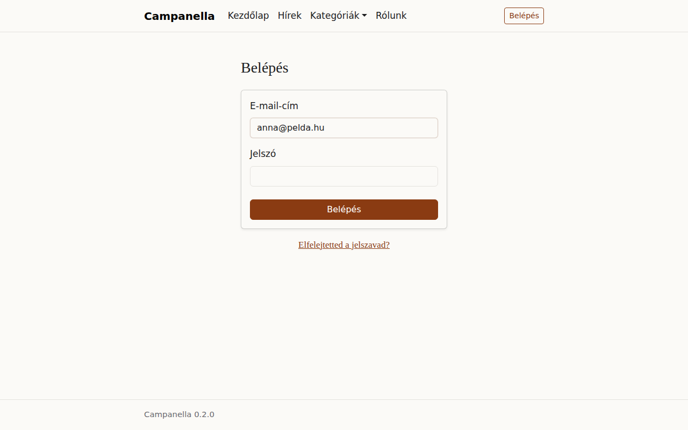
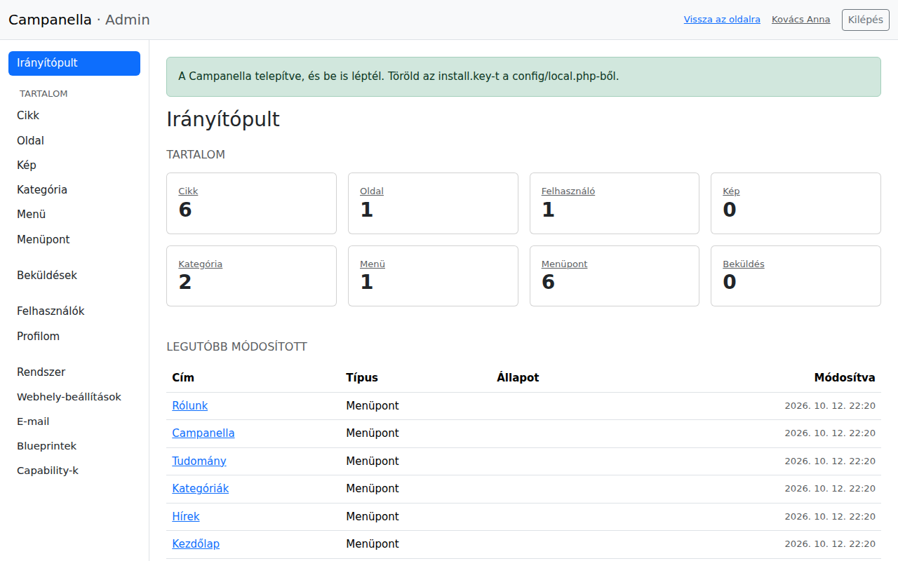
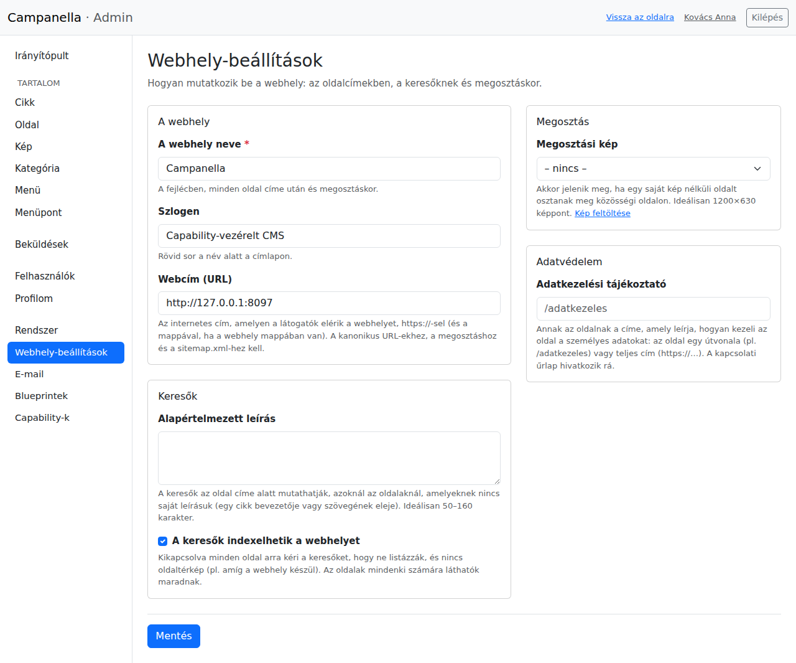
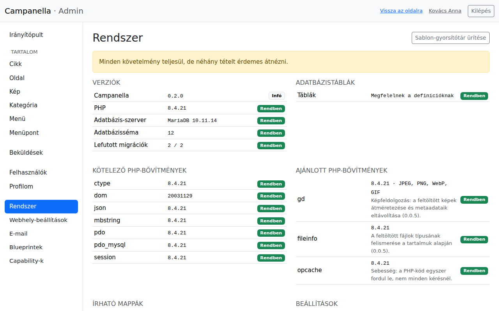
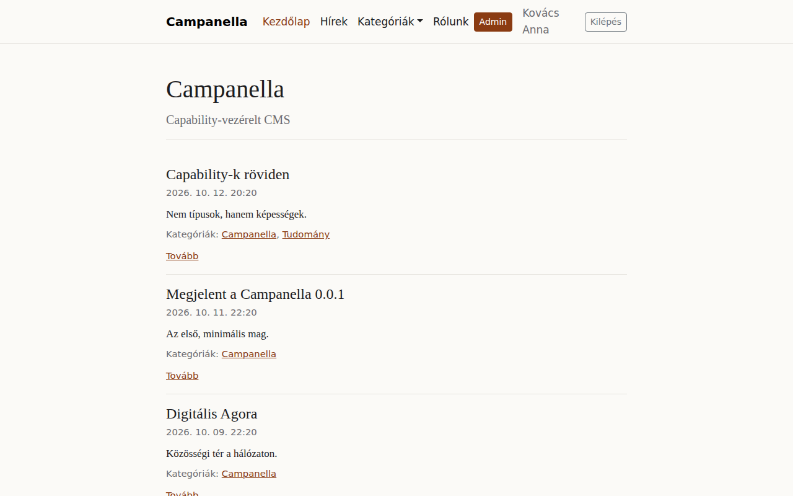

# 2. Első lépések

Telepítés után ezt a néhány dolgot érdemes rögtön elvégezni: megismerni az
admint, beállítani a webhely nevét és címét, és átnézni a Rendszer oldalt.

## Belépés és kilépés

Az admin a `/admin` címen van, például `https://pelda.hu/admin`. Ha nem vagy
belépve, a Campanella a belépő oldalra visz (`/login`):

Az e-mail-címeddel és a jelszavaddal lépsz be. Ha elfelejtetted a jelszavad,
az **Elfelejtetted a jelszavad?** linkkel kérhetsz egy új jelszó beállítására
szolgáló linket e-mailben. Ez csak akkor jelenik meg, ha az e-mail-küldés be
van állítva (lásd a 8. fejezetet).

Néhány dolog, amit a belépésről tudni érdemes:

- Rossz jelszónál a hibaüzenet nem árulja el, hogy az e-mail-cím vagy a
  jelszó volt-e rossz. Így senki nem tudja kipróbálni, kinek van fiókja.
- Ötszöri rossz próbálkozás után az adott címről 15 percig nem lehet belépni
  abba a fiókba.
- Egy belépés legfeljebb 12 óráig tart, és 2 óra tétlenség után is lejár. Ez
  után újra be kell lépni.

Kilépni a jobb felső **Kilépés** gombbal tudsz. Közös vagy idegen gépen mindig
lépj ki.

## Az admin felépítése

A bal oldali menü:

| Menüpont | Mire való? |
|---|---|
| **Irányítópult** | Áttekintés: hány elem van az egyes tartalomtípusokból, és mi változott legutóbb. |
| **Tartalom** | A tartalomtípusok listái: **Cikk**, **Oldal**, **Kép**, **Kategória**, **Menü**, **Menüpont**. Itt hozol létre, szerkesztesz és teszel közzé tartalmat (3–5. fejezet). |
| **Beküldések** | A kapcsolati űrlapon érkezett üzenetek (7. fejezet). Csak az adminisztrátorok látják. |
| **Felhasználók** | A fiókok kezelése (6. fejezet). Csak az adminisztrátorok látják. |
| **Profilom** | A saját neved, jelszavad, és hogy hol vagy belépve. |
| **Rendszer** | A webhely állapota, a **Webhely-beállítások**, az **E-mail** beállítása és naplója. A **Blueprintek** és a **Capability-k** a tartalomtípusok felépítését mutatják; ezek inkább fejlesztőknek szólnak. |

Fent a **Vissza az oldalra** link a nyilvános oldalra visz, a neved pedig a
profilodra.

A szerkesztők (az `editor` szerepkör) kevesebbet látnak: tartalmat kezelhetnek,
de a Beküldéseket, a Felhasználókat és a Rendszer oldalt nem.

## A webhely beállításai

A **Rendszer → Webhely-beállítások** oldalon adod meg, hogyan mutatkozik be a
webhely: az oldalcímekben, a keresőknek és megosztáskor.

**A webhely**

- **A webhely neve:** a fejlécben és minden oldal címében megjelenik (a
  böngésző fülén is).
- **Szlogen:** egy rövid sor a név alatt a címlapon. Üresen is hagyhatod.
- **Webcím (URL):** az a cím, amelyen a látogatók elérik az oldalt,
  `https://`-sel, például `https://pelda.hu`. A telepítő azt a címet írta ide,
  ahonnan megnyitottad. Ellenőrizd, és ha a domain vagy a HTTPS később
  változik, itt írd át. E nélkül a megosztási linkek, az oldaltérkép és az
  elfelejtett jelszó nem működik.

**Keresők**

- **Alapértelmezett leírás:** a keresők ezt mutathatják az oldal címe alatt,
  ha egy oldalnak nincs saját leírása. Egy-két mondat a webhelyről, 50–160
  karakter.
- **A keresők indexelhetik a webhelyet:** amíg az oldal készül, kapcsold ki.
  Ilyenkor minden oldal arra kéri a keresőket, hogy ne listázzák, de a
  látogatók továbbra is látják. Ha elkészültél, kapcsold vissza.

**Megosztás**

- **Megosztási kép:** ez a kép jelenik meg, ha valaki az oldaladat
  megosztja egy közösségi oldalon, és az adott oldalnak nincs saját képe.
  Ideális mérete 1200×630 képpont. Előbb fel kell töltened a **Kép** listában
  (5. fejezet), utána választhatod ki itt.

**Adatvédelem**

- **Adatkezelési tájékoztató:** az az oldal, amely leírja, hogyan kezeled a
  látogatók személyes adatait. A kapcsolati űrlap alatt link mutat rá. Erről a
  7. fejezet szól.

A végén kattints a **Mentés** gombra.

## A Rendszer oldal

A **Rendszer** oldal megmutatja, hogy minden rendben van-e a tárhelyen és a
beállításokban. Telepítés után, és minden frissítés után nézz rá.

Minden sor mellett egy jelzés áll:

| Jelzés | Jelentése |
|---|---|
| **Rendben** | Nincs teendő. |
| **Infó** | Csak tájékoztatás, nincs teendő. |
| **Figyelmeztetés** | Működik, de érdemes rendbe tenni. A sor alatt ott a teendő. |
| **Hiba** | Valami nem működik. A sor alatt ott, mi a teendő. |

Gyakori figyelmeztetések egy friss telepítés után:

| Sor | Mit jelent, mit tegyél? |
|---|---|
| **Kapcsolat: HTTP** | Az oldal nem titkosított kapcsolaton fut. Kapcsold be a HTTPS-t a tárhelyen. Ha a tárhely egy proxy mögött adja a HTTPS-t, és a sor mégis HTTP-t mutat, kérdezd meg a szolgáltatót; a beállítást a [telepítési útmutató](../../deployment.md#behind-a-proxy) írja le (angolul). |
| **Legnagyobb képfájl** | A PHP kisebb feltöltést enged, mint amekkora képet a Campanella fogadna. Ha nagyobb képeket is fel akarsz tölteni, a tárhely PHP-beállításaiban növeld az `upload_max_filesize` és a `post_max_size` értékét (például 16M és 20M). |
| **Küldés: nincs beállítva** (az E-mail részben) | Az oldal nem tud e-mailt küldeni. Erről a 8. fejezet szól. |
| **Adatkezelési tájékoztató: nincs belinkelve** | Lásd fent és a 7. fejezetben. |

A **Hibakereső mód** sorban mindig „ki” álljon. Ha „be”, azonnal javítsd a
`config/local.php`-ben (`'debug' => false`).

A jobb felső **Sablon-gyorsítótár ürítése** gomb csak ritkán kell: ha egy
frissítés után az oldal még a régi kinézetet mutatja.

## A nyilvános oldal

Ha a példatartalmat is telepítetted, a nyilvános oldalon már van mit nézni:

Amíg be vagy lépve, a fejlécben az **Admin** gomb, a neved és a **Kilépés**
gomb is látszik. A látogatók ezeket nem látják, és a piszkozatokat sem.

---

Előző: [1. Telepítés](01-telepites.md) · [Tartalomjegyzék](README.md)
