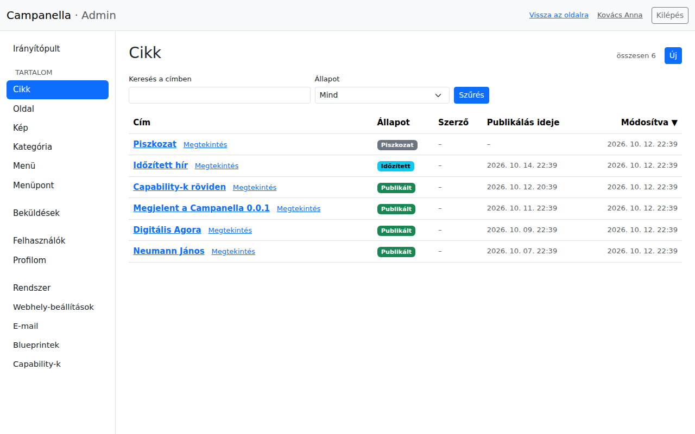
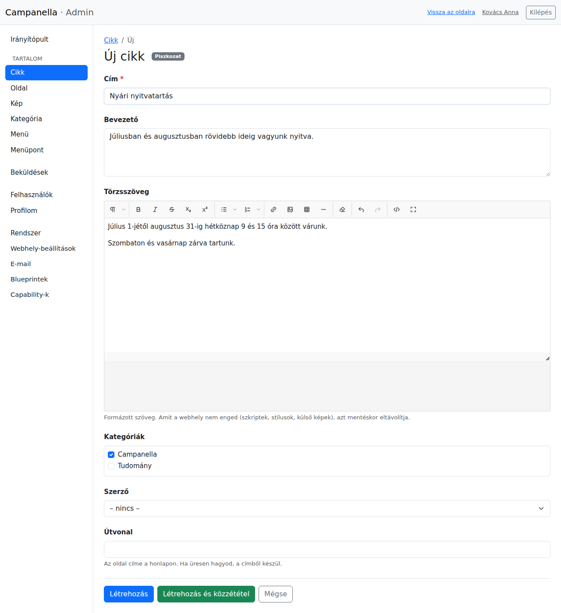
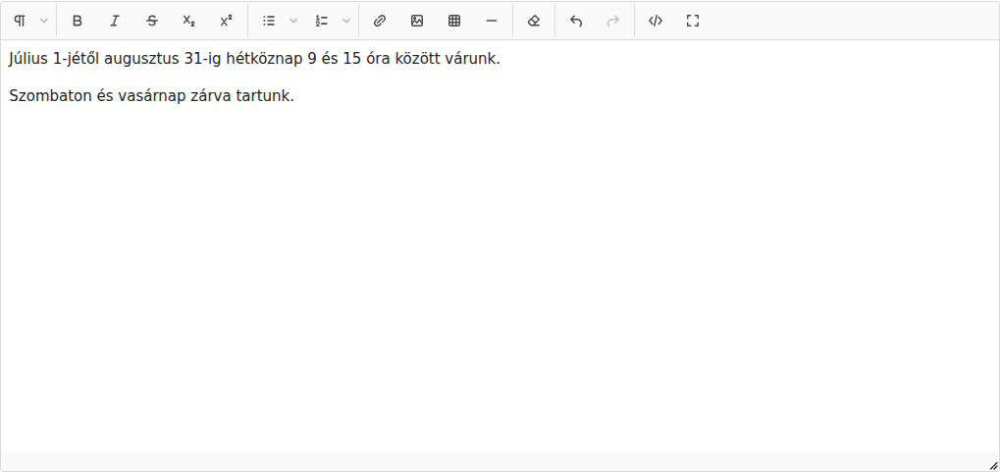
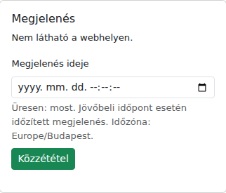
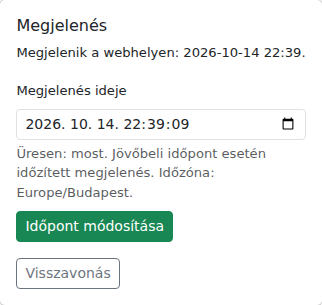
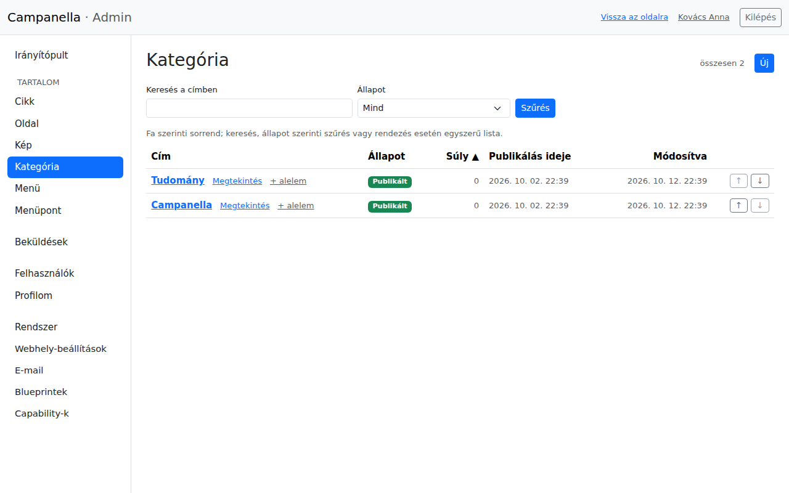
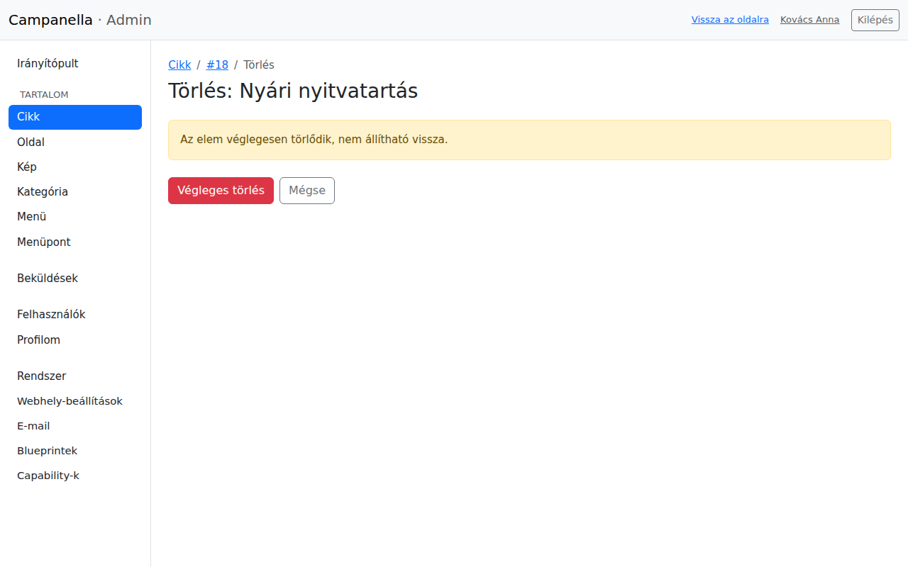

# 3. Tartalom

Az oldal tartalmát az admin **Tartalom** részében kezeled. Ez a fejezet a
cikkekről, az oldalakról és a kategóriákról szól: hogyan írod meg, teszed
közzé, időzíted, módosítod és törlöd őket.

## Cikk, oldal, kategória: mi a különbség?

| Fajta | Mire való? | Hol jelenik meg? |
|---|---|---|
| **Cikk** | Hír, bejegyzés, közlemény: aminek dátuma van, és újabbak jönnek utána. | A címlapon és a Hírek listában a legújabb elöl, a saját címén, és a kategóriái oldalán. |
| **Oldal** | Állandó tartalom: Rólunk, Elérhetőség, Adatkezelési tájékoztató. | Csak a saját címén. A látogatók a menüből érik el (4. fejezet). |
| **Kategória** | A cikkek csoportosítása, akár alkategóriákkal. | A saját oldalán, rajta a hozzá tartozó cikkekkel. |

## A lista

A bal oldali menüben a **Cikk** (vagy **Oldal**, **Kategória**) a tartalom
listáját nyitja meg:

- A **Keresés a címben** mezővel és az **Állapot** szerinti szűréssel
  találod meg, amit keresel. A **Szűrés** gomb alkalmazza.
- Az oszlopfejlécekre kattintva rendezheted a listát.
- A címre kattintva a szerkesztő oldal nyílik meg, a **Megtekintés** link az
  oldalon mutatja meg (a piszkozatot is, de csak neked).
- Jobb fent az **Új** gombbal hozol létre újat.

Az **Állapot** oszlop megmutatja, hol tart az elem:

| Állapot | Jelentése |
|---|---|
| **Piszkozat** | Még nem látható a webhelyen. Csak a belépett szerkesztők látják. |
| **Időzített** | Közzé van téve, de egy későbbi időpontban jelenik meg (lásd lent). |
| **Publikált** | Látható a webhelyen. |

## Új cikk írása

Az **Új** gomb után ez az űrlap jelenik meg:

- **Cím:** kötelező. Ez a cikk címe, és ebből készül a webcíme is.
- **Bevezető:** egy-két mondat a cikkről. A címlapon és a listákban ez
  jelenik meg a cím alatt, és ez lesz az oldal leírása a keresőkben is.
- **Törzsszöveg:** maga a cikk, a szövegszerkesztővel (lásd lent).
- **Kategóriák:** jelöld be, melyikbe tartozik. Több is lehet, vagy egy sem.
- **Szerző:** ha üresen hagyod, te leszel a szerző.
- **Útvonal:** a cikk címe a webhelyen, például `/nyari-nyitvatartas`. Ha
  üresen hagyod, a címből készül: ékezetek nélkül, kötőjelekkel. Ha később
  módosítod, a régi címre mutató linkek (más oldalakon, keresőkben) nem
  fognak működni, ezért közzététel után lehetőleg ne változtasd meg.

Alul két gomb van:

- **Létrehozás:** elmenti piszkozatként. Még senki nem látja, nyugodtan
  folytathatod később.
- **Létrehozás és közzététel:** elmenti, és azonnal meg is jelenteti.

### A szövegszerkesztő

Az eszköztár gombjai balról jobbra:

| Gomb | Mit csinál? |
|---|---|
| ¶ | A bekezdés fajtája: normál szöveg, **címsorok** (2–4. szint), idézet, kód. A cikk címe az 1. szint, ezért a cikken belüli alcímek a 2. szinttel kezdődnek. |
| **B**, *I*, áthúzás, alsó és felső index | Betűstílusok. |
| Felsorolás, számozott lista | Listák. A kis nyíllal a jelölés fajtája is választható. |
| Lánc | Link. Jelöld ki a szöveget, kattints rá, és írd be a címet. |
| Kép | Kép feltöltése a szövegbe (5. fejezet). |
| Táblázat, vízszintes vonal | Táblázat, illetve elválasztó vonal beszúrása. |
| Radír | A kijelölt szöveg formázásának törlése. |
| Visszavonás, újra | Az utolsó módosítás visszavonása vagy megismétlése. |
| `</>` | A szöveg HTML-kódja (haladóknak). |
| Négyzet | Teljes képernyős szerkesztés. |

Néhány tudnivaló:

- **Beillesztés Wordből vagy egy weboldalról:** a szerkesztő a felesleges
  formázást eltávolítja. Más webhelyről bemásolt képek nem maradnak meg:
  ezeket töltsd fel (5. fejezet).
- **Mentéskor** a Campanella minden szöveget átszűr, és eltávolít belőle
  mindent, ami nem biztonságos vagy nem illik az oldal kinézetébe (szkriptek,
  egyedi stílusok, színek, betűtípusok). Ezért a mentett szöveg kicsit
  egyszerűbb lehet, mint amit beillesztettél. Ez szándékos: így marad
  egységes és biztonságos az oldal.

## Közzététel

Mentés után a szerkesztő oldal jobb oldalán a **Megjelenés** doboz mutatja,
hol tart a cikk, és itt teheted közzé:

- **Azonnal:** hagyd üresen a **Megjelenés ideje** mezőt, és kattints a
  **Közzététel** gombra.
- **Később (időzítve):** adj meg egy jövőbeli időpontot, és kattints a
  **Közzététel** gombra. A cikk addig nem látható, és a megadott időpontban
  magától megjelenik. Az időpont az oldal időzónájában értendő (a doboz alján
  látszik, például Europe/Budapest).

Egy időzített cikknél a doboz így néz ki:

- Az **Időpont módosítása** gombbal másik időpontot adhatsz meg.
- A **Visszavonás** gomb visszateszi piszkozatba: eltűnik a webhelyről (ha már
  megjelent), de nem törlődik.

Ha az űrlapon módosítottál valamit, de még nem mentetted, a doboz figyelmeztet:
a közzétételi gombok csak a közzétételt végzik el, a módosításokat nem
mentik. Előbb a **Mentés** gombbal mentsd el őket.

Egy közzétett cikk módosításai a **Mentés** után azonnal látszanak a
webhelyen.

## Oldalak

Az oldalak ugyanígy működnek, de nincs bevezetőjük, kategóriájuk és
szerzőjük, és nem jelennek meg a címlapon. Egy új oldalt általában a menübe
is felveszel, különben a látogatók nem találják meg (4. fejezet).

Az adatkezelési tájékoztatót is oldalként érdemes megírni, például
`/adatkezeles` útvonallal (7. fejezet).

## Kategóriák

A kategóriák fát alkotnak: egy kategóriának lehetnek alkategóriái.

- A **+ alelem** link egy új alkategóriát hoz létre az adott kategória alatt.
  A szerkesztő oldalon a **Szülő** mezővel is áthelyezheted.
- A sor végén lévő **↑** és **↓** nyilakkal változtatod a sorrendet. A
  **Súly** oszlop mutatja a sorrendet: a kisebb kerül előre.
- Egy kategória oldala a hozzá tartozó cikkeket mutatja, az alkategóriáiéval
  együtt.
- Egy kategória, amelynek alkategóriái vannak, nem törölhető: a törlés oldala
  felsorolja őket, ezeket előbb töröld vagy helyezd át.

## Törlés

A szerkesztő oldalon a **Törlés** gomb előbb rákérdez:

A **Végleges törlés** után az elem **nem állítható vissza**. Ha csak el
akarod rejteni a webhelyről, inkább vond vissza a közzétételét
(**Visszavonás**): így megmarad, és később újra közzéteheted.

A szerkesztők nem törölhetnek, ez az adminisztrátorok joga.

## A példatartalom eltávolítása

Ha a telepítéskor példatartalmat is kértél, ezeket töröld vagy írd át, mielőtt
az oldal nyilvános lesz: a cikkeket (Neumann János, Digitális Agora …), a
**Tudomány** és **Campanella** kategóriát, a **Rólunk** oldalt, és a főmenü
megfelelő pontjait (4. fejezet).

---

Előző: [2. Első lépések](02-elso-lepesek.md) · Következő:
[4. Menük](04-menuk.md) · [Tartalomjegyzék](README.md)
