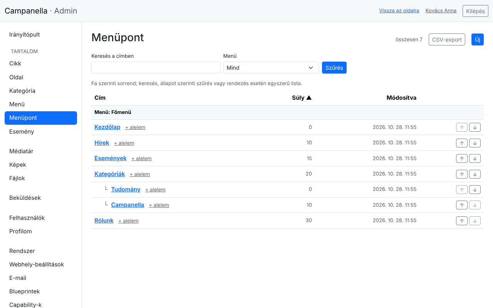
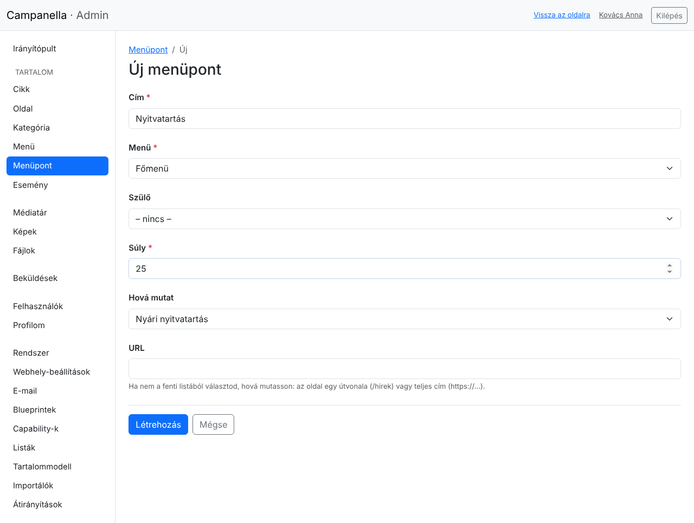
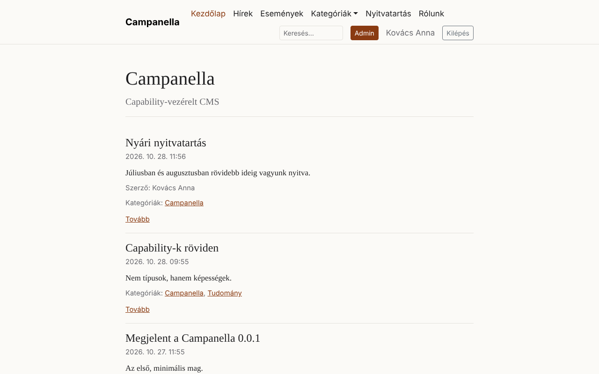

# 4. Menük

Az oldal tetején lévő menüt (a **főmenüt**) az adminban szerkeszted: mi
szerepeljen benne, milyen sorrendben, és mi legyen lenyíló almenüben.

## Menük és menüpontok

- A **Menü** lista a menüket sorolja fel. Telepítés után egy van, a
  **Főmenü**, ezt mutatja a webhely fejléce. Ezt ne töröld és ne nevezd át a
  gépi nevét (`main`).
- A **Menüpont** lista a menük pontjait mutatja, fa formában:

Ez a lista a példatartalom főmenüjét mutatja: a **Kategóriák** pont alatt két
alpont van (**Tudomány**, **Campanella**). A webhelyen a Kategóriák egy lenyíló
menü lesz, benne ezzel a kettővel.

Ha több menü is van, a **Menü** szűrővel választhatod ki, melyiknek a pontjait
látod.

## Új menüpont

Kattints a **Menüpont** listában az **Új** gombra (vagy egy pont mellett a
**+ alelem** linkre, ha alpontot akarsz):

- **Cím:** ez a szöveg látszik a menüben. Legyen rövid.
- **Menü:** melyik menübe kerüljön (a **Főmenü**).
- **Szülő:** ha egy másik pont alá, lenyíló almenübe kerüljön, itt választod ki.
  Üresen a menü legfelső szintjére kerül.
- **Súly:** a sorrend. A kisebb számú pont kerül előre. A példában a
  Kategóriák súlya 20, a Rólunké 30, így egy 25-ös súlyú pont a kettő közé
  kerül.
- **Hová mutat:** az oldal egy cikke, oldala vagy kategóriája. Ha ezt
  választod, a menüpont akkor is jó helyre mutat, ha a cél útvonala később
  megváltozik.
- **URL:** ha nem a fenti listából választasz, ide írd a címet: az oldal egy
  útvonalát (például `/hirek`, vagy egy lista címét, mint az `/esemenyek`, 11.
  fejezet) vagy egy teljes, más webhelyre mutató címet (`https://…`).

A **Létrehozás** után a menüpont azonnal megjelenik a webhelyen:

## Sorrend és áthelyezés

- A listában a **↑** és **↓** nyilakkal egy pontot a testvérei között mozgatsz
  egyet feljebb vagy lejjebb.
- Egy pontot másik szülő alá a szerkesztő oldalán, a **Szülő** mezővel teszel.
- Egy menüpont törlése csak a menüből veszi ki a hivatkozást: a cikk vagy oldal,
  amire mutatott, megmarad. Egy pontot, amely alatt alpontok vannak, nem lehet
  törölni: a törlés oldala felsorolja őket, ezeket előbb töröld vagy helyezd át.

## Ha a menü nem úgy jelenik meg, ahogy szeretnéd

| Jelenség | Ok, teendő |
|---|---|
| Egy pont nem jelenik meg | Egy piszkozat cikkre vagy oldalra mutat: a látogatók azt nem látják, ezért a menüpontot sem (és az alatta lévő alpontokat sem). Tedd közzé a célt. |
| A menü túl hosszú | A fejléc keskeny: a sok pontot rendezd lenyíló almenükbe (Szülő). |
| A webhely menüje nem változik | A **Főmenü** gépi neve nem `main`, vagy egy másik menüt szerkesztesz. |

---

Előző: [3. Tartalom](03-tartalom.md) · Következő:
[5. Képek és fájlok](05-kepek.md) · [Tartalomjegyzék](README.md)
