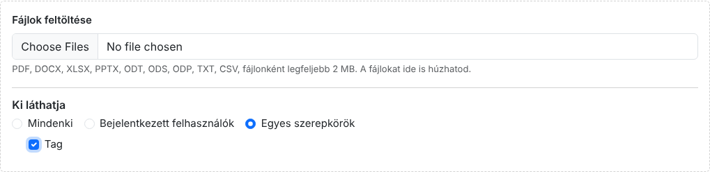
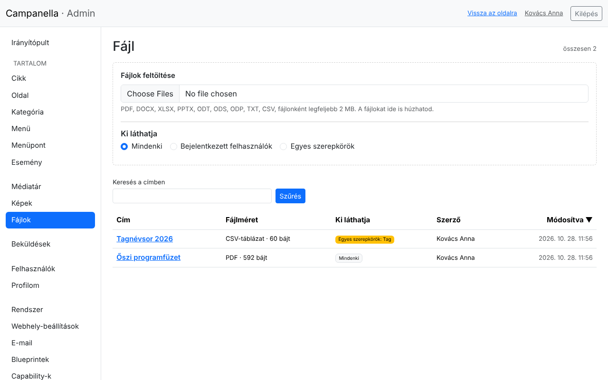
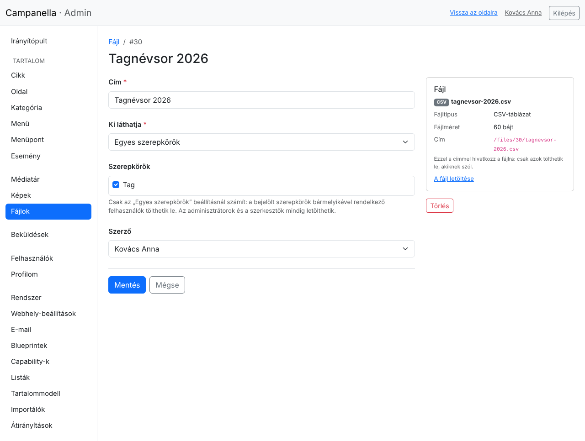
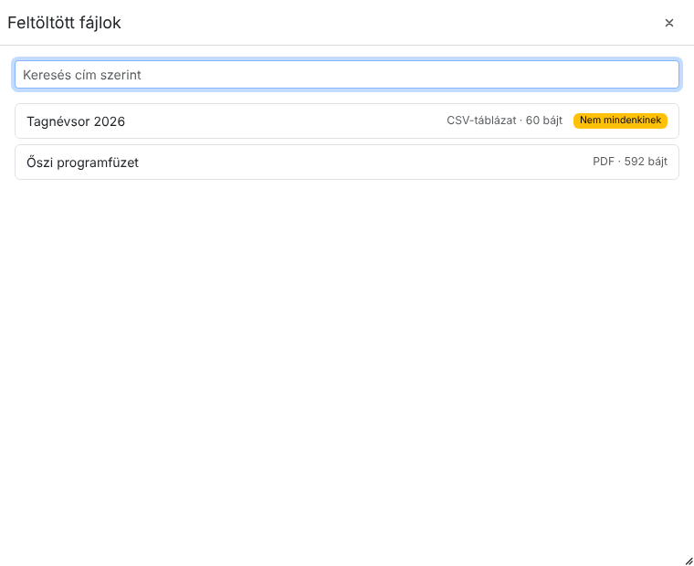
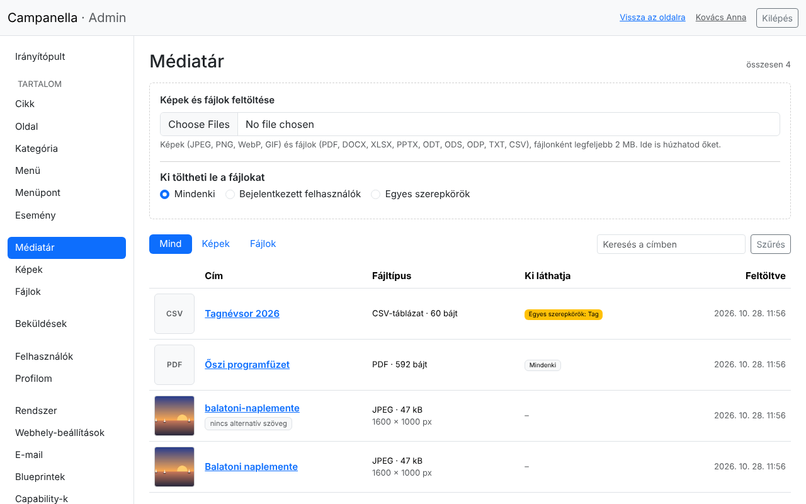

# 5. Képek és fájlok

A képeket és a letölthető fájlokat (dokumentumokat, táblázatokat) a
Campanella maga tárolja: feltöltöd őket, és a szövegekben használod őket. Ez a
fejezet arról szól, hogyan. Mindkettő a bal oldali menü **Médiatár** pontja
alatt van: a **Képek** és a **Fájlok** a saját listájuk, a Médiatár együtt
mutatja őket ([lent](#a-médiatár)).

## Feltöltés a Képek listában

A **Képek** a feltöltött képek listáját nyitja meg, felül a feltöltő mezővel:


- Kattints a fájlválasztóra, és válassz egy vagy több képet, vagy húzd őket a
  dobozba a gépedről. A feltöltés azonnal elindul, és minden képről kiírja,
  sikerült-e.
- Elfogadott formátumok: **JPEG, PNG, WebP és GIF**. A mező alatt látod,
  mekkora lehet egy fájl. Ha a fényképezőgéped vagy telefonod képei ennél
  nagyobbak, a tárhely PHP-beállításaiban növelhető (2. fejezet, Rendszer
  oldal), vagy kicsinyítsd őket feltöltés előtt.
- Egy kép legfeljebb 25 megapixeles lehet (például 6000×4000 képpont).

Feltöltéskor a Campanella:

- megnézi, hogy a fájl tényleg kép-e (nem csak a kiterjesztése),
- újrakódolja, és közben **eltávolítja a metaadatokat**: például a telefon
  által rögzített GPS-koordinátákat, amelyek elárulnák, hol készült a kép,
- elkészíti a kép **kisebb változatait** (320, 640, 1024 és 1600 képpont
  szélesen). A webhely mindig a látogató képernyőjéhez illőt küldi, így a
  telefonon is gyorsan betöltődik.

A kép címe kezdetben a fájl neve. A listában a **nincs alternatív szöveg**
jelzés mutatja, melyik képnél hiányzik a leírás.

## A kép adatai

A kép címére kattintva megnyílik a szerkesztő oldala:


- **Cím:** az adminban ezzel találod meg a képet. Érdemes beszédesre
  átírni a fájlnévből.
- **Alternatív szöveg:** egy rövid leírás arról, mi látható a képen.
  A vak és gyengénlátó látogatók felolvasóprogramja ezt olvassa fel, a
  keresők ebből tudják, mit ábrázol a kép, és akkor is ez látszik, ha a kép nem
  töltődik be. Írd le egy mondatban, mit mutat a kép (ne azt, hogy „kép”).
- Jobb oldalt a kép előnézete és adatai: típusa, mérete, címe a webhelyen.

## Kép a szövegben

A cikkek és oldalak szövegszerkesztőjében a **kép** gombbal tölthetsz fel képet
közvetlenül a szövegbe, oda, ahol a kurzor áll:


Kattints a **Feltölt** fülön a mezőre, és válaszd ki a képet, vagy húzd rá.
A kép ugyanúgy feltöltődik, mint a Kép listában (ott is megjelenik), és
bekerül a szövegbe. Képet a szerkesztőbe húzva vagy beillesztve is
feltölthetsz.

**Már feltöltött kép** beszúrásához a mellette lévő **mappa** gombot
(*Feltöltött kép választása*) használd: a megjelenő ablakban a legújabb képek
látszanak, cím szerint kereshetsz köztük, és egy kattintással beszúrhatod
őket a kurzor helyére, a már megadott alternatív szövegükkel együtt.

**Az alternatív szöveget a szövegben is add meg:** kattints duplán a képre a
szerkesztőben, és töltsd ki a **Helyettesítő szöveg** mezőt, majd
**Alkalmazni**:


Ugyanitt a kép **Link** mezőjével a képet linkké is teheted. A **Haladó**
fül beállításait (margók, stílusok) a Campanella mentéskor eltávolítja: a kép
elhelyezését az oldal kinézete határozza meg.

A szöveg mentése után a cikk így jelenik meg a webhelyen:


## Fájlok

Letölthető fájlt (például programfüzetet, jelentkezési lapot, tagnévsort)
a **Fájlok** listán tölthetsz fel. Elfogadott fájlok: **PDF, Word (DOCX),
Excel (XLSX), PowerPoint (PPTX), OpenDocument (ODT, ODS, ODP), szöveg (TXT) és
CSV**, legfeljebb 20 MB-osak (ha a tárhely PHP-ja kevesebbet enged, a mező
alatt az látszik).



- Válassz egy vagy több fájlt, vagy húzd őket a dobozba: a feltöltés azonnal
  elindul.
- Feltöltés előtt add meg, **ki töltheti le** őket (a dobozban jelölt
  beállítás a következő feltöltésekre érvényes):
  - **Mindenki:** a webhely bármely látogatója;
  - **Bejelentkezett felhasználók:** csak aki be van lépve;
  - **Egyes szerepkörök:** csak azok a bejelentkezett felhasználók, akiknek
    a bejelölt szerepkörük van (például a *Tag*). Ez a lehetőség akkor jelenik
    meg, ha a webhelynek vannak saját szerepkörei ([lent](#saját-szerepkörök)).
- Az adminisztrátorok és a szerkesztők minden fájlt letölthetnek.

A Campanella feltöltéskor **a fájl tartalmát** nézi meg, nem a nevét: egy
átnevezett fájl a valódi típusa szerint kerül be, vagy nem fogadja el.
**Makrót vagy szkriptet tartalmazó fájlt** (például `.docm`, makrós Excel
munkafüzet, szkriptes OpenDocument) nem fogad el, akkor sem, ha a neve
`.docx`: mentsd el makrók nélkül. Weboldalt (HTML), SVG-t és programot sem
lehet feltölteni. A ZIP-et a tárhely gazdája engedélyezheti, de csak ha
mindenkiben megbízik, aki feltölt: a tartalmát nem lehet ellenőrizni.

A lista mutatja a fájlok típusát, méretét, és azt, ki láthatja őket:



A fájl címe kezdetben a fájl neve, a **letöltési neve** pedig ugyanez, ékezet
és szóköz nélkül (`Őszi programfüzet.pdf` → `oszi-programfuzet.pdf`): ezen a
néven tölti le a látogató.

### Egy fájl adatai, és ki láthatja

A fájl címére kattintva megnyílik a szerkesztő oldala:



- **Cím:** így jelenik meg a listákban és a fájlválasztóban.
- **Ki láthatja:** mint feltöltéskor. Ha *Egyes szerepkörök*, a
  **Szerepkörök** közül jelöld be, kiknek szól.
- Jobb oldalt a fájl típusa, mérete és **címe**: ezzel a címmel hivatkozhatsz
  rá bárhonnan. A webhely mindig letöltésként adja (a böngésző nem nyitja meg
  oldalként), és csak annak, aki láthatja: másnak úgy válaszol, mintha nem is
  létezne („Az oldal nem található.”).

### Saját szerepkörök

Az adminisztrátor és a szerkesztő mellett a webhely gazdája saját
szerepköröket is megadhat a `config/local.php` fájlban, például egy *Tag*
szerepkört:

```php
'users' => ['roles' => ['member']],
```

(A `member` neve a magyar felületen *Tag*.) Ezután a felhasználók
szerkesztésekor ez a szerepkör is bejelölhető (6. fejezet), és egy fájl
csak a tagoknak szólhat. Ez a szerepkör az adminba nem enged be: a tag csak a
webhelyen lép be, és letöltheti, ami neki szól.

### Fájl a szövegben

A szövegszerkesztő **fájl** gombja (*Hivatkozás feltöltött fájlra*) a
feltöltött fájlokat mutatja. Jelöld ki a szövegben azt a részt, amelyből
hivatkozás legyen (például „Letölthető programfüzet”), kattints a gombra,
majd a fájlra:



A kijelölt szöveg a fájlra mutató hivatkozás lesz. Ha nem jelölsz ki
semmit, a fájl címe kerül be hivatkozásként. A *Nem mindenkinek* jelzés a
korlátozott fájlokat mutatja: egy ilyen fájl hivatkozása a többi látogatónak
nem vezet sehová, ezért azt olyan oldalra tedd, amelyet csak azok olvasnak,
akiknek szól.

## A Médiatár

A bal oldali menü **Médiatár** pontja a képeket és a fájlokat együtt mutatja,
a legújabbal kezdve:



- Felül egyetlen feltöltő mező van: ami kép, az a Képek közé kerül, minden
  más a Fájlok közé (a *Ki töltheti le* beállítás a fájlokra vonatkozik).
- A **Mind**, **Képek**, **Fájlok** gombokkal szűkíthetsz, és cím szerint
  kereshetsz.

## Megosztási kép

Az a kép, amely akkor jelenik meg, ha valaki az oldaladat egy közösségi
oldalon megosztja, a **Rendszer → Webhely-beállítások** oldalon választható ki
(2. fejezet). Ideális mérete 1200×630 képpont.

## Kép vagy fájl törlése

Egy kép szerkesztő oldalán a **Törlés** gomb előbb megmutatja, **mely
szövegekben szerepel a kép**. Ha mégis törlöd, azokban a szövegekben a kép
helyén egy hibás kép (vagy csak az alternatív szövege) látszik, ezért előbb
vedd ki a képet ezekből a szövegekből, vagy cseréld le. A törléssel a fájl és a kisebb változatai is
törlődnek, és nem állíthatók vissza.

Egy fájl törlése ugyanígy megmutatja, mely szövegek hivatkoznak rá: törlés után
ezek a hivatkozások nem vezetnek sehová.

---

Előző: [4. Menük](04-menuk.md) · Következő:
[6. Felhasználók és a saját fiókod](06-felhasznalok.md) · [Tartalomjegyzék](README.md)
