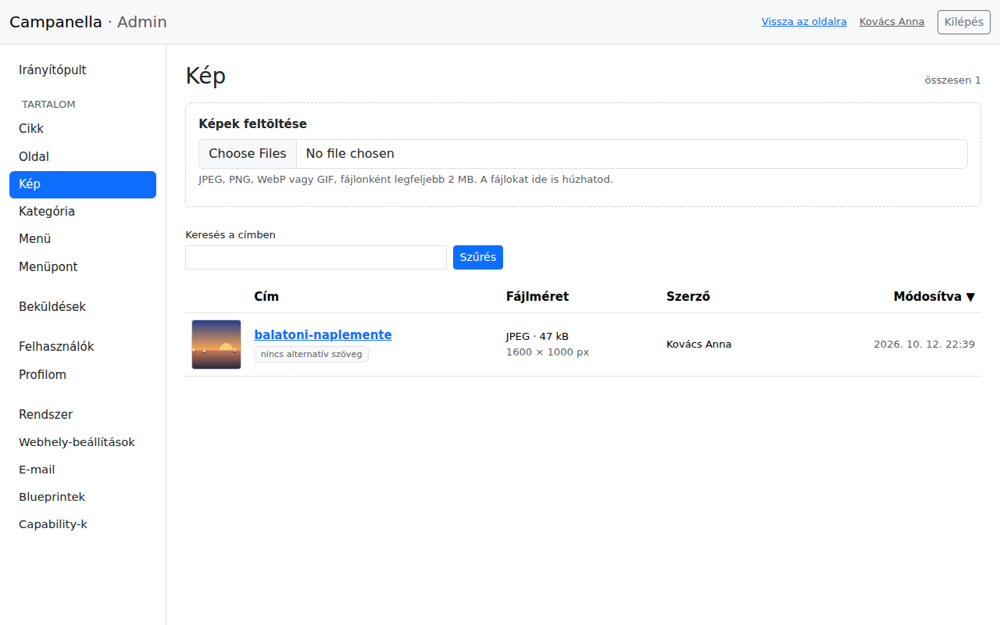
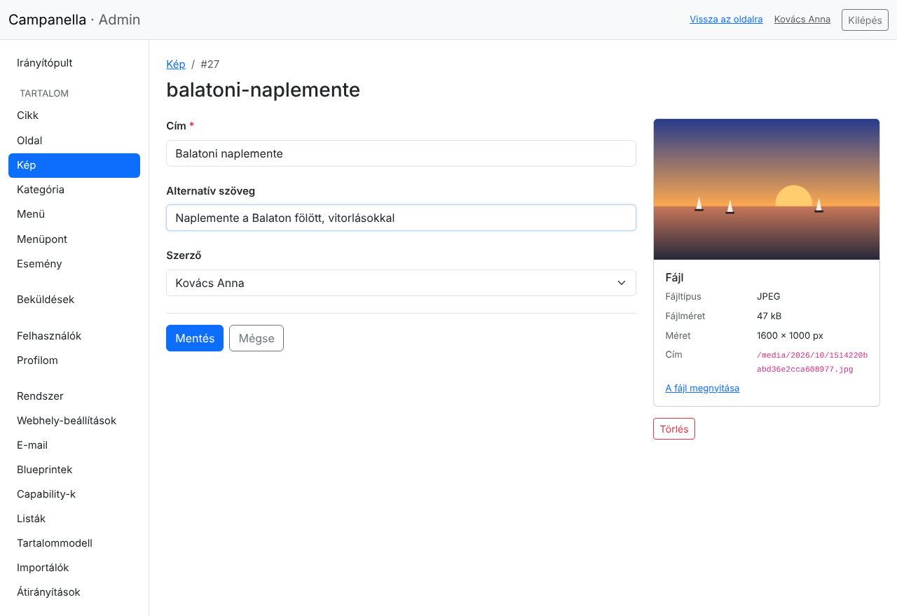
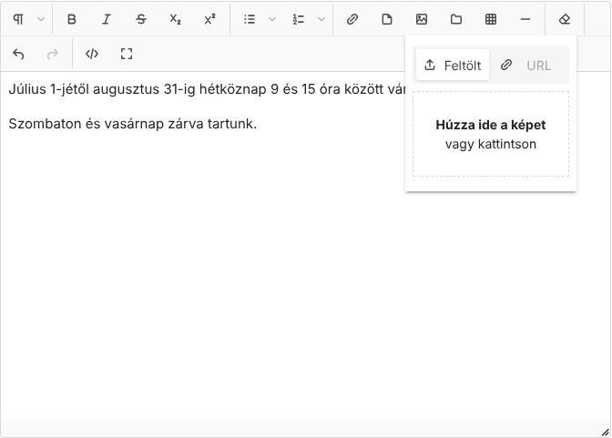
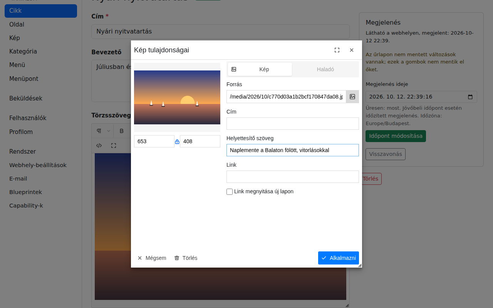
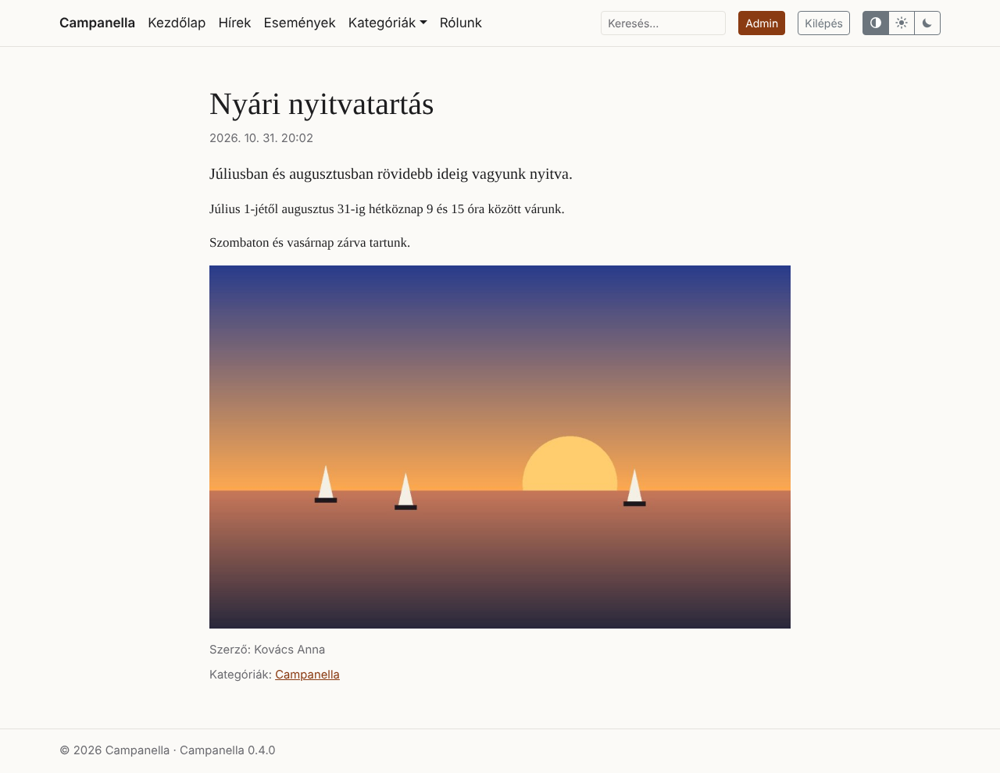

# 5. Képek

A képeket a Campanella maga tárolja: feltöltöd őket, és a szövegekbe, illetve
megosztási képnek használod őket. Ez a fejezet arról szól, hogyan.

## Feltöltés a Kép listában

A bal oldali menüben a **Kép** a feltöltött képek listáját nyitja meg, felül a
feltöltő mezővel:

- Kattints a fájlválasztóra, és válassz egy vagy több képet, vagy húzd őket a
  dobozba a gépedről. A feltöltés azonnal elindul, és minden képről kiírja,
  sikerült-e.
- Elfogadott formátumok: **JPEG, PNG, WebP és GIF**. A mező alatt látod,
  mekkora lehet egy fájl. Ha a fényképezőgéped vagy telefonod képei ennél
  nagyobbak, a tárhely PHP-beállításaiban növelhető (2. fejezet, Rendszer
  oldal), vagy kicsinyítsd őket feltöltés előtt.
- Egy kép legfeljebb 25 megapixeles lehet (például 6000×4000 képpont).

Feltöltéskor a Campanella:

- megnézi, hogy a fájl tényleg kép-e (nem csak a kiterjesztése),
- újrakódolja, és közben **eltávolítja a metaadatokat**: például a telefon
  által rögzített GPS-koordinátákat, amelyek elárulnák, hol készült a kép,
- elkészíti a kép **kisebb változatait** (320, 640, 1024 és 1600 képpont
  szélesen). A webhely mindig a látogató képernyőjéhez illőt küldi, így a
  telefonon is gyorsan betöltődik.

A kép címe kezdetben a fájl neve. A listában a **nincs alternatív szöveg**
jelzés mutatja, melyik képnél hiányzik a leírás.

## A kép adatai

A kép címére kattintva megnyílik a szerkesztő oldala:

- **Cím:** az adminban ezzel találod meg a képet. Érdemes beszédesre
  átírni a fájlnévből.
- **Alternatív szöveg:** egy rövid leírás arról, mi látható a képen.
  A vak és gyengénlátó látogatók felolvasóprogramja ezt olvassa fel, a
  keresők ebből tudják, mit ábrázol a kép, és akkor is ez látszik, ha a kép nem
  töltődik be. Írd le egy mondatban, mit mutat a kép (ne azt, hogy „kép”).
- Jobb oldalt a kép előnézete és adatai: típusa, mérete, címe a webhelyen.

## Kép a szövegben

A cikkek és oldalak szövegszerkesztőjében a **kép** gombbal tölthetsz fel képet
közvetlenül a szövegbe, oda, ahol a kurzor áll:

Kattints a **Feltölt** fülön a mezőre, és válaszd ki a képet, vagy húzd rá.
A kép ugyanúgy feltöltődik, mint a Kép listában (ott is megjelenik), és
bekerül a szövegbe. Képet a szerkesztőbe húzva vagy beillesztve is
feltölthetsz.

**Már feltöltött kép** beszúrásához a mellette lévő **mappa** gombot
(*Feltöltött kép választása*) használd: a megjelenő ablakban a legújabb képek
látszanak, cím szerint kereshetsz köztük, és egy kattintással beszúrhatod
őket a kurzor helyére, a már megadott alternatív szövegükkel együtt.

**Az alternatív szöveget a szövegben is add meg:** kattints duplán a képre a
szerkesztőben, és töltsd ki a **Helyettesítő szöveg** mezőt, majd
**Alkalmazni**:

Ugyanitt a kép **Link** mezőjével a képet linkké is teheted. A **Haladó**
fül beállításait (margók, stílusok) a Campanella mentéskor eltávolítja: a kép
elhelyezését az oldal kinézete határozza meg.

A szöveg mentése után a cikk így jelenik meg a webhelyen:

## Megosztási kép

Az a kép, amely akkor jelenik meg, ha valaki az oldaladat egy közösségi
oldalon megosztja, a **Rendszer → Webhely-beállítások** oldalon választható ki
(2. fejezet). Ideális mérete 1200×630 képpont.

## Kép törlése

Egy kép szerkesztő oldalán a **Törlés** gomb előbb megmutatja, **mely
szövegekben szerepel a kép**. Ha mégis törlöd, azokban a szövegekben a kép
helyén egy hibás kép (vagy csak az alternatív szövege) látszik, ezért előbb
vedd ki a képet ezekből a szövegekből, vagy cseréld le. A törléssel a fájl és a kisebb változatai is
törlődnek, és nem állíthatók vissza.

---

Előző: [4. Menük](04-menuk.md) · Következő:
[6. Felhasználók és a saját fiókod](06-felhasznalok.md) · [Tartalomjegyzék](README.md)
