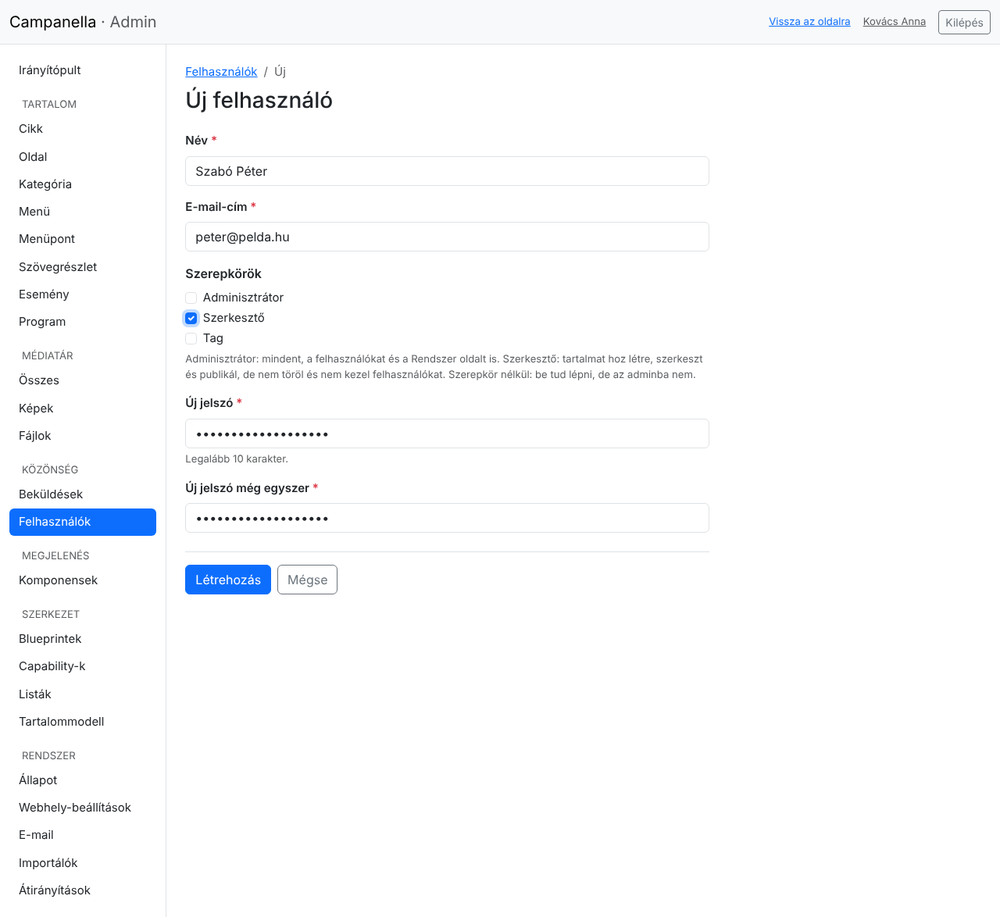
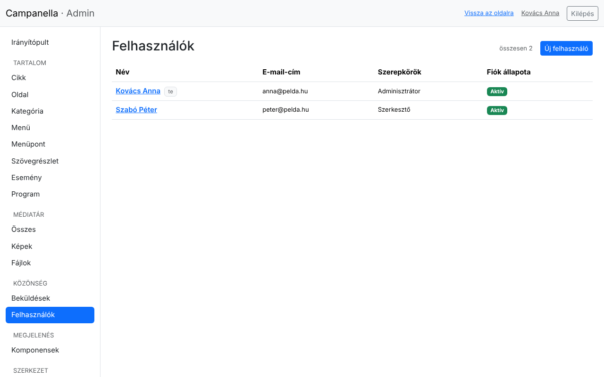
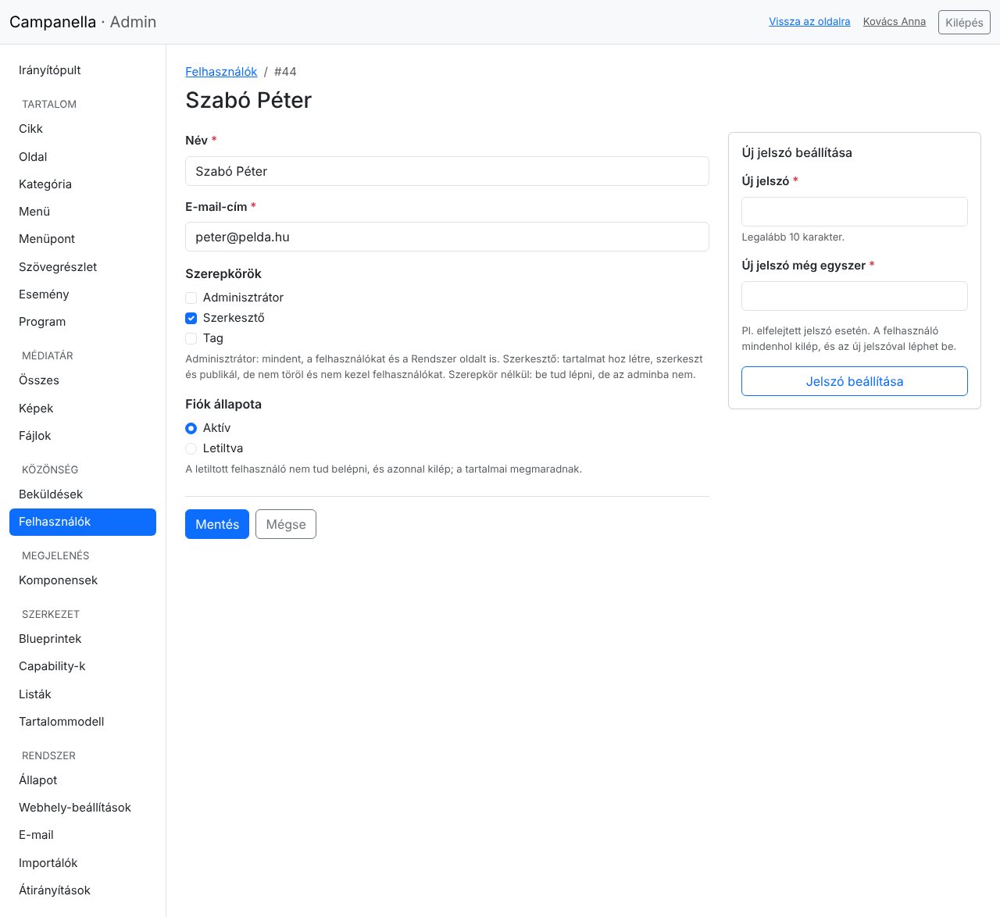
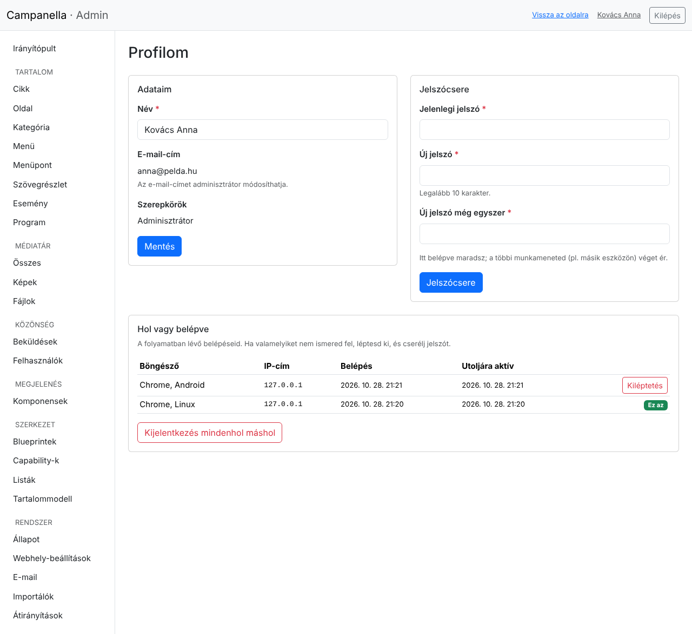
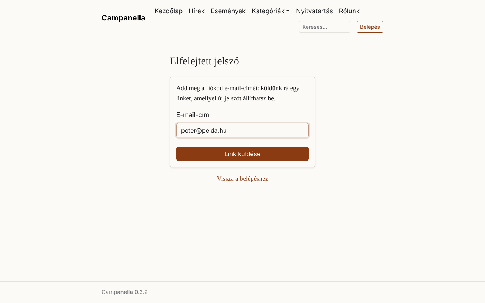
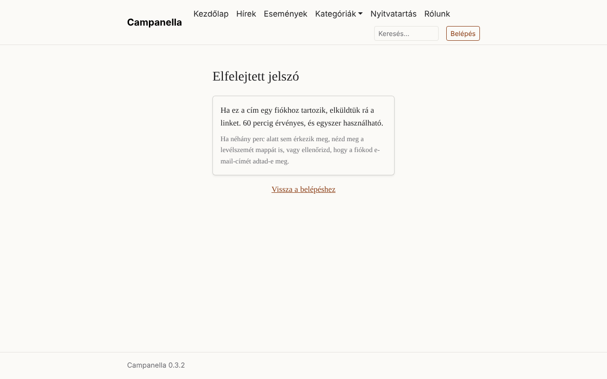
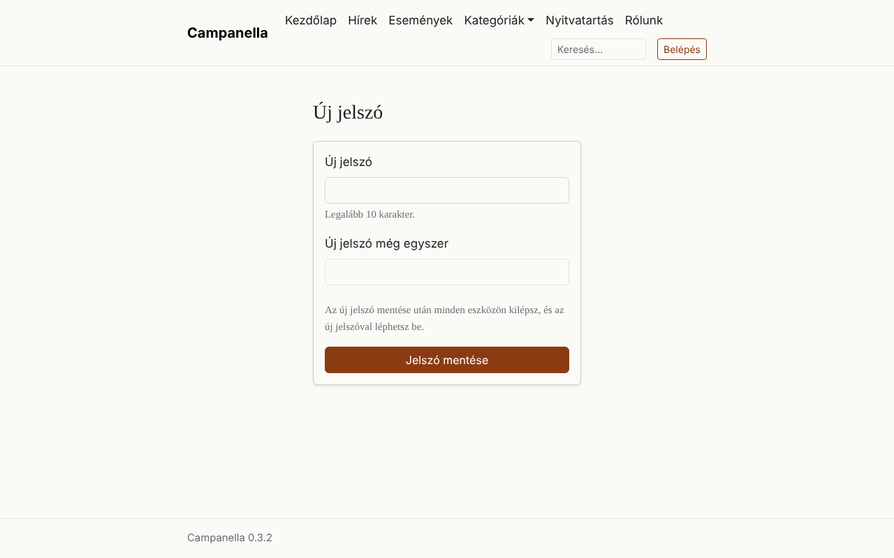

# 6. Felhasználók és a saját fiókod

Ez a fejezet arról szól, hogyan adsz hozzáférést másoknak az adminhoz, hogyan
kezeled a fiókokat, és mit tehetsz a saját fiókoddal: jelszócsere, belépések,
elfelejtett jelszó.

## Szerepkörök

| Szerepkör | Mit tehet? |
|---|---|
| **Adminisztrátor** | Mindent: tartalom, felhasználók, Beküldések, a Rendszer oldal és a beállítások. |
| **Szerkesztő** | Tartalmat hoz létre, szerkeszt és publikál. Nem töröl, nem látja a Beküldéseket, nem kezel felhasználókat, és nem látja a Rendszer oldalt. |
| *Szerepkör nélkül* | Be tud lépni, de az adminba nem. |
| *A webhely saját szerepkörei* (például **Tag**) | Mint szerepkör nélkül, és letöltheti a neki szóló fájlokat. A webhely gazdája adja meg őket (5. fejezet, [Saját szerepkörök](05-kepek.md#saját-szerepkörök)). |

Csak annyi adminisztrátor legyen, amennyi feltétlenül kell: aki csak írni
fog, annak elég a szerkesztő szerepkör.

## Új felhasználó

A **Felhasználók** listában az **Új** gombbal:



- **Név** és **E-mail-cím:** az e-mail-címmel lép majd be.
- **Szerepkörök:** jelöld be, amelyik kell (lásd fent).
- **Új jelszó**, kétszer: legalább 10 karakter.

A Campanella **nem küld e-mailt** az új felhasználónak, és a jelszót sem
küldi el senkinek. Két jó megoldás:

1. **Ő maga állítja be a jelszavát (javasolt):** adj meg egy hosszú, véletlen
   jelszót, amit senkinek nem mondasz el, és kérd meg, hogy a belépő oldalon
   az **Elfelejtetted a jelszavad?** linkkel állítson be magának egyet. Így a
   jelszavát csak ő ismeri. Ehhez az e-mail-küldésnek működnie kell (8.
   fejezet).
2. Ha ez nem megy, mondd el neki a jelszót biztonságos úton (személyesen,
   telefonon), és kérd, hogy első belépés után a profilja oldalán (a jobb felső sarokban a nevére kattintva)
   cserélje le.

## A felhasználók listája és egy fiók szerkesztése



Egy névre kattintva a fiók szerkesztő oldala nyílik meg:



- Itt módosíthatod a nevét, az **e-mail-címét** és a **szerepköreit**. Az
  e-mail-címet csak adminisztrátor módosíthatja, a felhasználó a saját
  profilján nem.
- **Fiók állapota:** **Letiltva** állapotban a felhasználó nem tud belépni, és
  ha be van lépve, azonnal kilép. A tartalmai megmaradnak, és ő marad a
  szerzőjük. Ha később újra **Aktív**-ra állítod, ismét beléphet a régi
  jelszavával.
- **Új jelszó beállítása** (jobbra): ha valaki elfelejtette a jelszavát, és
  nem tudja magának visszaállítani. A felhasználó minden eszközén kilép, és az
  új jelszóval léphet be.

Felhasználót **törölni nem lehet**, csak letiltani: így a cikkeinek megmarad
a szerzője. Két védelem is van:

- Senki nem tilthatja le saját magát.
- Az utolsó aktív adminisztrátort nem lehet letiltani, és nem veheted el tőle
  az adminisztrátor szerepkört: mindig marad valaki, aki kezelni tudja az
  oldalt.

**Ha valakinek a fiókjához illetéktelen férhetett hozzá:** állíts be neki új
jelszót. Ezzel minden belépése véget ér, és csak az új jelszóval lehet újra
belépni. Ha egy munkatárs távozik, tiltsd le a fiókját.

## A saját profilod

A **Profilom** oldalon (a jobb felső sarokban a nevedre kattintva):



- **Adataim:** a neved. Az e-mail-címedet egy adminisztrátor módosíthatja.
- **Jelszócsere:** a jelenlegi jelszavaddal és kétszer az újjal. Ebben a
  böngészőben belépve maradsz, a többi eszközödön kilépsz. Ötszöri rossz
  jelenlegi jelszó után 15 percig várnod kell.

### Hol vagy belépve

A **Hol vagy belépve** táblázat megmutatja minden folyamatban lévő
belépésedet: a böngészőt és a rendszert, az IP-címet, hogy mikor léptél be, és
mikor voltál utoljára aktív. A mostanit az **Ez az** jelzés mutatja.

- A **Kiléptetés** gomb egy másik belépést fejez be: azon az eszközön a
  következő kattintásnál kilépsz.
- A **Kijelentkezés mindenhol máshol** minden belépést befejez, kivéve a
  mostanit. Ha elfelejtettél kilépni egy közös gépen, ezzel pótolhatod.

Ha olyan belépést látsz, amelyet nem ismersz fel, léptesd ki, és azonnal
cserélj jelszót.

## Elfelejtett jelszó

Ha nem tudsz belépni, mert elfelejtetted a jelszavad, a belépő oldalon kattints
az **Elfelejtetted a jelszavad?** linkre, és add meg az e-mail-címedet:



A válasz mindig ugyanaz, akár van ilyen fiók, akár nincs: így senki nem tudja
kipróbálni, kinek van fiókja az oldalon.



Ha a cím egy aktív fiókhoz tartozik, néhány percen belül megérkezik ez az
e-mail:

```text
Tárgy: Új jelszó beállítása: Campanella

Kedves Szabó Péter!

Valaki (remélhetőleg te) új jelszót kért a(z) Campanella fiókodhoz. Ezen a
linken állíthatod be:

https://pelda.hu/password-reset?token=…

A link 60 percig érvényes, és egyszer használható.

Ha nem te kérted, nincs teendőd: a jelszavad nem változik.
```

A link az új jelszó oldalára visz:



Mentés után minden eszközön kilépsz, és az új jelszóval léphetsz be.

Tudnivalók:

- A link **60 percig** érvényes és **egyszer** használható. Egy újabb kérés
  érvényteleníti az előzőt.
- Egy e-mail-címre óránként legfeljebb 3 kérés küldhető.
- Letiltott fiókhoz nem megy link.
- Ha nem érkezik meg: nézd meg a levélszemét mappát, és ellenőrizd, jó címet
  adtál-e meg. Az adminisztrátor az **E-mail** naplóban látja, elment-e a
  levél (8. fejezet), és be is állíthat neked új jelszót.
- Az elfelejtett jelszó csak akkor működik, ha az e-mail-küldés be van
  állítva, és a webhely címe meg van adva a **Webhely-beállításokban**. Addig
  a link meg sem jelenik.

---

Előző: [5. Képek és fájlok](05-kepek.md) · Következő:
[7. Kapcsolati űrlap és adatvédelem](07-kapcsolati-urlap.md) ·
[Tartalomjegyzék](README.md)
