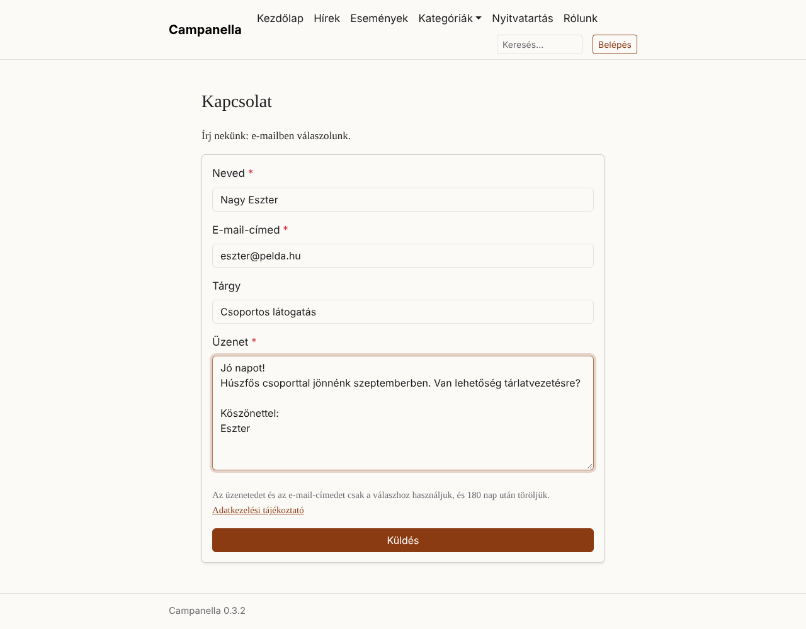
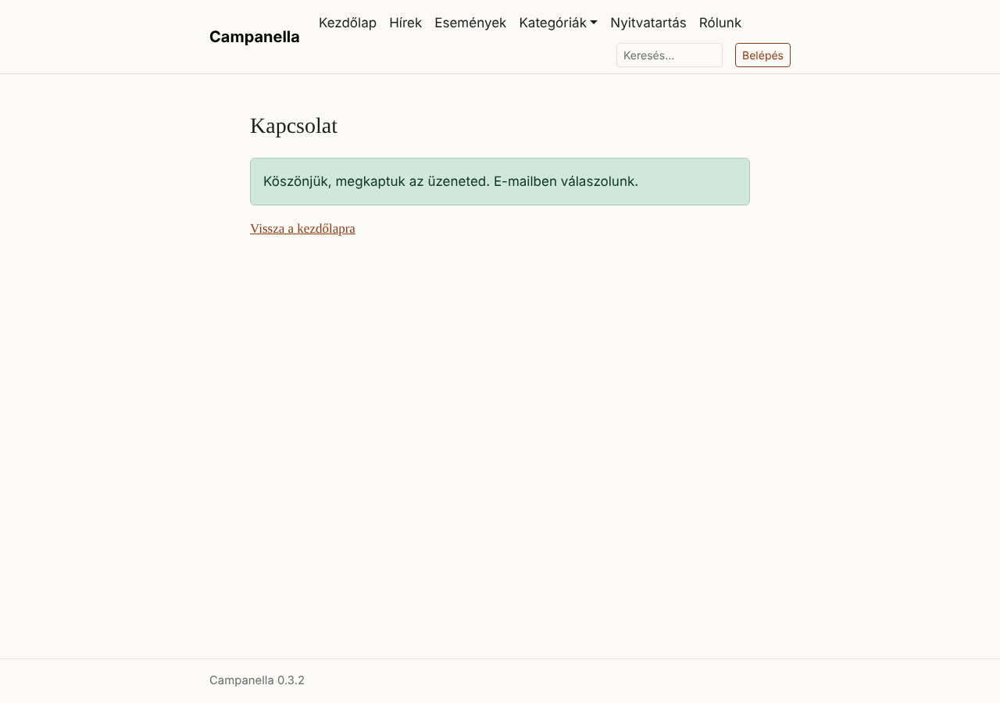
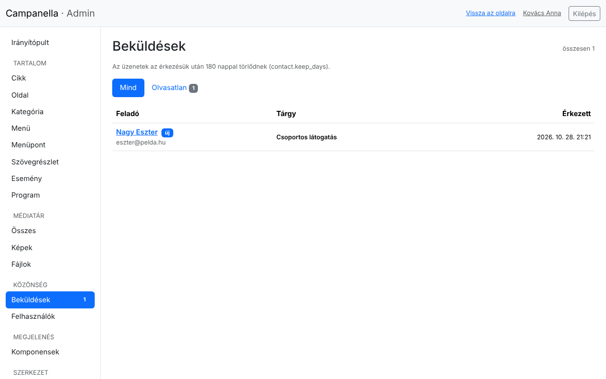
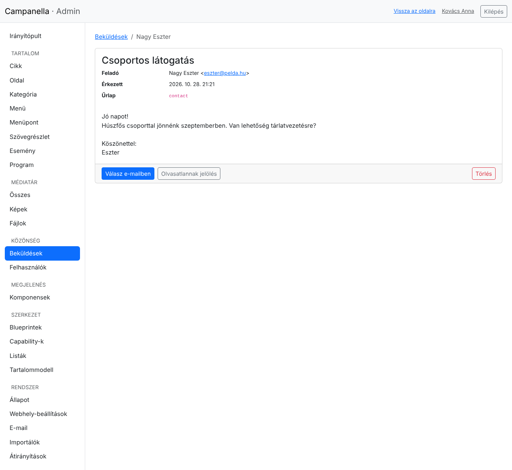
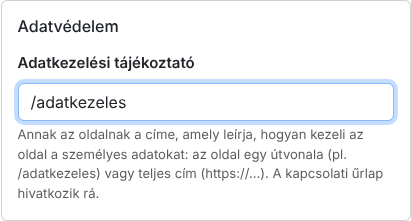

# 7. Kapcsolati űrlap és adatvédelem

A látogatók egy kapcsolati űrlapon írhatnak neked. Az üzenetek az admin
**Beküldések** részébe érkeznek, és e-mailben is értesítést kapsz róluk. Ez a
fejezet arról is szól, milyen személyes adatokat kezel a Campanella, hogy meg
tudd írni az adatkezelési tájékoztatót.

## Az űrlap

Az űrlap a `/contact` címen van, például `https://pelda.hu/contact`.
Telepítés után be van kapcsolva. Ahhoz, hogy a látogatók megtalálják, vedd fel
a főmenübe egy menüponttal, amelynek az **URL**-je `/contact` (4. fejezet).

A látogató megadja a nevét, az e-mail-címét, egy tárgyat (nem kötelező) és az
üzenetét. Az űrlap alatt egy rövid adatkezelési tájékoztató áll: mire
használod az adatait, és mikor törlődnek. Ha megadtad az adatkezelési
tájékoztatód címét (lásd lent), egy link is mutat rá.

Küldés után ezt látja:

A Campanella nem küld másolatot a látogatónak: különben bárki küldhetne az
oldalad nevében levelet bármilyen címre.

### Védelem a kéretlen üzenetek ellen

Az űrlapot a Campanella magától védi a robotok és az elárasztás ellen:

- egy rejtett mező, amit csak a robotok töltenek ki (az ilyen üzenet nem
  mentődik el, de a robot „elküldve” választ kap),
- a megnyitás után 3 másodpercen belül küldött űrlapot robotnak tekinti, és
  újra kéri,
- egy címről (IP-címről) óránként legfeljebb 5, egy feladói e-mail-címről
  legfeljebb 3 üzenet érkezhet,
- óránként legfeljebb 50 értesítő e-mail megy ki; az üzenetek ezen felül is
  mind megérkeznek a Beküldések közé.

Ehhez neked nem kell semmit beállítanod.

## Az üzenetek olvasása

Az új üzenetek számát a bal oldali menüben a **Közönség → Beküldések** mellett egy szám
jelzi. A lista:

- Az **új** jelzés az olvasatlan üzeneteket mutatja. Az **Olvasatlan** fül
  csak ezeket listázza.
- Az üzenetek az érkezésük után **180 nappal maguktól törlődnek**. Ha valamit
  meg akarsz tartani, másold ki, vagy válaszolj rá e-mailben (a válaszod a
  saját postafiókodban megmarad).

Egy üzenetre kattintva elolvashatod, és ezzel olvasottnak jelölöd:

- **Válasz e-mailben:** megnyitja a levelezőprogramodat a feladó címével.
- **Olvasatlannak jelölés:** ha később akarsz vele foglalkozni.
- **Törlés:** véglegesen törli az üzenetet.

Az üzeneteket csak az adminisztrátorok látják, a szerkesztők nem.

### Értesítés e-mailben

Minden új üzenetről e-mailt kap minden aktív adminisztrátor (ha az
e-mail-küldés be van állítva, 8. fejezet). Az e-mail tárgya nem tartalmaz
semmit abból, amit a látogató írt, a szövegében viszont benne van az egész
üzenet, egy linkkel az adminra. Ha **erre az e-mailre válaszolsz**, a válaszod a
látogatónak megy, nem a webhelynek.

## Adatkezelési tájékoztató

Ha az oldalad személyes adatokat kezel (a kapcsolati űrlap ilyen: neveket és
e-mail-címeket), egy adatkezelési tájékoztatóban le kell írnod, milyen adatokat,
mire, mennyi ideig tárolsz, és ki fér hozzájuk.

1. Írd meg oldalként (**Oldal → Új**), például **Adatkezelési tájékoztató**
   címmel és `/adatkezeles` útvonallal, és tedd közzé.
2. A **Rendszer → Webhely-beállítások** oldalon, az **Adatvédelem** dobozban
   add meg az útvonalát, és mentsd el:

   

3. Vedd fel a menübe is, hogy bárhonnan elérhető legyen.

Ezután a kapcsolati űrlap alatt link mutat rá, és a Rendszer oldal sem jelez
miatta.

### Milyen személyes adatokat tárol a Campanella?

Ez a lista segít a tájékoztató megírásában. **Nem jogi tanács:** a
tájékoztató tartalmáért te felelsz, kérdés esetén kérd szakember segítségét.

| Adat | Kiről? | Mennyi ideig? | Ki látja? |
|---|---|---|---|
| A kapcsolati űrlap üzenetei: név, e-mail-cím, tárgy, üzenet | A látogatóktól, akik írnak | 180 napig, utána maguktól törlődnek | Az adminisztrátorok; e-mailben a címzettek postafiókjában is (onnan te törlöd) |
| A felhasználók fiókjai: név, e-mail-cím, a jelszó lenyomata (maga a jelszó soha) | A szerkesztőktől és adminisztrátoroktól | Amíg a fiók létezik | Az adminisztrátorok |
| A belépések: IP-cím, böngésző, a belépés és az utolsó aktivitás ideje | A belépett felhasználóktól | Amíg a belépés tart (legfeljebb 12 óra) | A felhasználó maga, a Profilom oldalon |
| Az elküldött e-mailek naplója: címzett, tárgy, időpont (a szövegük soha) | A címzettekről | 90 napig | Az adminisztrátorok |
| A visszaélések elleni számlálók: az IP-cím és az e-mail-cím lenyomata (egy titkos kulccsal képezve, amiből a cím nem fejthető vissza) | A belépést, az elfelejtett jelszót vagy a kapcsolati űrlapot használóktól | 15 perctől 1 óráig | Senki: csak a korlátozáshoz kell |

Ezen felül:

- **Az üzenet küldőjének IP-címét a Campanella nem tárolja** az üzenettel.
- **Sütik:** egy munkamenet-süti (`campanella_session`), csak a belépéshez és
  az űrlapokhoz (belépés, elfelejtett jelszó, kapcsolati űrlap), a
  biztonságos működéshez. A többi oldal nem állít be sütit. Nincs statisztika,
  nincs hirdetés, és nincs külső szolgáltatás (betűtípus, térkép, közösségi
  gomb), amely a látogatók adatait gyűjtené.
- **A tárhely** naplózhatja a látogatások adatait (például az IP-címeket) a
  webszerver naplójában. Ezt a tárhelyszolgáltatótól kérdezd meg.

---

Előző: [6. Felhasználók és a saját fiókod](06-felhasznalok.md) · Következő:
[8. E-mail](08-e-mail.md) · [Tartalomjegyzék](README.md)
