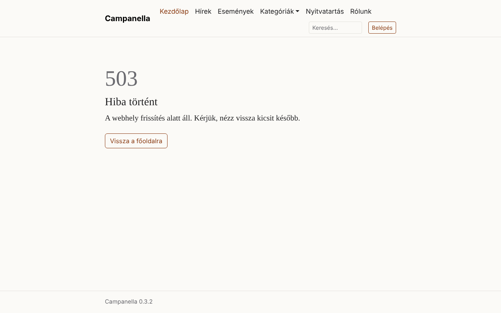
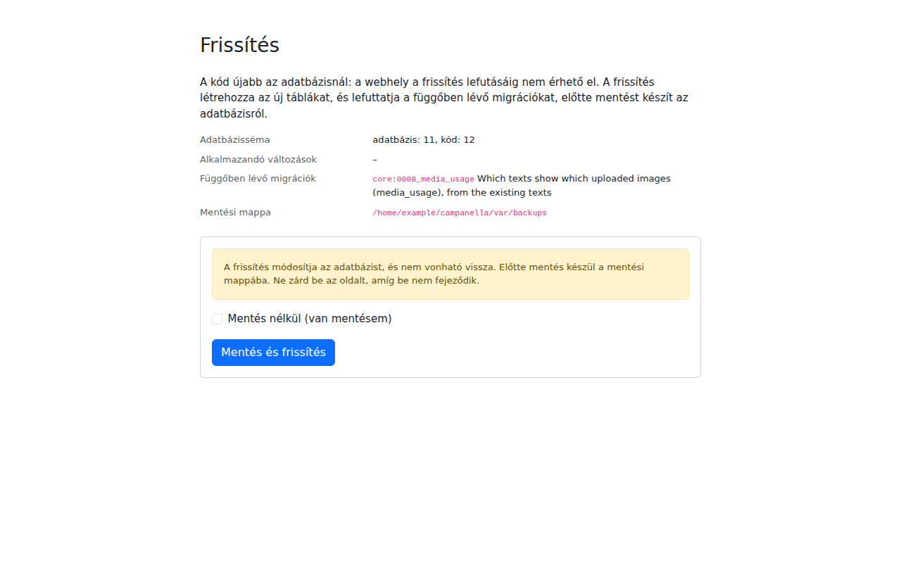
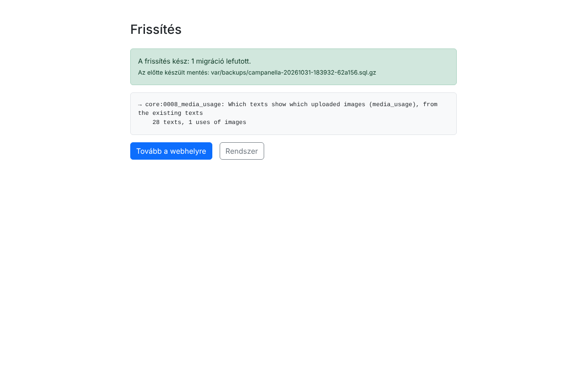

# 9. Mentés és frissítés

Egy weboldal adatai elveszhetnek: hibás frissítés, egy véletlen törlés, a
tárhely meghibásodása vagy egy betörés miatt. Ez a fejezet arról szól, mit és
hogyan ments, és hogyan frissítsd a Campanellát egy újabb verzióra.

## Mit kell menteni?

| Mit | Hol van | Miért |
|---|---|---|
| **Az adatbázis** | A tárhely adatbázis-szerverén | Minden tartalom, felhasználó, beállítás és üzenet. |
| **A feltöltött képek** | A `public/media/` mappa | A képek fájljai (az adatbázisban csak az adataik vannak). |
| **A feltöltött fájlok** | A `var/files/` mappa | A letölthető fájlok (0.3.2-től). A csak tagoknak szóló fájlok is itt vannak: a mentést ugyanúgy őrizd, mint a webhelyet. |
| **A beállítási fájl** | `config/local.php` | Az adatbázis és az e-mail beállításai. |
| *A saját téma, ha van* | `themes/` | Ha valaki egyedi kinézetet készített az oldalnak. |

A program többi fájlját nem kell menteni: azok bármikor újra letölthetők a
kiadási oldalról.

## Hogyan ments?

Használj legalább egyet ezek közül, és **a mentést tárold máshol is**, ne
csak a tárhelyen: ha a tárhely veszik el, vele vész a rajta tárolt mentés is.

1. **A tárhely saját mentése.** Sok tárhely naponta ment, és néhány napig
   megőrzi. Kérdezd meg a szolgáltatót, mit ment (az adatbázist is?), mennyi
   ideig őrzi, és hogyan lehet visszaállítani.
2. **phpMyAdmin.** A tárhely felületén a phpMyAdmin **Exportálás** funkciója
   egy fájlba menti az adatbázist. A képeket és a `config/local.php`-t a
   fájlkezelővel töltsd le.
3. **A Campanella mentése.** Minden frissítés előtt a Campanella magától
   menti az adatbázist a `var/backups/` mappába (`campanella-<dátum>.sql.gz`).
   Ezt a mappát a látogatók nem érik el; a fájlkezelővel letöltheted. Ha van
   parancssor, a `php bin/campanella db:backup` parancs bármikor készít egyet,
   és a tárhely időzített feladataival (cron) naponta is futtatható.

A régi mentések nem törlődnek maguktól a `var/backups/` mappából: időnként
töröld azokat, amelyekre már nincs szükséged.

**Próbáld is ki a visszaállítást** egyszer, amikor még nincs baj: egy
mentés csak akkor ér valamit, ha vissza is lehet tölteni.

### Visszaállítás

1. Az adatbázist a phpMyAdmin **Importálás** funkciójával töltsd vissza a
   mentett fájlból (a `.sql.gz` fájlt a phpMyAdmin tömörítve is elfogadja).
   A mentés a táblákat törli, és a mentett állapotukban hozza létre újra.
2. A `public/media/` és a `var/files/` mappát a fájlkezelővel töltsd vissza.

Ami a mentés óta történt (új tartalom, üzenetek), az a visszaállítással
elveszik.

## Frissítés újabb verzióra

### Mikor frissíts?

Az új verziók a [GitHub kiadási oldalán](https://github.com/szhajagos/campanella/releases)
jelennek meg. Ha értesítést szeretnél róluk, ennek az oldalnak a hírcsatornáját
(`https://github.com/szhajagos/campanella/releases.atom`) egy hírolvasóban
követheted.

- **Javító verziók** (például 0.2.0 → 0.2.1): hibajavítások, biztonsági
  javítások, apró fejlesztések. A Campanella ígérete, hogy ezek nem
  változtatnak meg semmit, amire az oldalad épít
  ([kompatibilitási ígéret](../../compatibility.md), angolul). Ezeket mindig
  érdemes telepíteni, a biztonsági javításokat minél előbb.
- **Új verziók** (például 0.3 → 0.4): új funkciók, és változások is lehetnek.
  Előtte olvasd el a kiadás leírását, mert lehet teendőd.

### Lépésről lépésre

1. **Ments** (lásd fent). A Campanella is ment a frissítés előtt, de legyen
   egy saját mentésed is, a képekkel együtt.
2. **Töltsd le** az új `campanella-<verzió>.zip`-et, és csomagold ki a
   gépeden.
3. **Töltsd fel**, és cseréld le vele a program mappáit: `bin/`, `config/`
   (a `local.php` kivételével!), `lang/`, `public/` (a `public/media/`
   kivételével!), `resources/` (0.3.7 óta), `src/`, `templates/`, `vendor/`,
   és a gyökérben lévő
   fájlokat. **Ne töröld és ne írd felül:** a `config/local.php`-t, a
   `public/media/` mappát, a `var/` mappát és a `themes/` mappát, ha van.
4. **Nyisd meg az oldalt.** Ha az új verzió az adatbázist is módosítja, a
   látogatók addig ezt látják:

   

5. **Lépj be** (a belépés frissítés alatt is működik), és nyisd meg a
   `/admin/upgrade` oldalt (az admin is ide irányít):

   

   Az oldal megmutatja, mi fog történni. Kattints a **Mentés és frissítés**
   gombra, és **ne zárd be az oldalt**, amíg be nem fejeződik (általában pár
   másodperc).

   

6. **Nézd meg a Rendszer oldalt:** az új verziószám látszik-e, és nincs-e
   rajta hiba. Ha az oldal még a régi kinézetet mutatja, a **Sablon-gyorsítótár
   ürítése** gomb, illetve a böngészőben a frissítés (Ctrl+F5) segít.

Ha az új verzió nem módosítja az adatbázist (ez a javító verzióknál gyakori),
az oldal a feltöltés után azonnal működik, és a frissítés oldala azt írja,
hogy nincs teendő.

**Ha nem tudsz belépni**, mert a frissítés előtt a belépés sem működik: írj a
`config/local.php`-be egy legalább 20 karakteres frissítési kulcsot
(`'upgrade' => ['key' => '…']`), nyisd meg a `/admin/upgrade` oldalt, add meg
a kulcsot, és a frissítés után **töröld a kulcsot**.

### Ha valami rosszul sült el

A frissítés előtti állapot visszaállítható: töltsd vissza a régi verzió
fájljait, és az adatbázist a frissítés előtt készült mentésből (a frissítés
oldala kiírja a nevét). A részleteket a fejlesztői
[frissítési útmutató](../../upgrading.md#going-back) írja le (angolul).

A 0.3.x, 0.2.x és 0.1.x verziókról a 0.4-re frissítés teendőit szintén a
[frissítési útmutató](../../upgrading.md) gyűjti össze.

---

Előző: [8. E-mail](08-e-mail.md) · Következő:
[10. Ha valami nem működik](10-hibaelharitas.md) · [Tartalomjegyzék](README.md)
