# 11. Saját tartalomtípusok: egy programnaptár

A cikk, az oldal és a kategória mellé saját tartalomtípust is készíthetsz,
programozás nélkül, az adminban: például programokat, termékeket, munkatársakat
vagy szálláshelyeket, a saját mezőikkel. Ez a fejezet lépésről lépésre végigvisz
egy példán: egy egyesület **programnaptárán**, amelyben a látogatók a közelgő
programokat látják, és fajta, időpont, belépő szerint szűrhetnek.

A lépések:

1. [A tartalomtípus](#a-tartalomtípus): a neve és a képességei.
2. [A mezői](#a-mezők): időpont, fajta, helyszín, belépő, jelentkezés.
3. [A lista az adminban](#a-lista-az-adminban): az oszlopai és szűrői.
4. [Az első programok](#az-első-programok) felvitele.
5. [A naptár a látogatóknak](#a-naptár-a-látogatóknak): egy lista a közelgő
   programokról, saját címmel és szűrőkkel, és egy menüpont hozzá.
6. [Átvitel egy másik webhelyre](#átvitel-egy-másik-webhelyre), például egy
   tesztoldalról az élesre.

Mindezt adminisztrátorként teheted meg; a szerkesztők utána ugyanúgy írják a
programokat, mint a cikkeket.

**Kész példa a példatartalomban.** Ha a telepítéskor példatartalmat is kértél,
már van egy hasonló tartalomtípusod, az **Esemény**, a **Közelgő események**
listával (`/esemenyek`, a főmenüben **Események**). Megnézheted, hogyan van
beállítva, vagy törölheted (lásd [a fejezet végén](#törlés)). Ebben a fejezetben
egy újat készítünk, **Program** néven.

## A tartalomtípus

A Campanellában a tartalomtípusok neve **Blueprint** (tervrajz). Egy Blueprint
megmondja, milyen részei vannak egy elemnek: ezek egyrészt a **képességei**
(capability-k: van-e címe, szövege, saját oldala, közzé kell-e tenni), másrészt
a **saját mezői**.

A **Rendszer → Blueprintek** oldal mindet felsorolja: a kódban megadottakat
(cikk, oldal …), amelyek itt nem változtathatók, és az adminban készülteket,
amelyek mellett a **Szerkesztés** gomb áll. Jobb fent az **Új Blueprint**
gombbal kezdesz egy újat:

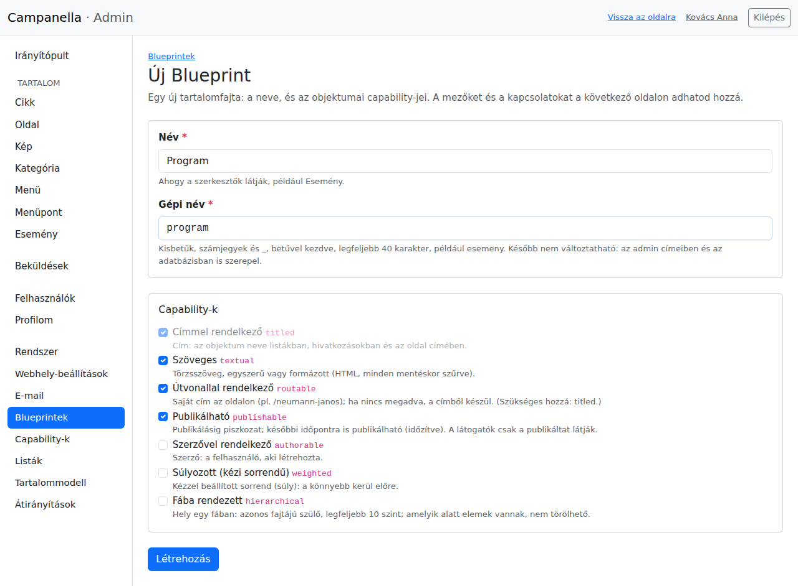

- **Név:** ahogy a szerkesztők látják, az admin menüjében is: *Program*.
- **Gépi név:** kisbetűk, számok és aláhúzás, betűvel kezdve: `program`. Az
  admin címeiben (`/admin/program`) és az adatbázisban is ez szerepel, ezért
  **később nem változtatható**.
- **Capability-k:** mit tudjon minden program.

| Képesség | Mit ad? | A programnaptárhoz |
|---|---|---|
| **Címmel rendelkező** | Cím, a listákban és az oldal fejlécében. | Mindig benne van. |
| **Szöveges** | Törzsszöveg a szövegszerkesztővel. | Igen: a program leírása. |
| **Útvonallal rendelkező** | Saját oldal a webhelyen, például `/korushangverseny`. | Igen: minden programnak legyen oldala. |
| **Publikálható** | Piszkozat, közzététel, időzítés, mint a cikkeknél. | Igen. |
| **Szerzővel rendelkező** | Melyik felhasználó írta. | Nem kell. |
| **Súlyozott** | Kézzel beállított sorrend. | Nem kell: időpont szerint rendezzük. |
| **Fába rendezett** | Szülő és gyerek elemek, mint a kategóriáknál. | Nem kell. |

A **Létrehozás** után a Blueprint oldala nyílik meg, és a bal oldali menüben
megjelenik a **Program**. Egy képességet később is hozzáadhatsz vagy elvehetsz
(az oldal alján, **Név és capability-k**): az elvett képesség adatai nem
vesznek el.

## A mezők

A Blueprint oldalán a **Mezők** dobozban az **Új mező** gombbal adsz hozzá egy
mezőt. A programnaptárhoz ezt az ötöt:

| Név | Gépi név | Típus | Kötelező | Szűrhető és rendezhető |
|---|---|---|---|---|
| Időpont | `idopont` | Dátum és idő | igen | igen |
| Fajta | `fajta` | Választás | igen | igen |
| Helyszín | `helyszin` | Szöveg (egy sor) | | |
| Belépő (Ft) | `belepo` | Tizedes szám, 0 tizedesjegy | | igen |
| Jelentkezés szükséges | `jelentkezes` | Igen/nem | | igen |

Így néz ki az űrlap a **Fajta** mezővel:

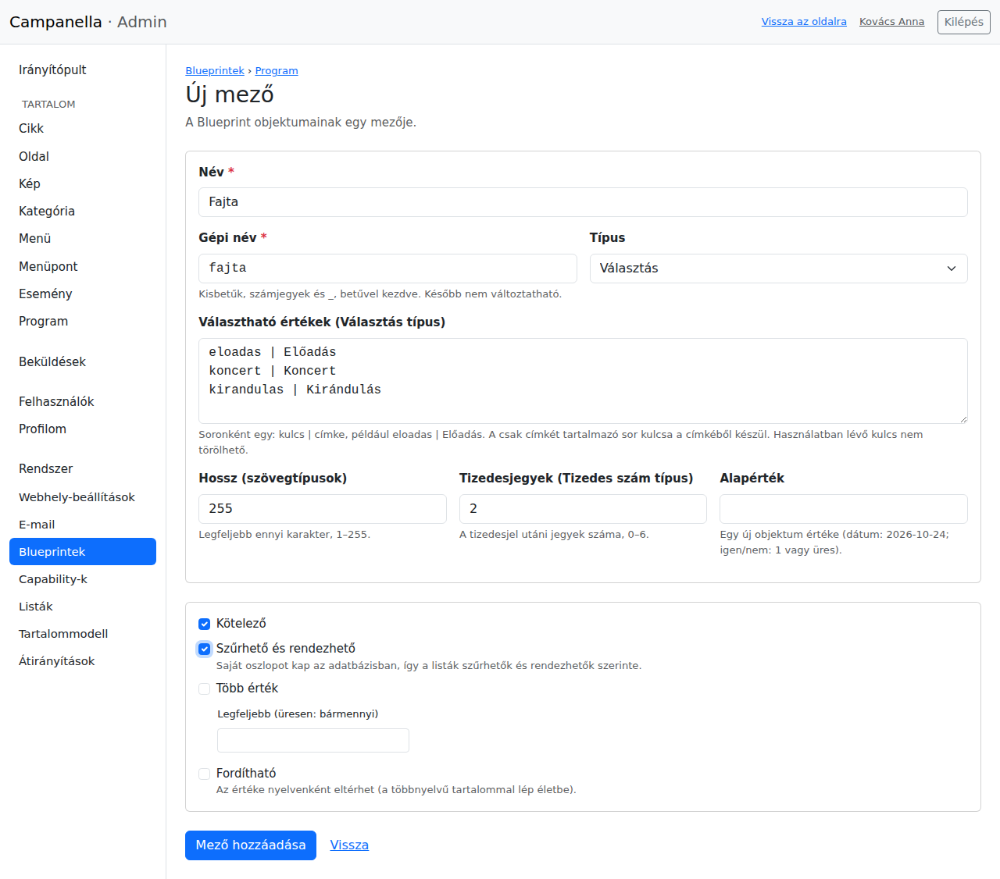

- **Név, Gépi név:** mint a Blueprintnél. A gépi név később itt sem
  változtatható.
- **Típus:**

  | Típus | Mire való? |
  |---|---|
  | Szöveg (egy sor) | Rövid szöveg, legfeljebb 255 karakter (a **Hossz** mezőben kevesebb is megadható). |
  | Hosszú szöveg | Több soros, formázás nélküli szöveg. |
  | Formázott szöveg | Szöveg a szövegszerkesztővel. |
  | Egész szám, Tizedes szám | Számok. A tizedes számnál a **Tizedesjegyek** mondja meg, hány jegy legyen a tizedesvessző után (pénzösszegnél forintban 0). |
  | Igen/nem | Egy jelölőnégyzet. |
  | Dátum, Dátum és idő | Egy nap, illetve egy nap és időpont. |
  | E-mail-cím, Webcím | Ellenőrzött cím. |
  | Választás | Előre megadott értékek egyike, egy legördülő listából. |

- **Választható értékek** (csak a Választás típusnál): soronként egy, `kulcs |
  címke` alakban, például `koncert | Koncert`. A címkét látják a szerkesztők
  és a látogatók; a kulcsot a webhely tárolja, és a webcímekben is ez jelenik
  meg (a szűrőknél). Ha csak a címkét írod, a kulcs abból készül.
- **Alapérték:** egy új elem ezzel indul (üresen is hagyhatod).
- **Kötelező:** mentéskor nem lehet üres.
- **Szűrhető és rendezhető:** a mező saját oszlopot kap az adatbázisban. **Ez
  kell ahhoz, hogy egy lista e mező szerint válogasson, rendezzen, vagy a
  látogatók szűrhessenek rá.** Azokat a mezőket jelöld be, amelyekre ilyen
  kell: az időpontot, a fajtát, a belépőt, a jelentkezést. A helyszínre nem
  kell.
- **Több érték:** egy elemnek több értéke is lehet (például több címke). A
  **Legfeljebb** mezőben korlátozhatod a számukat.
- **Fordítható:** a többnyelvű tartalommal lép majd életbe; most hagyd üresen.

A **Mező hozzáadása** után a mező azonnal megvan. Ha már vannak programok, a
Campanella előbb mentést készít az adatbázisról.

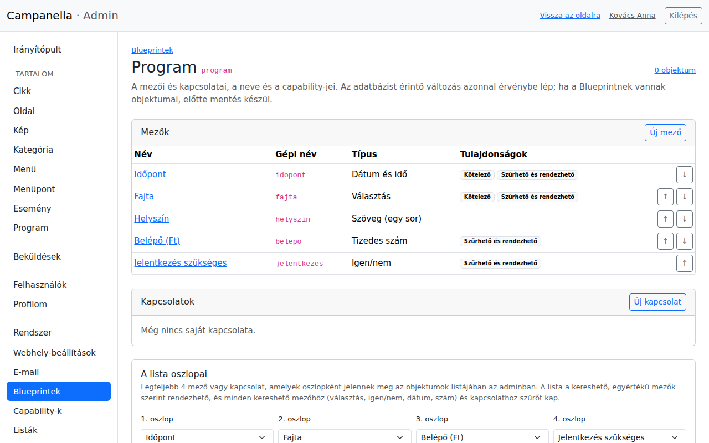

A mezők sorrendje az űrlapé és az oldalé is: a **↑** és **↓** gombokkal
változtatod. A mező nevére kattintva módosíthatod:

- a nevét, az alapértékét, a választható értékeket (újakat adhatsz hozzá; egy
  olyan kulcs, amelyet egy elem már használ, nem törölhető);
- a típusát csak „bővebbre”: egy sorból hosszú szövegre, egész számból
  tizedesre, dátumból dátumra és időre, egy e-mail-címből, webcímből vagy
  választásból szövegre. Ami adatvesztéssel járna, azt az admin nem engedi;
- a **Kötelező** jelölést: ha már vannak üres értékek, előbb egy alapértéket
  kér, és azzal tölti ki őket;
- a **Szűrhető és rendezhető** jelölést és a **Több érték** beállítást: a
  meglévő értékek átkerülnek. Ha több értékből egy lesz, csak az első marad
  meg, ezért ezt külön meg kell erősítened.

Egy mező, amelyet egy lista használ (feltételben, a sorrendben, oszlopként vagy
szűrőként), addig nem törölhető és nem tehető nem szűrhetővé, amíg a listát
nem módosítod: az admin megnevezi a listát.

Egy mező törlése a mező oldalának alján van: a programok ezen értékei
véglegesen törlődnek (előtte itt is mentés készül).

**Kapcsolatok.** A **Kapcsolatok** dobozban a programokat más tartalmakhoz
kötheted, például egy **Helyszín** kapcsolattal egy kategóriához vagy oldalhoz:
ilyenkor a szerkesztő nem begépeli, hanem kiválasztja a helyszínt, és a lista
szűrhető is lesz rá. A példában a helyszín egyszerű szöveg marad.

## A lista az adminban

Az admin **Program** listája alapból a címet, az állapotot és a dátumokat
mutatja. A Blueprint oldalán a **Lista oszlopai** dobozban legfeljebb négy
saját mezőt vagy kapcsolatot adhatsz hozzá:

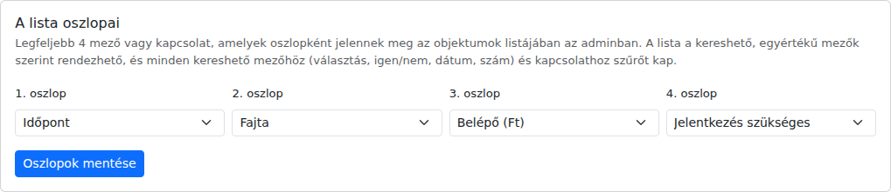

Az **Oszlopok mentése** után az admin listája így néz ki:

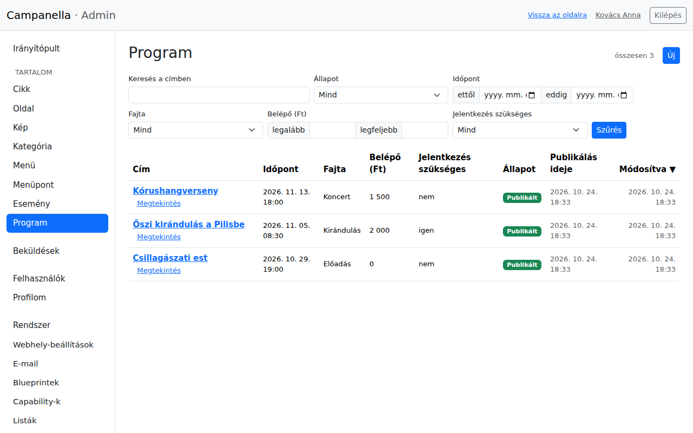

- A szűrhető, egy értékű oszlopok fejlécére kattintva rendezhetsz (itt:
  időpont, belépő).
- A szűrhető mezők a lista fölött szűrőt kapnak a típusuk szerint: a
  választás és az igen/nem egy legördülő listát, a dátum és a szám egy
  tartományt (**ettől–eddig**, **legalább–legfeljebb**), a kapcsolat a
  lehetséges elemeit.

## Az első programok

A bal oldali menüben a **Program → Új** gombbal írsz egy programot. Az űrlapon
a saját mezők a cím után jönnek, a Blueprint sorrendjében:

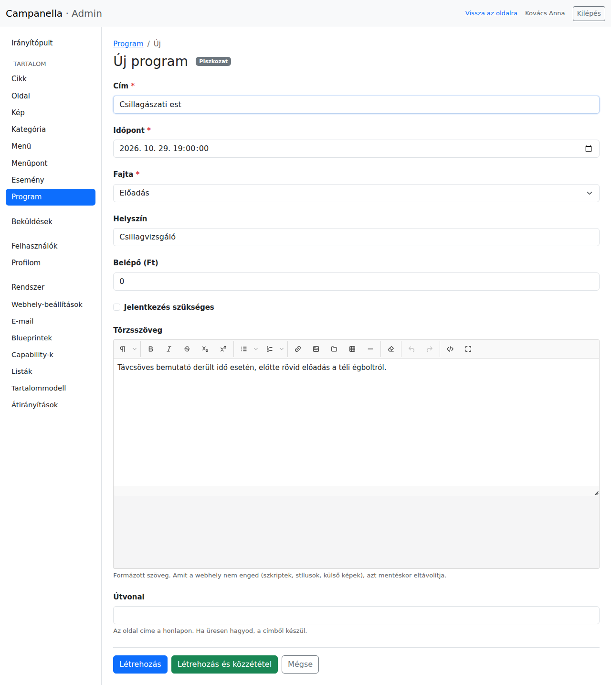

Minden más úgy működik, mint a cikkeknél (3. fejezet): piszkozatként vagy
azonnal közzétéve mentheted, időzítheted, és a program saját oldalt kap az
útvonalán. A program oldalán a leírás alatt a mezői is megjelennek.

## A naptár a látogatóknak

A programok saját oldala még nem naptár: kell egy lista, amely a közelgő
programokat időrendben mutatja. Ezt a **Rendszer → Listák** oldalon készíted,
az **Új lista** gombbal:

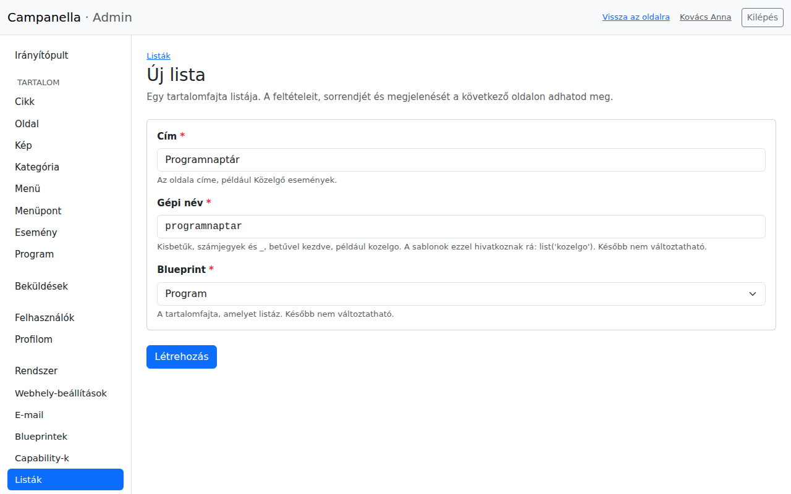

- **Cím:** a lista oldalának címe: *Programnaptár*.
- **Gépi név:** `programnaptar`. Ezzel hivatkozhat rá egy sablon is.
- **Blueprint:** a *Program*. Később nem változtatható.

A **Létrehozás** után a lista beállításai következnek:

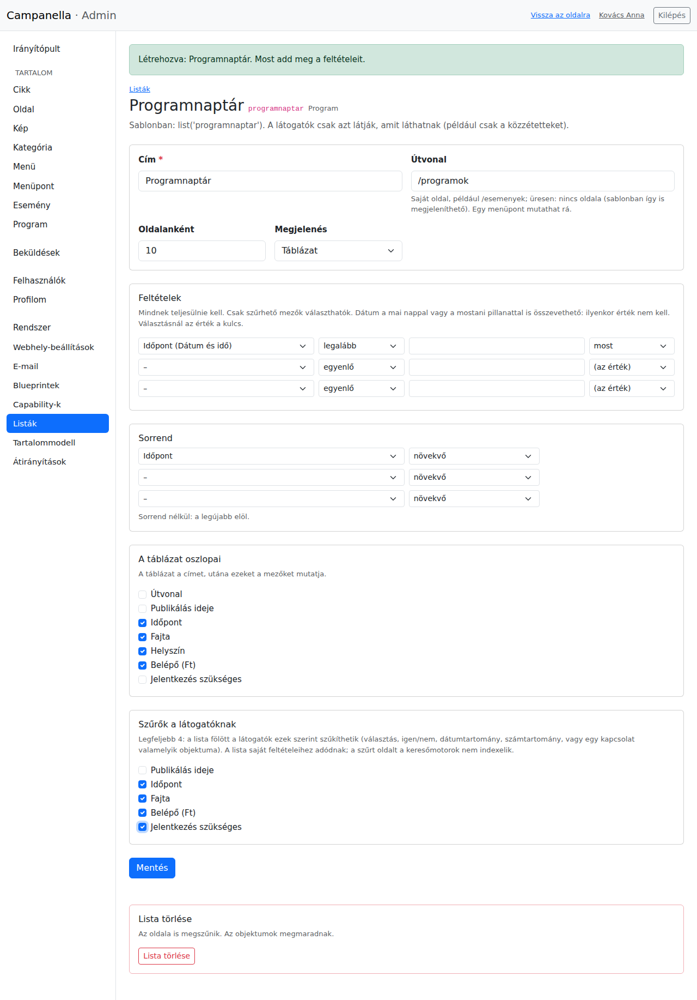

- **Útvonal:** a lista saját címe a webhelyen: `/programok`. Üresen a listának
  nincs oldala (egy sablon ilyenkor is megjelenítheti).
- **Oldalanként:** hány program legyen egy oldalon (legfeljebb 100); a többi a
  következő oldalakra kerül.
- **Megjelenés:** **Rövid kártyák** (a cím és a szöveg eleje, mint a Hírek
  listában) vagy **Táblázat** (a kiválasztott mezők oszlopokban). Naptárhoz a
  táblázat jó.
- **Feltételek:** melyik programok kerüljenek a listába. Mindnek teljesülnie
  kell. Itt: *Időpont* – *legalább* – **most**: csak a még el nem kezdett
  programok. A dátumokat a **ma** és a **most** értékhez is hasonlíthatod: ez
  minden látogatáskor újra számolódik, így a lista magától frissül. Egy
  választás mezőnél az érték a kulcs (például `koncert`).
- **Sorrend:** *Időpont*, *növekvő*: a legközelebbi elöl.
- **A táblázat oszlopai:** a cím után ezek a mezők jelennek meg.
- **Szűrők a látogatóknak:** legfeljebb négy mező vagy kapcsolat, amely
  szerint a látogatók szűkíthetik a listát. A lista saját feltételeihez
  adódnak hozzá.

A lista csak a közzétett programokat mutatja, a piszkozatokat és az időzítetteket
nem (neked sem, belépve sem).

A **Mentés** után a lista oldala azonnal elérhető (jobb fent az **Az oldala**
link viszi oda):

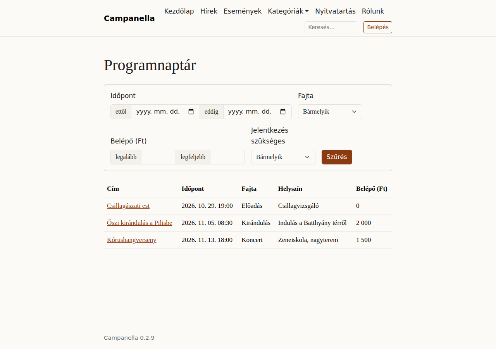

A szűrőkkel a látogató például csak a kirándulásokat nézheti meg:

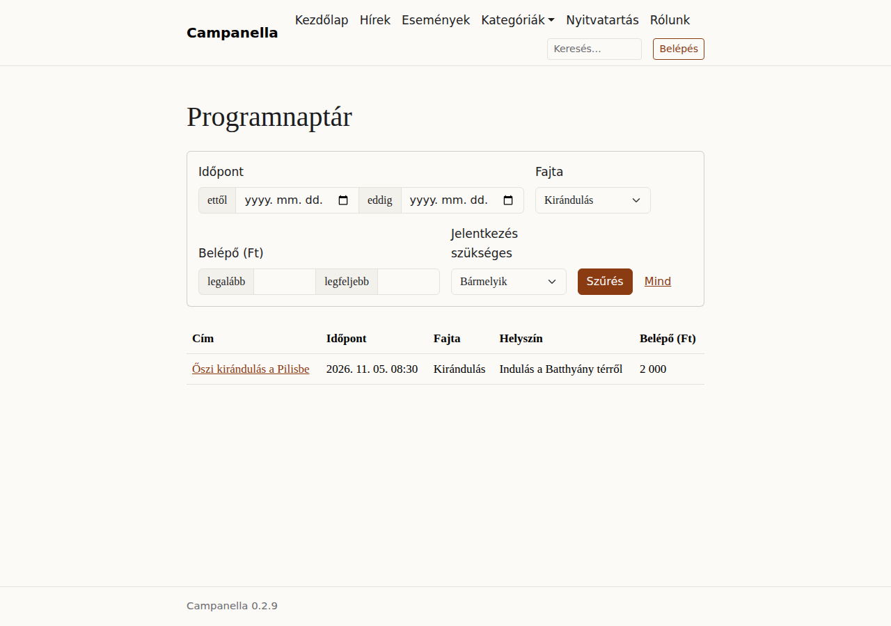

- A szűrt oldal címe tartalmazza a szűrést (például `/programok?f[fajta]=kirandulas`),
  így elküldhető vagy könyvjelzőbe tehető. A lapozás megtartja a szűrést.
- A keresőmotorok a szűrt oldalakat nem listázzák, csak a lista alapoldalát.
- A **Mind** link törli a szűrést.

**A menübe** egy új menüponttal teszed (4. fejezet): **URL**: `/programok`. A
példatartalom **Események** pontja ugyanígy a `/esemenyek` listára mutat.

**A lista neve a sablonokban.** Egy saját téma (fejlesztő) a lista gépi
nevével bármelyik oldalon megjelenítheti, például a címlapon a következő három
programot. Ehhez nem kell útvonal.

## Átvitel egy másik webhelyre

Ha a tartalomtípust és a listát egy tesztoldalon készítetted el, nem kell az
élesen mindent újra beállítanod. A **Rendszer → Tartalommodell** oldalon:

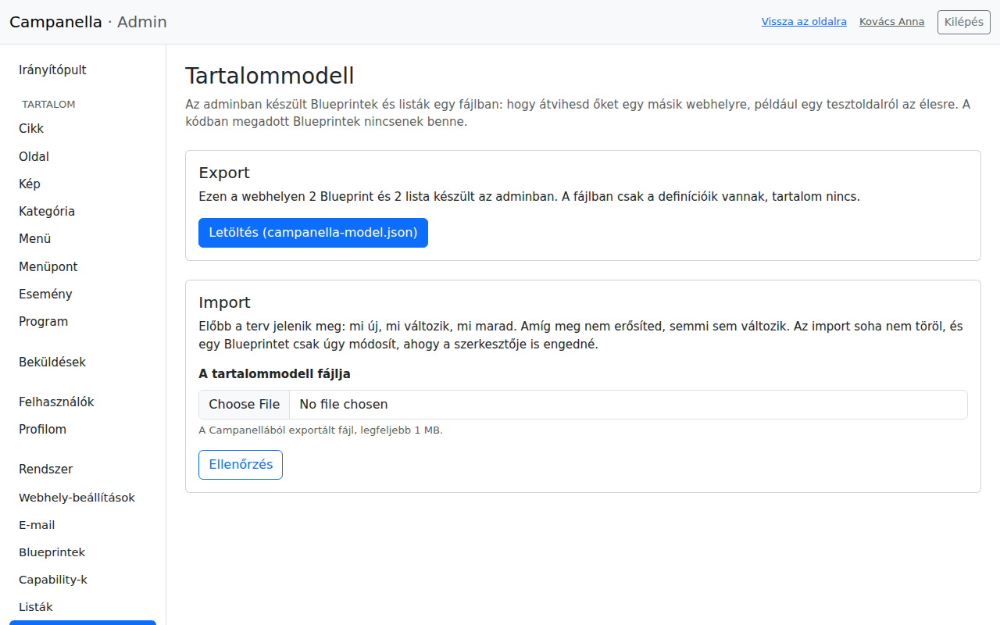

1. A tesztoldalon az **Export** dobozban a **Letöltés** gomb egy fájlt ad
   (`campanella-model.json`): benne az adminban készült összes Blueprint és
   lista beállításai. **Tartalom (programok, cikkek) nincs benne.**
2. Az éles oldalon az **Import** dobozban válaszd ki a fájlt, és kattints az
   **Ellenőrzés** gombra. A Campanella előbb csak megmutatja, mit tenne:

   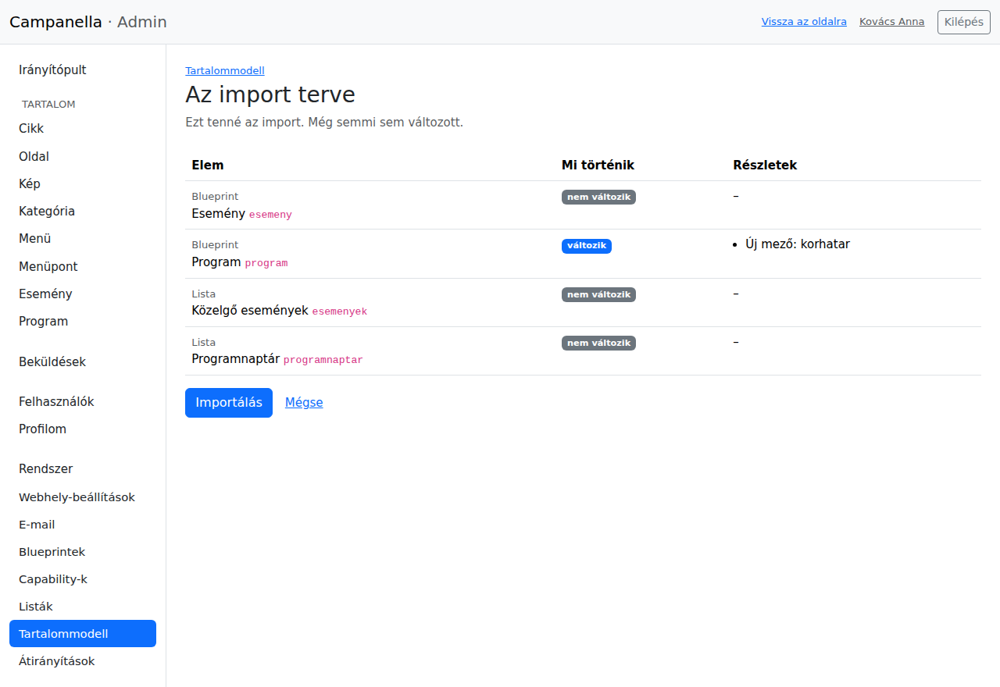

   Itt például a Program egy új mezőt kapna (*korhatar*), a többi nem változik.
   **Amíg nem kattintasz az Importálás gombra, semmi sem változik.**
3. Az **Importálás** elvégzi a tervet. Ha az adatbázis változik, és már vannak
   elemek, előtte mentés készül.

Az import **soha nem töröl**: egy mező, amely az éles oldalon megvan, de a
fájlban nincs, megmarad. Egy Blueprintet csak úgy módosít, ahogy a szerkesztője
is engedné (lásd a mezőknél); ami ennél többet kérne, azt a terv hibaként
jelzi, és akkor semmit sem importál.

## Törlés

- **Egy lista** a beállításai alján törölhető (**Lista törlése**). Az oldala
  megszűnik, a programok megmaradnak. A rá mutató menüpontot is töröld.
- **Egy Blueprint** csak akkor törölhető, ha nincs eleme, nincs rá épülő
  listája, és egy másik Blueprint kapcsolata sem mutat rá: előbb a programokat
  töröld (a Program listában), utána a listát, végül a Blueprintet (az oldala
  alján, **Blueprint törlése**).

A példatartalom Eseményét is így távolítod el: az események, a **Közelgő
események** lista, az **Esemény** Blueprint, és a főmenü **Események** pontja.

## Határok és tanácsok

| | |
|---|---|
| Egy Blueprint saját oszlopai az adminban | legfeljebb 4 |
| Egy lista szűrői | legfeljebb 4 |
| Egy lista feltételei, rendezése | legfeljebb 10 feltétel, 3 rendezési szempont |
| Egy lista oldalanként | legfeljebb 100 elem |
| Választható értékek egy mezőben | legfeljebb 200 |

- **Előbb tervezz, aztán építs.** A gépi nevek később nem változtathatók, és a
  típus csak bővebbre: érdemes papíron végiggondolni a mezőket.
- **Csak azt jelöld szűrhetőnek, amire szűrni vagy rendezni akarsz.** A többi
  mező is megjelenik az űrlapon és az oldalon.
- **Tesztoldalon kísérletezz**, és a kész modellt vidd át az Exporttal.

---

Előző: [10. Ha valami nem működik](10-hibaelharitas.md) ·
[Tartalomjegyzék](README.md)
