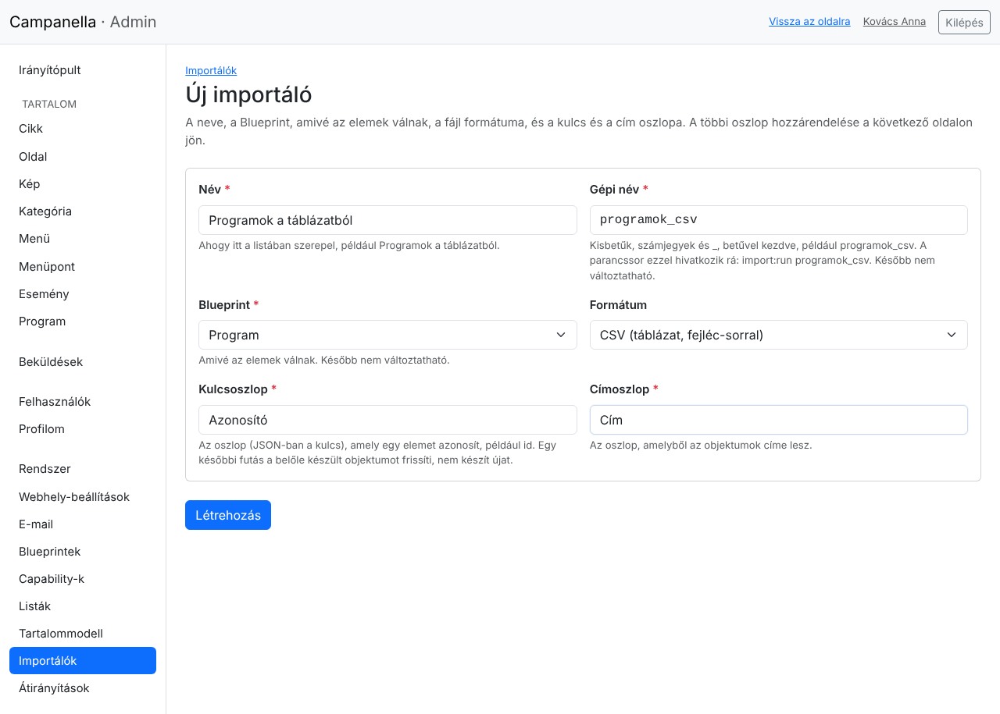
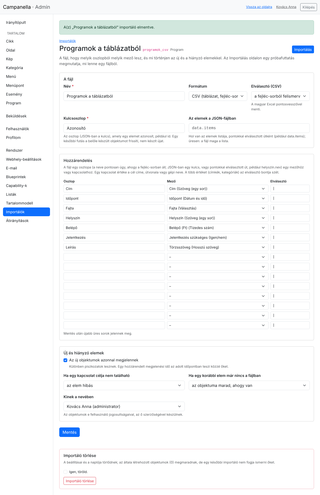
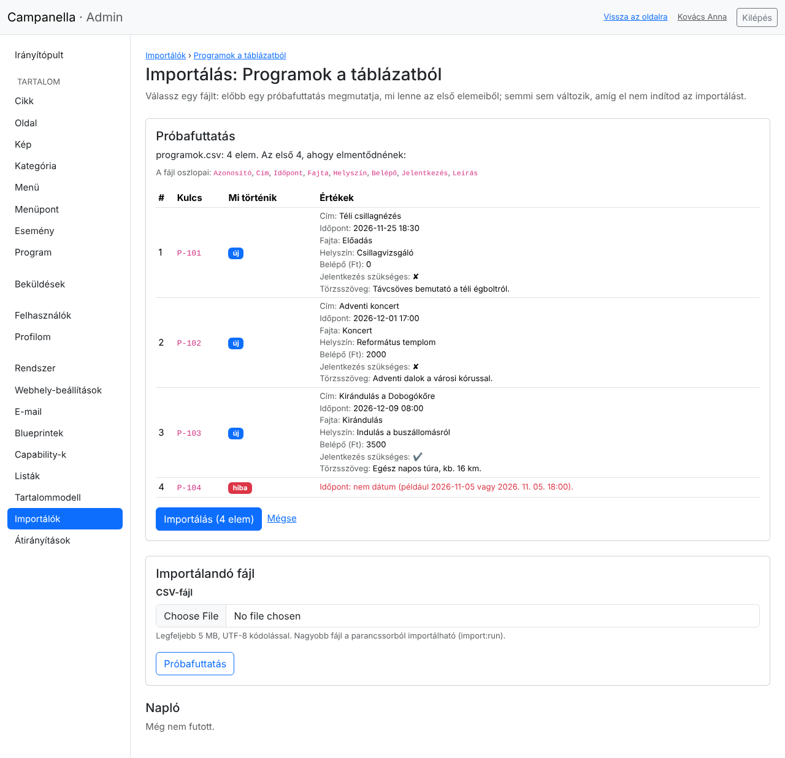
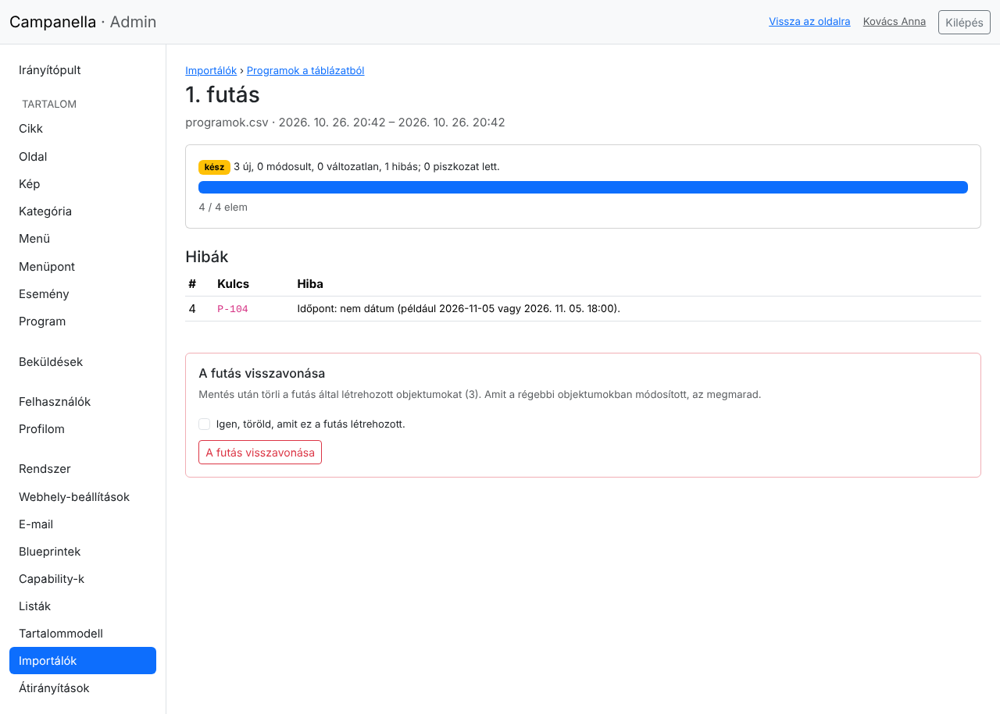
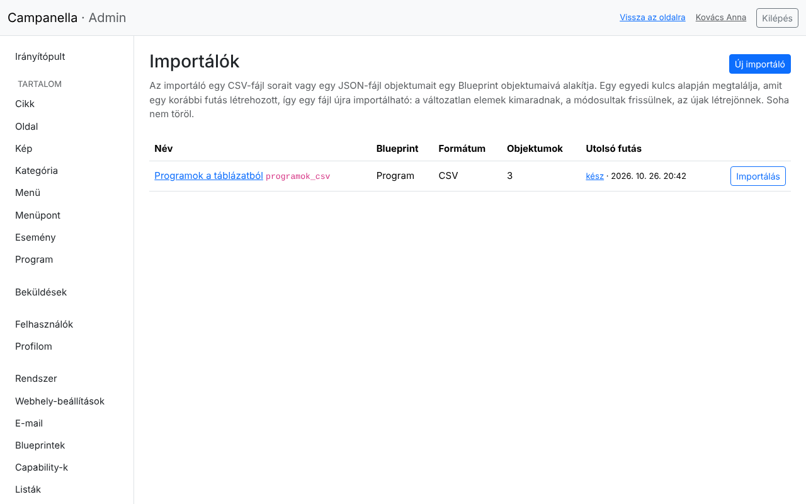

# 12. Importálás táblázatból

Ha a tartalom már megvan valahol, például egy Excel-táblázatban vagy egy másik
rendszer exportjában, nem kell kézzel begépelned: egy **importáló** a fájl
soraiból a webhely elemeit készíti el. Ugyanazt a fájlt (vagy egy frissebb
változatát) később újra importálhatod: ami nem változott, kimarad, ami
megváltozott, frissül, ami új, létrejön.

Ez a fejezet a 11. fejezet programnaptárát folytatja: a programok egy
táblázatból kerülnek fel. Az importálást adminisztrátorként állíthatod be és
indíthatod.

## Mit lehet importálni?

- **CSV-fájlt:** ezt minden táblázatkezelő tudja menteni (az Excelben: *Fájl →
  Mentés másként → CSV UTF-8*). Az első sora a fejléc, az oszlopok nevével.
  Az elválasztó (pontosvessző, vessző vagy tabulátor) magától felismerhető.
- **JSON-fájlt:** egy másik rendszer exportját, objektumok listájával.

A fájl legyen **UTF-8** kódolású (különben az ékezetes betűk elromlanának; az
importáló ilyenkor szól). Az adminban legfeljebb 5 MB-os fájl tölthető fel;
nagyobbat a parancssorból lehet importálni (lásd a fejezet végén).

Egy sor egy elem lesz: egy program, egy cikk, egy termék. Az elemek egy
tartalomtípus (Blueprint) elemei lesznek, a felhasználók, képek és menüpontok
nem importálhatók így.

**Tipp: kezdd az exporttal.** Az admin minden listájánál, jobb fent, a
**CSV-export** gomb letölti a lista elemeit (a keresésével és szűrőivel) egy
olyan CSV-fájlban, amilyet az importáló olvas:


Ennek az oszlopai a mezők gépi nevei (`title`, `idopont` …). Ha táblázatban
szeretnéd szerkeszteni a programokat, töltsd le, írd át vagy bővítsd, és
importáld vissza.

## A táblázat

A példában a táblázat ilyen (pontosvesszővel elválasztva, ahogy a magyar Excel
menti):

```
Azonosító;Cím;Időpont;Fajta;Helyszín;Belépő;Jelentkezés;Leírás
P-101;Téli csillagnézés;2026. 11. 25. 18:30;Előadás;Csillagvizsgáló;0;nem;Távcsöves bemutató.
P-102;Adventi koncert;2026. 12. 01. 17:00;Koncert;Református templom;2 000;nem;Adventi dalok.
```

- **Az azonosító** minden sorban más, és később sem változik. Ebből tudja az
  importáló, hogy egy sor egy korábban már importált programot jelent-e. Lehet
  egy egyszerű sorszám is, csak egyedi legyen.
- **Dátum:** `2026. 11. 25.`, `2026.11.25.` vagy `2026-11-25`; időponttal:
  `2026. 11. 25. 18:30`. Az időpont a webhely időzónájában értendő.
- **Szám:** szóközzel és tizedesvesszővel is jó (`2 000`, `1 234,5`).
- **Igen/nem:** `igen` vagy `nem` (vagy `1`, `0`, `x`).
- **Választás:** a címkéje (`Koncert`) vagy a kulcsa (`koncert`).
- **Több érték** (például címkék, kategóriák): egy cellában, elválasztóval:
  `zene|gyerek`.
- **Kapcsolat** (például egy kategória): a cél **címe** (vagy útvonala). Ha
  nincs ilyen, az importáló beállítása dönti el, mi történjen (lent).
- **Formázott szöveg:** HTML-ként, vagy egyszerű szövegként, ami bekezdésekké
  alakul. Mentéskor itt is minden átszűrődik, ahogy az adminban.

## Új importáló

A **Rendszer → Importálók** oldalon az **Új importáló** gombbal:



- **Név:** ahogy a listában szerepel.
- **Gépi név:** `programok_csv`. A parancssor ezzel hivatkozik rá; később nem
  változtatható.
- **Blueprint:** amivé a sorok válnak, itt a *Program*.
- **Formátum:** CSV vagy JSON.
- **Kulcsoszlop:** az azonosító oszlopa, pontosan úgy, ahogy a fejlécben áll:
  `Azonosító`.
- **Címoszlop:** amiből a programok címe lesz: `Cím`.

## Melyik oszlopból mi lesz

A **Létrehozás** után az importáló beállításai jönnek. A **Hozzárendelés**
részben minden sorban egy oszlop nevét (bal oldalt) egy mezőhöz rendeled
(jobb oldalt):



- Az oszlop nevét pontosan úgy írd, ahogy a fejléc-sorban áll (a kis- és
  nagybetű is számít).
- Egy mezőt csak egy oszlophoz rendelhetsz. Amit nem rendelsz hozzá, az nem
  változik.
- A **Publikálás ideje** mezőt is hozzárendelheted: ilyenkor az elem a
  megadott időpontban jelenik meg.
- Ha elfogytak az üres sorok, ments: újak jelennek meg.

Alatta:

- **Az új objektumok azonnal megjelennek:** különben piszkozatként kerülnek
  fel, és egyenként teheted közzé őket.
- **Ha egy kapcsolat célja nem található** (például nincs ilyen című
  kategória): az elem legyen hibás (ez a biztonságos), importálódjon e kapcsolat
  nélkül, vagy jöjjön létre a cél (egy új kategória az értékkel mint címmel).
- **Ha egy korábbi elem már nincs a fájlban:** az objektuma maradjon, ahogy
  van, vagy legyen piszkozat (így eltűnik a webhelyről, de nem törlődik). Az
  importáló **soha nem töröl**.
- **Kinek a nevében:** az elemek e felhasználó jogosultságaival és szerzőként
  készülnek. Egy letiltott felhasználó nevében az importáló nem fut.

## Próbafuttatás és importálás

A jobb felső **Importálás** gombbal (vagy a listából) az importálás oldalára
jutsz. Válaszd ki a fájlt, és kattints a **Próbafuttatás** gombra. Ez még
**semmit sem változtat**, csak megmutatja, mi lenne az első tíz sorból:



- Az **új** sorokból új program lesz, a **változik** sorok egy korábban
  importált programot frissítenek, a **nem változik** sorok kimaradnak.
- A **hiba** sorok kimaradnak, mellettük a hiba oka: itt a negyedik sor
  időpontja („jövő héten”) nem dátum.
- Ha a fájlban egy hozzárendelt oszlop nincs meg, a lap tetején figyelmeztetés
  jelzi (például elírt oszlopnév).

Ha minden rendben, az **Importálás** gomb elindítja. Az importálás szakaszokban
halad, amíg az oldala nyitva van (egy nagy fájl is, a szerver terhelése
nélkül); a végén a napló:



- Hány elem lett új, módosult, maradt változatlan vagy volt hibás, és hány
  lett piszkozat.
- A hibák soronként, a sor számával és kulcsával: javítsd őket a táblázatban,
  és importáld újra. A már rendben lévő sorok ilyenkor változatlanként
  kimaradnak.
- **A futás visszavonása** (mentés után) törli azokat a programokat, amelyeket
  ez a futás hozott létre. Amit régebbi programokban módosított, az megmarad.

Ha közben bezárod az oldalt, a futás megáll ott, ahol tart; az oldalát újra
megnyitva (a naplóból) folytatódik. A **Leállítás** gomb befejezi: amit addig
elvégzett, megmarad.

Az importálók listája az utolsó futásukat is mutatja:



## Rendszeres importálás a parancssorból

Ha egy fájl rendszeresen frissül (például egy másik rendszer minden éjjel
lementi), a tárhely ütemezett feladata (cron) futtathatja az importálót:

```
php bin/campanella import:run programok_csv /utvonal/programok.csv --yes
```

A `--yes` nélkül csak a próbafuttatást írja ki. A parancssorból bármekkora fájl
importálható, és egy futás a `php bin/campanella import:undo <futás száma> --yes`
paranccsal vonható vissza. Az importálás soha nem indul egy látogató kérésére:
a látogatók oldala ettől nem lassul.

## Ha valami nem úgy megy

| Jelenség | Ok, teendő |
|---|---|
| „A fájl nem UTF-8 szöveg” | Mentsd a táblázatot *CSV UTF-8* formátumban. |
| „A fájlban nincs … nevű oszlop” | Az oszlop neve a fejlécben máshogy áll (szóköz, ékezet, kis- és nagybetű). Írd át a hozzárendelésben vagy a táblázatban. |
| Minden sor „új”, pedig már importáltad | Megváltozott az azonosító oszlop, vagy másik importálóval importáltad. Az importáló a saját korábbi futásait ismeri. |
| „… nincs „…” nevű objektum” | A kapcsolat célja (például egy kategória) nem létezik ezen a címen. Hozd létre, javítsd a nevet, vagy állítsd be, hogy az importáló hozza létre. |
| Egy cella elején `'` jel áll az exportban | Az `=`, `+`, `-` vagy `@` jellel kezdődő szöveg elé a CSV-export egy aposztrófot tesz, hogy a táblázatkezelő ne képletként futtassa le. |

---

Előző: [11. Saját tartalomtípusok](11-sajat-tartalomtipusok.md) ·
[Tartalomjegyzék](README.md)
