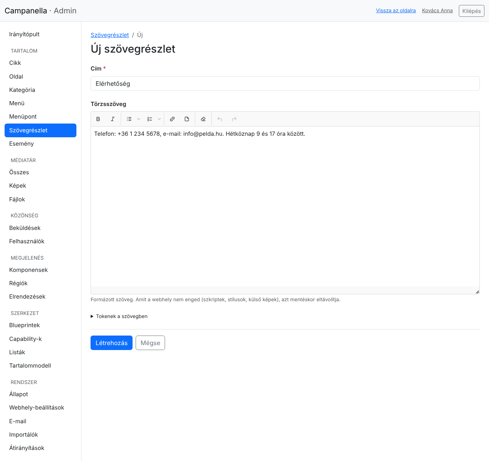
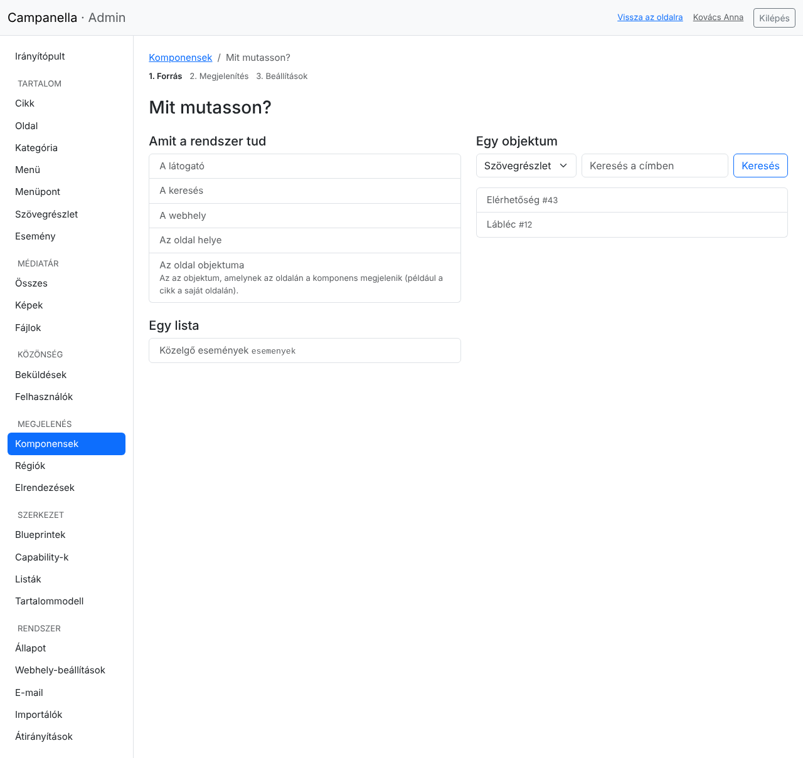
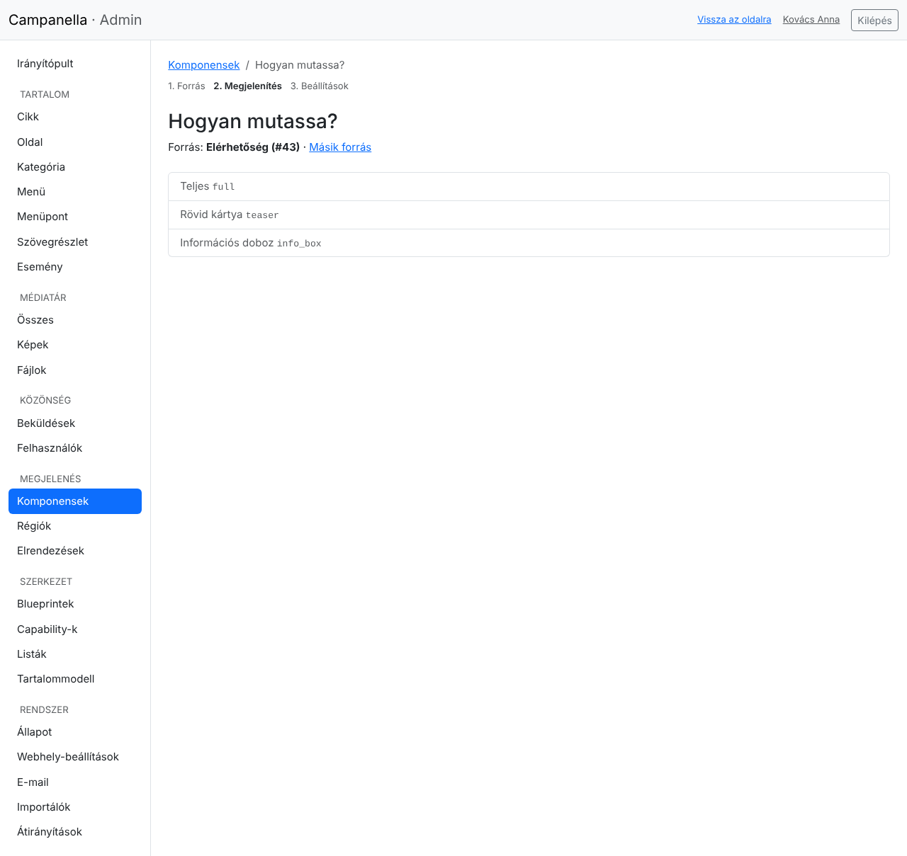
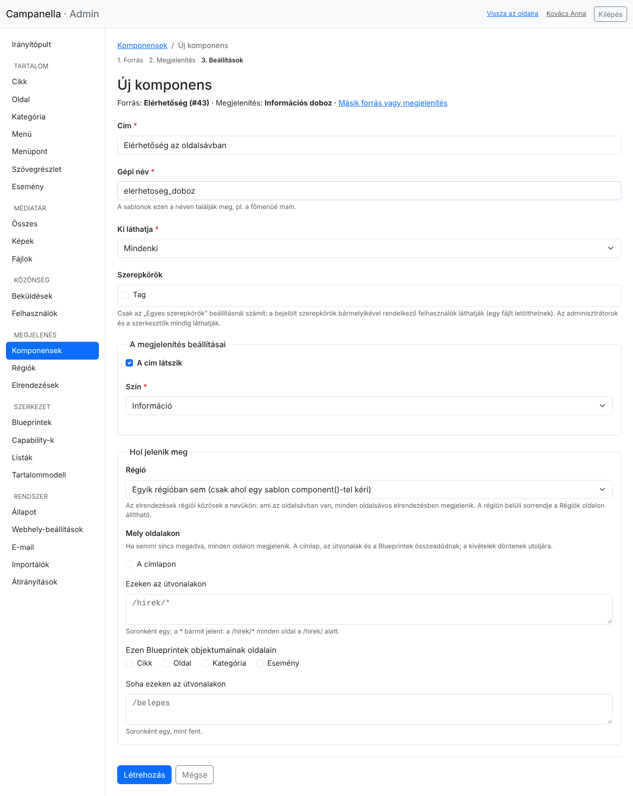
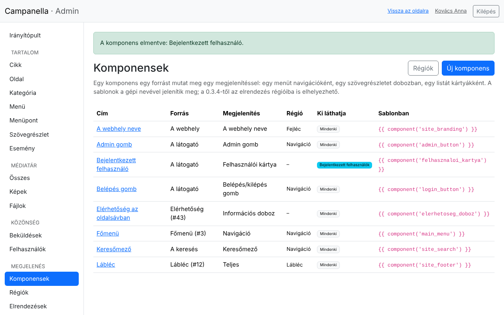

# 13. Komponensek

Egy **komponens** megmutat valamit a webhelyen: egy menüt navigációként, egy
rövid szöveget (például az elérhetőséget) egy dobozban, egy lista legújabb
elemeit kártyákként, vagy a látogatónak egy belépés gombot. Minden komponens
három dologból áll:

- **a forrásból:** mit mutat (egy szövegrészlet, egy menü, egy lista, a
  látogató …);
- **a megjelenítésből:** hogyan mutatja (dobozban, navigációként, kártyákként
  …);
- **a megjelenítés beállításaiból:** például a doboz színe, vagy hány elemet
  mutasson egy lista.

Komponenst csak az adminisztrátorok készíthetnek és módosíthatnak: hogy mi
jelenjen meg a webhelyen, az a szerkesztőknél magasabb jog. A szerkesztők azt
módosíthatják, amit a komponens mutat (a szövegrészletet, a menüt).

> **Hol jelenik meg egy komponens?** Az elrendezés valamelyik **régiójában**
> (fejléc, navigáció, oldalsáv, lábléc …): ezt az űrlapján választod ki, a
> sorrendjét a **Megjelenés → Régiók** oldalon állítod (14. fejezet). Vagy ott,
> ahol a téma sablonja a **gépi nevével** meghívja (lent).

## Szövegrészlet: a rövid szövegek

Egy rövid szöveg, amit egy komponens mutat (nyitvatartás, elérhetőség, egy
közlemény), **szövegrészlet**. Ez egy tartalomtípus címmel és formázott
szöveggel, de saját oldala nincs: csak ott látszik, ahol egy komponens
megmutatja.

A **Tartalom → Szövegrészlet → Új** gombbal írsz egyet, mint egy cikket:



## Új komponens, három lépésben

A **Megjelenés → Komponensek** oldalon az **Új komponens** gombbal.

**1. Mit mutasson?**



| Forrás | Mire jó? |
|---|---|
| **A látogató** | A belépés gomb, az admin gomb (csak annak, aki beléphet az adminba), a belépési űrlap, vagy a bejelentkezett felhasználó kártyája. |
| **A keresés** | Egy keresőmező. |
| **A webhely** | A webhely neve és szlogenje. |
| **Az oldal helye** | A morzsamenü: a kezdőlap, a kategóriák, maga az oldal. |
| **Az oldal objektuma** | Az, amelynek az oldalán a komponens megjelenik: például a cikk a saját oldalán. |
| **Egy lista** | Egy, a **Szerkezet → Listák** oldalon készült lista (11. fejezet), például a közelgő események. |
| **Egy objektum** | Egy szövegrészlet, egy menü, egy kép, egy fájl, egy oldal …: válaszd ki a tartalomtípust, és keress a címében. |

**2. Hogyan mutassa?** Csak azok a megjelenítések jönnek fel, amelyek a forrást
meg tudják mutatni: egy menühöz a navigáció, egy fájlhoz a letöltés, egy
listához a kártyák és a táblázat.



| Megjelenítés | Mit mutat? |
|---|---|
| **Teljes**, **Rövid kártya** | Egy tartalmat teljes egészében, vagy röviden, a címével és a bevezetőjével. |
| **Hivatkozás** | Egy link az oldalára. |
| **Információs doboz** | A címét és a szövegét egy színes keretben: ez illik a szövegrészletekhez. |
| **Navigáció** | Egy menüt vízszintes sávként vagy függőleges listaként. |
| **Kép**, **Letöltés** | Egy képet, vagy egy fájl letöltési linkjét a típusával és a méretével. |
| **Kártyák**, **Táblázat** | Egy lista első elemeit. |
| **Belépés/kilépés gomb**, **Admin gomb**, **Belépési űrlap**, **Felhasználói kártya** | A látogatónak. |
| **Keresőmező**, **A webhely neve**, **Morzsamenü** | A keresést, a webhely nevét, az oldal helyét. |

**3. A komponens adatai és a beállítások**



- **Cím:** csak az adminban látszik, hogy megtaláld.
- **Gépi név:** kisbetűk, számok és aláhúzás (például `elerhetoseg_doboz`). A
  sablonok ezen a néven hívják. Nem lehet ugyanaz, mint egy menüé.
- **Ki láthatja:** mindenki, csak a bejelentkezett felhasználók, vagy egyes
  szerepkörök (5. fejezet). Akinek nem szól, annak a komponens nem jelenik meg.
- **A megjelenítés beállításai:** a választott megjelenítéstől függnek. Egy
  információs doboznál a cím és a szín, egy listánál az elemek és az oszlopok
  száma.
- **Hol jelenik meg** (0.3.4-től): a **régió**, és hogy mely oldalakon: a
  címlapon, adott útvonalakon, egyes tartalomtípusok oldalain, kivéve néhány
  útvonalat. Lásd a [14. fejezetet](14-elrendezesek.md#hol-jelenjen-meg).

A **Létrehozás** gombbal mented. Később a listában a címére kattintva
módosítod; a **Másik forrás vagy megjelenítés** linkkel újra végigmész a
lépéseken.

## A komponensek listája



A lista megmutatja, mit mutat és hogyan az egyes komponens, kinek, és hogy a
sablonban hogyan hívható. Ha egy komponens **nem működik**, piros jelzés áll
mellette, az okával: például törölték a menüt, amit mutatott. Ilyenkor a
webhelyen nem jelenik meg semmi a helyén; válassz neki másik forrást, vagy
töröld.

Egy komponens törlése nem törli azt, amit mutatott (a szövegrészlet, a menü
megmarad).

## Egy komponens a sablonban

Egy régióba nem tett komponens ott jelenik meg, ahol a téma sablonja meghívja
a gépi nevével. Ezt az, aki a témát készíti, egy sorral teszi meg:

```twig
{{ component('elerhetoseg_doboz') }}
```

Ha nincs ilyen komponens, vagy a látogató nem láthatja, a helye üres marad: az
oldal nem romlik el. A témák készítőinek szóló leírás:
[PHP API, 28. fejezet](../../php-api/28-displays.md).

---

Előző: [12. Importálás táblázatból](12-importalas.md) ·
Következő: [14. Elrendezések és régiók](14-elrendezesek.md) ·
[Tartalomjegyzék](README.md)
