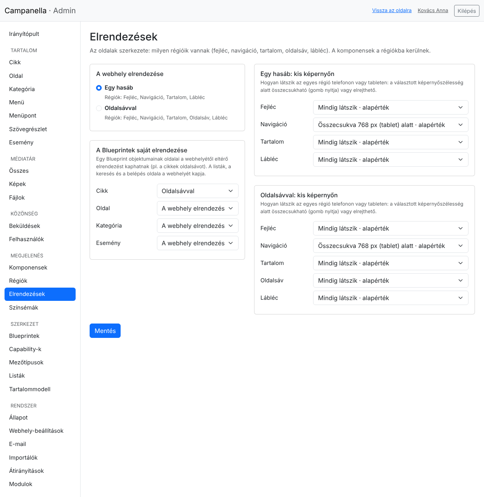
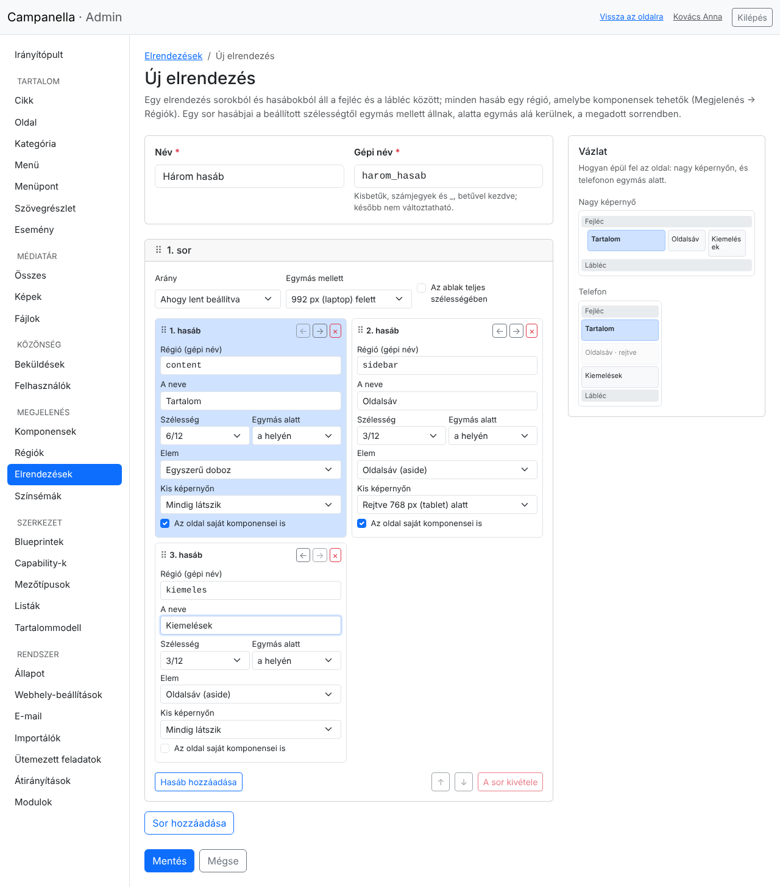
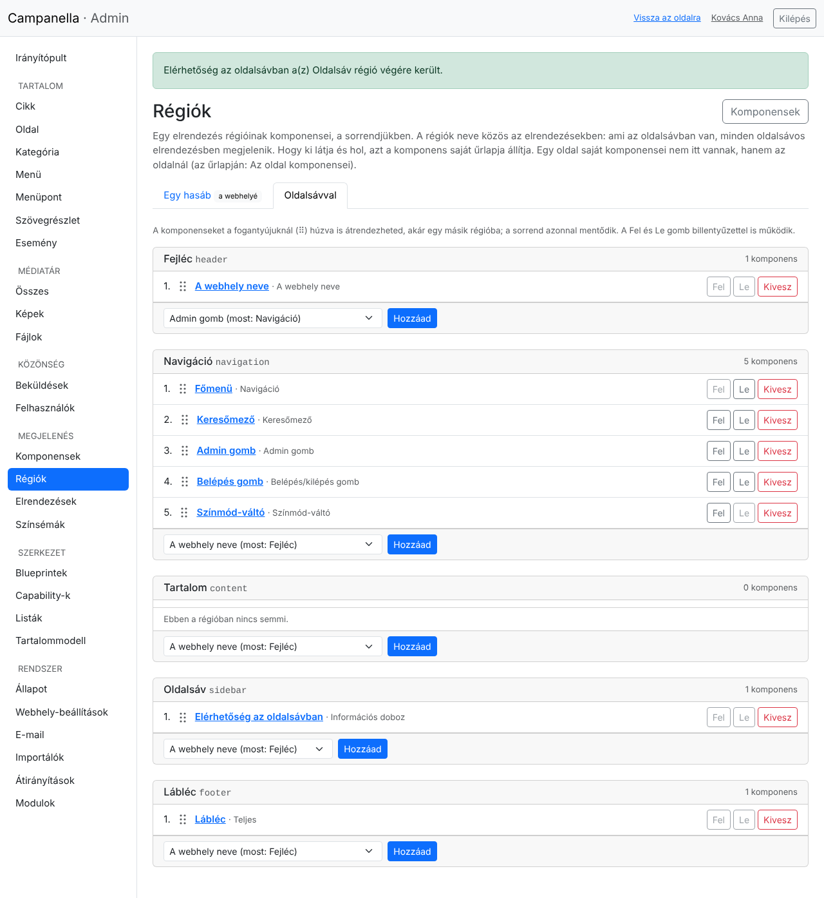
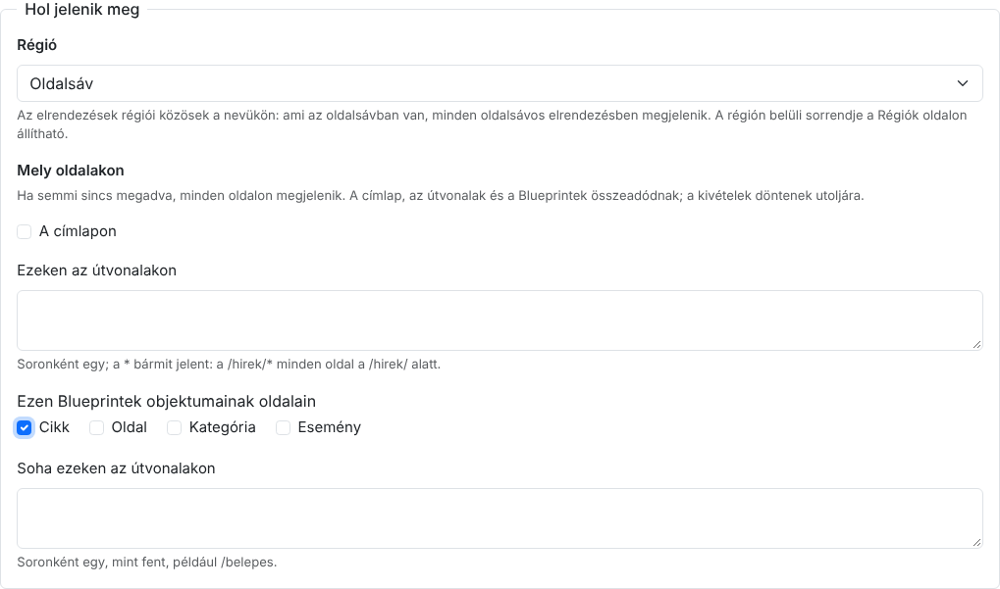
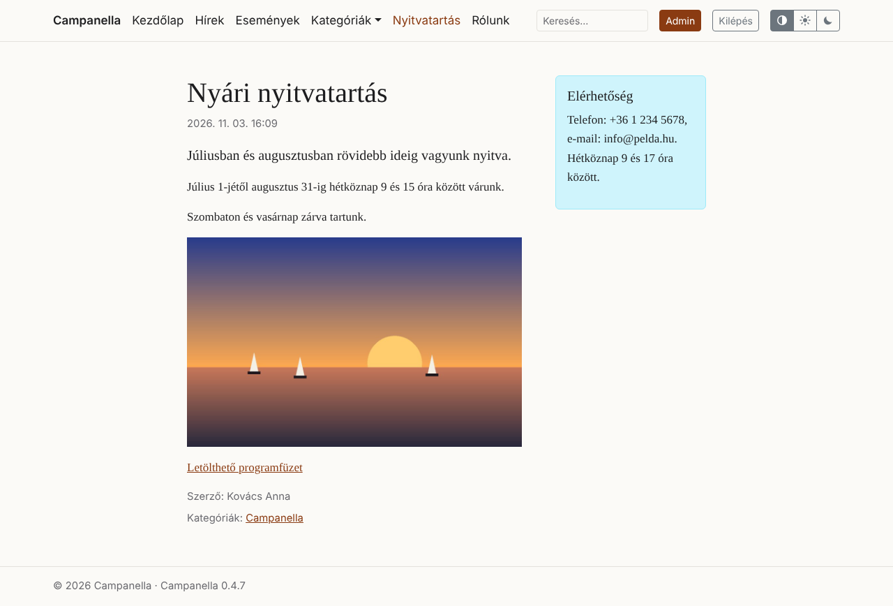

# 14. Elrendezések és régiók

Egy oldal **elrendezése** a szerkezete: milyen részekből, **régiókból** áll, és
azok hol vannak. A régiókba **komponensek** kerülnek (13. fejezet), egymás alá,
a sorrendjükben. A Campanellában két elrendezés van:

| Elrendezés | Régiói |
|---|---|
| **Egy hasáb** (az alapértelmezett) | Fejléc, Navigáció, Tartalom, Lábléc |
| **Oldalsávval** | Ugyanezek, és egy **Oldalsáv** a tartalom mellett (kisebb képernyőn alatta) |

A témák további elrendezéseket hozhatnak; ezek az adminban ugyanígy
választhatók. Az oldal saját tartalma (a cikk, a lista, a keresés találatai)
mindig a **Tartalom** régió elején van; amit oda teszel, az alatta jelenik meg.

## A fejléc és a lábléc

A 0.3.4-től a webhely fejléce és lábléce is komponensekből áll. A telepítés és
a 0.3.4-re frissítés ezeket elkészíti, úgy, ahogy a fejléc addig kinézett:

| Régió | Komponens | Mit mutat? |
|---|---|---|
| Fejléc | **A webhely neve** | A webhely nevét, a címlapra mutató linkként. |
| Navigáció | **Főmenü** | A főmenüt (4. fejezet). |
| | **Keresőmező** | A keresést (3. fejezet). |
| | **Admin gomb** | Csak annak, aki beléphet az adminba. |
| | **Belépés gomb** | Belépés, bejelentkezve kilépés. |
| Lábléc | **Lábléc** | Egy szövegrészletet: © 2026 Campanella · Campanella 0.3.4. |

Ezeket ugyanúgy módosíthatod, mint bármelyik komponenst: a **Megjelenés →
Komponensek** listában a címükre kattintva. A lábléc szövegét a **Tartalom →
Szövegrészlet** listában, a *Lábléc* szövegrészletnél írod át. A benne lévő
szögletes zárójeles **tokenek** helyén megjelenéskor az értékük áll:

| Token | Mivé lesz? |
|---|---|
| `[site:name]` | A webhely neve (**Rendszer → Webhely-beállítások**). |
| `[site:slogan]` | A webhely szlogenje. |
| `[site:url]` | A webhely címe. |
| `[date:year]` | Az aktuális év. |
| `[campanella:version]` | A Campanella verziója. |

A szövegrészlet szerkesztője alatt a **Tokenek a szövegben** részt kinyitva
ezeket mindig látod.

> Ha egy régióból kiveszel mindent, az a rész üres marad: üres lábléc nem
> jelenik meg. A komponensek a **Komponensek** listában megmaradnak, bármikor
> visszateheted őket.

## Az elrendezés kiválasztása

A **Megjelenés → Elrendezések** oldalon:

- **A webhely elrendezése:** ezt kapja minden oldal, amelynek nincs sajátja.
- **A Blueprintek saját elrendezése:** egy tartalomtípus oldalai (például a
  cikkek) a webhelyétől eltérő elrendezést kaphatnak. Itt a cikkek kapják az
  **Oldalsávval** elrendezést. A listák, a keresés és a belépés oldala a
  webhelyét kapja.
- **Kis képernyőn:** régiónként beállíthatod, hogyan látszik telefonon vagy
  tableten. **Mindig látszik**; **összecsukva** egy szélesség alatt (egy
  gombbal nyílik, mint a navigáció); vagy **rejtve** egy szélesség alatt. Az
  *alapérték* az elrendezés saját beállítása.

A **Mentés** gombbal érvényesek a webhelyen.

## Saját elrendezés

Saját elrendezést is készíthetsz, programozás nélkül: sorokból és hasábokból,
a fejléc és a lábléc között. Minden hasáb egy **régió**, amelybe komponenseket
tehetsz, ugyanúgy, mint a beépített elrendezések régióiba.

A **Megjelenés → Elrendezések** oldal tetején láthatod az összes elrendezést,
egy kis vázlattal, és azzal, hogy hol használják őket. Az **Új elrendezés**
gombbal üresen kezdhetsz, a **Másolat** gombbal egy meglévő elrendezésből
(például az Oldalsávvalból).

- **Név** és **gépi név:** a gépi név később nem változtatható, és nem lehet
  egy beépített elrendezés neve.
- **Sorok:** minden sornál beállíthatod:
  - az **arányt** (például 2/3 – 1/3, vagy három egyforma hasáb); a választás
    ennyi hasábot ad a sornak, a megfelelő szélességekkel;
  - hogy milyen képernyőszélességtől álljanak a hasábok **egymás mellett**
    (alatta egymás alá kerülnek);
  - hogy a sor **az ablak teljes szélességében** legyen-e (például egy kiemelt
    sáv).
- **Hasábok:** mindegyiknél:
  - a **régió** gépi neve és a neve; egy már meglévő régió nevét választva az
    oda tett komponensek itt is megjelennek;
  - a **szélesség** (12-ből);
  - a helye **egymás alatt**, kis képernyőn (például az oldalsáv a tartalom
    fölé kerülhet);
  - hogy **oldalsáv** legyen-e (a felolvasóprogramok így ismerik fel) vagy
    egyszerű doboz;
  - hogyan látsszon **kis képernyőn** (mindig, összecsukva vagy rejtve);
  - hogy **az oldal saját komponensei** is kerülhetnek-e bele (15. fejezet).
- A sorokat és a hasábokat a **⠿** fogantyúval áthúzhatod, vagy a nyilakkal
  mozgathatod. Ugyanitt vehetsz fel újat, vagy vehetsz ki egyet.
- A **Vázlat** megmutatja az elrendezést nagy képernyőn és telefonon, és minden
  módosításra frissül.

A **tartalom** (`content`) régiónak pontosan egyszer szerepelnie kell: ide kerül
az oldal saját tartalma. A fejléc, a navigáció és a lábléc mindig ott van,
felül és alul. A **Mentés** után az elrendezés választható a webhelynek vagy egy
tartalomtípusnak, ugyanazon az oldalon lejjebb.

Egy saját elrendezés addig nem törölhető, amíg a webhely vagy egy tartalomtípus
használja. Törléskor a régióiba tett komponensek megmaradnak.

## A régiók és a komponensek sorrendje

A **Megjelenés → Régiók** oldalon egy elrendezés régióit látod, mindegyikben a
komponenseit, a sorrendjükben. A fülekkel válthatsz az elrendezések között.

- **Húzás:** egy komponenst a bal szélén lévő fogantyújánál (⠿) megfogva
  feljebb vagy lejjebb húzhatsz, akár egy másik régióba is; elengedve a sorrend
  azonnal mentődik („A sorrend mentve.”). Érintőképernyőn is működik.
- **Fel**, **Le:** ugyanez gombokkal, egy hellyel (billentyűzettel is). A
  navigációban például a menü után jön a kereső, aztán a gombok.
- **Kivesz:** a komponens kikerül a régióból, de megmarad (a Komponensek
  listában).
- **Hozzáad:** a régió alján választhatsz egy komponenst; a régió végére kerül.
  Ha addig másik régióban volt, a lista azt is mutatja („most: Fejléc”), és
  onnan átkerül.

A régiók neve közös az elrendezésekben: ami az **Oldalsáv** régióban van, az
minden oldalsávos elrendezésben megjelenik, ami a **Fejléc**-ben, az mindegyikben.

## Hol jelenjen meg?

Egy komponens űrlapján, a **Hol jelenik meg** részben (13. fejezet):

- **Régió:** melyikben legyen. *Egyik régióban sem:* csak ott jelenik meg, ahol
  a téma sablonja a gépi nevével meghívja.
- **Mely oldalakon:** ha semmi sincs megadva, mindenhol.
  - **A címlapon:** a címlapon.
  - **Ezeken az útvonalakon:** soronként egy, `/`-rel kezdve. A `*` bármit
    jelent: a `/hirek/*` minden oldal a `/hirek/` alatt (maga a `/hirek` nem).
  - **Ezen Blueprintek objektumainak oldalain:** például minden cikk oldalán.
  - **Soha ezeken az útvonalakon:** a kivételek, ugyanígy soronként.

  A címlap, az útvonalak és a Blueprintek összeadódnak: elég, ha az oldal az
  egyiknek megfelel. A kivételek mindig döntenek. Hogy **ki** láthatja, azt a
  komponens **Ki láthatja** mezője mondja meg (mindenki, a bejelentkezettek,
  egyes szerepkörök).

Az *Elérhetőség* doboz itt az oldalsávba került, csak a cikkek oldalain:

## Ha valami nem úgy jelenik meg

| Jelenség | Ok és teendő |
|---|---|
| Egy komponens nem látszik | Nincs régióban (az űrlapján), az oldal nem felel meg a feltételeinek (**Mely oldalakon**), vagy a látogató nem láthatja (**Ki láthatja**). Az is lehet, hogy az oldal elrendezésében nincs olyan régió (például oldalsáv az *Egy hasáb* elrendezésben). |
| Az oldalsáv üres, nem látszik | Az oldal elrendezése *Egy hasáb*: a **Megjelenés → Elrendezések** oldalon adj az oldal tartalomtípusának *Oldalsávval* elrendezést. |
| Elfogyott a fejléc, nincs menü | A *Főmenü* komponenst kivették a régióból: a **Régiók** oldalon tedd vissza a Navigáció régióba. Ha törölték, készíts egy újat: forrás a *Főmenü*, megjelenítés a *Navigáció*. |
| A lábléc régi szöveget mutat | A lábléc a *Lábléc* szövegrészlet: azt írd át. |
| Telefonon nem látszik egy rész | A régió kis képernyőn rejtve van: a **Megjelenés → Elrendezések** oldalon állítsd *Mindig látszik*-ra vagy *összecsukva*-ra. |

A témák készítőinek szóló leírás:
[PHP API, 29. fejezet](../../php-api/29-layouts.md).

---

Előző: [13. Komponensek](13-komponensek.md) ·
Következő: [15. Oldalak komponensekből](15-oldalak.md) · [Tartalomjegyzék](README.md)
