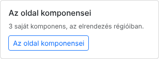
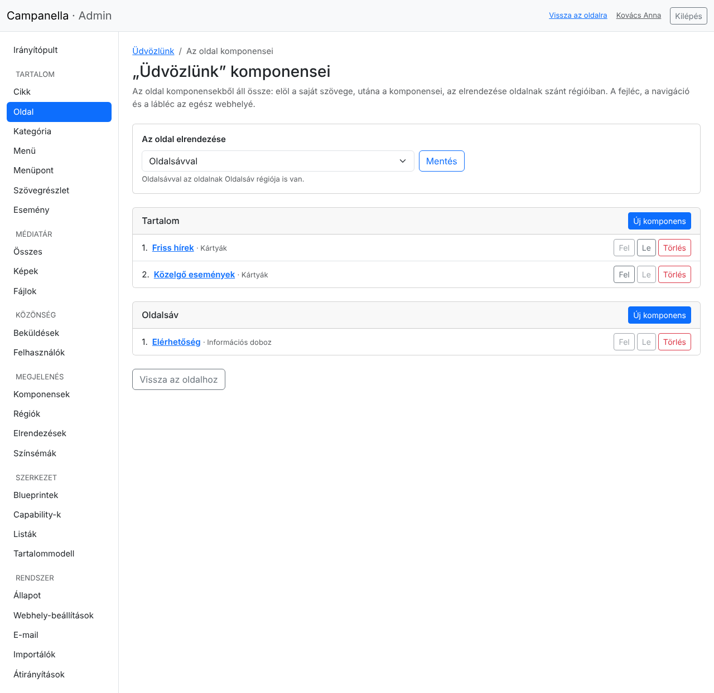
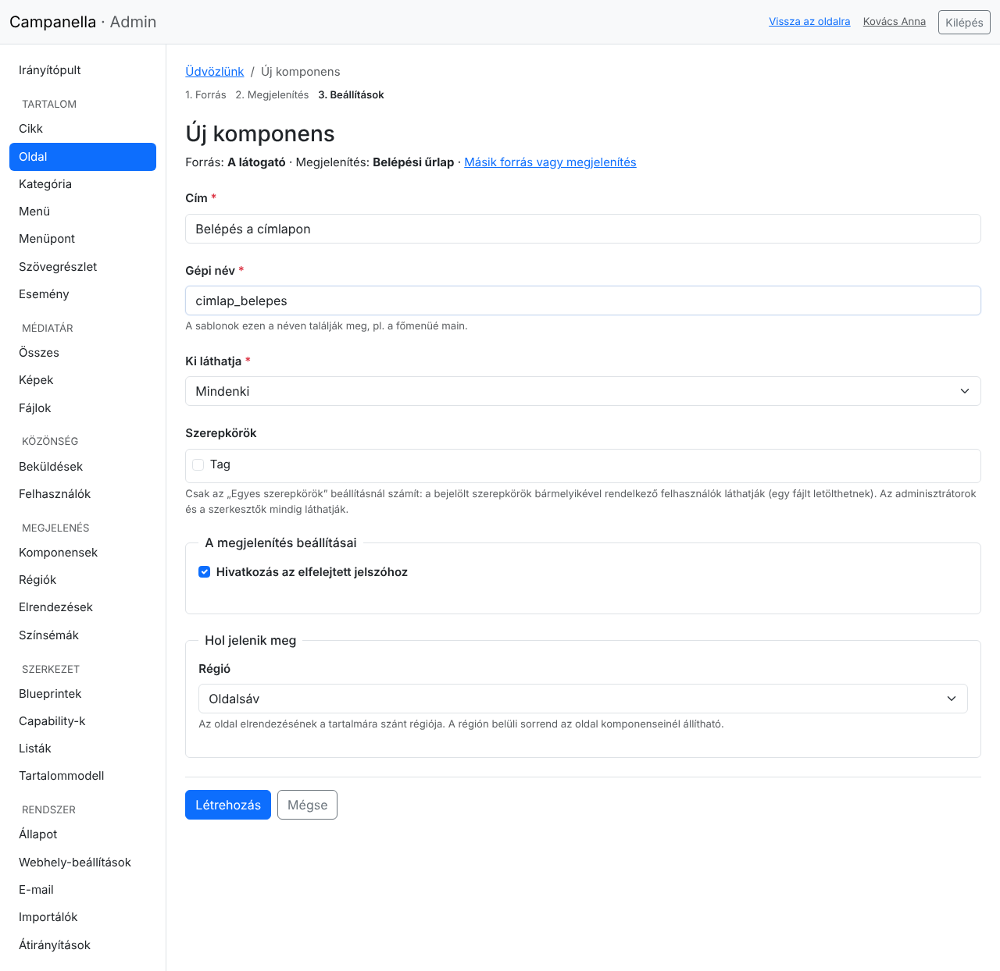
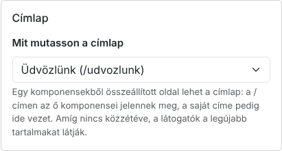
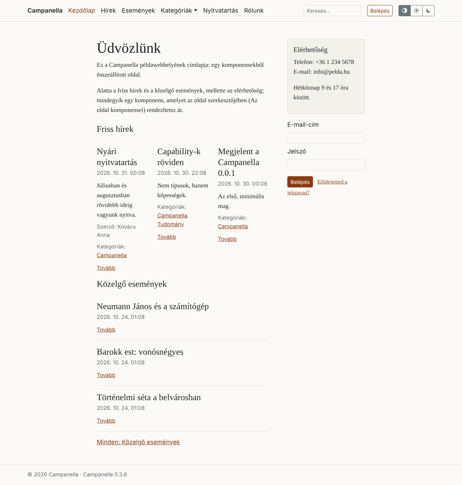

# 15. Oldalak komponensekből

Egy **oldal** (például a *Rólunk* vagy a címlap) nemcsak szöveg lehet: a
szövege alá és mellé **saját komponensei** kerülhetnek, például a legújabb
hírek kártyákként, a közelgő események, egy elérhetőség-doboz vagy egy
belépési űrlap. Ezek csak azon az oldalon jelennek meg, és a **szerkesztők is**
összeállíthatják, nem csak az adminisztrátorok.

Mi a különbség a 14. fejezet komponenseitől?

| | A webhely komponensei (14. fejezet) | Egy oldal saját komponensei |
|---|---|---|
| Hol jelennek meg? | Minden oldalon (vagy ahol a feltételeik mondják), a fejlécben, a navigációban, a láblécben, az oldalsávban … | Csak a saját oldalukon, a szövege után |
| Melyik régióban? | Bármelyikben | Csak az oldal tartalmára szántakban: **Tartalom**, és oldalsávos elrendezésben **Oldalsáv** |
| Ki kezeli őket? | Az adminisztrátorok (**Megjelenés → Régiók**) | Mindenki, aki az oldalt szerkesztheti, a szerkesztők is (az oldal űrlapján) |

## Az oldal komponensei

Egy oldal űrlapján, jobb oldalt, **Az oldal komponensei** kártya mutatja, hány
saját komponense van:

Az **Az oldal komponensei** gombbal nyílik meg az oldal saját komponenseinek
oldala:

- **Az oldal elrendezése:** *a tartalomtípusáé* (a **Megjelenés →
  Elrendezések** oldalon beállított, 14. fejezet), vagy egy saját. Az
  **Oldalsávval** elrendezésben az oldalnak **Oldalsáv** régiója is van.
- **A régiók:** mindegyikben az oldal komponensei, a sorrendjükben. **Fel**,
  **Le:** a sorrendjük; **Törlés:** a komponens törlése (amit mutatott, például
  egy szövegrészlet, megmarad).
- A címére kattintva egy komponens űrlapja nyílik meg: itt a címét, ki
  láthatja, a megjelenítés beállításait (például hány kártya, hány oszlopban)
  módosítod.

## Új komponens egy oldalnak

Egy régió **Új komponens** gombjával, ugyanabban a három lépésben, mint a 13.
fejezetben: mit mutasson, hogyan, és a beállításai.

A **Hol jelenik meg** részben csak a régiót választod (az oldal elrendezésének
tartalomra szánt régiói közül); feltételek nincsenek, mert a komponens csak a
saját oldalán jelenik meg. A **Létrehozás** gombbal visszakerülsz az oldal
komponenseihez, és az új komponens a régió végére kerül.

> **Szerkesztőként** az oldal komponenseit kezelheted, a webhelyéit nem: a
> **Megjelenés** menü nem látszik, és egy webhely-komponens űrlapja sem nyílik
> meg. Olyan tartalmat sem választhatsz forrásnak, amelyet nem láthatsz.

## A címlap

A címlap (a webhely `/` címe) alapból a **legújabb tartalmakat** mutatja. Egy
komponensekből összeállított oldal is lehet címlap: a **Rendszer →
Webhely-beállítások** oldalon, a **Címlap** résznél választod ki.

- A `/` címen az oldal jelenik meg, a saját komponenseivel és elrendezésével.
- Az oldal saját címe (például `/udvozlunk`) a `/`-re vezet, hogy egy címe
  legyen; a keresők is így látják.
- Amíg az oldal **piszkozat**, a látogatók a legújabb tartalmakat látják, te
  (bejelentkezve) már az oldalt.

A példatartalom címlapja ilyen oldal: a bevezető szöveg alatt a friss hírek és
a közelgő események, mellette az elérhetőség, most a belépési űrlappal:

## Ha valami nem úgy jelenik meg

| Jelenség | Ok és teendő |
|---|---|
| Nincs **Az oldal komponensei** kártya | A tartalomtípus nem komponensekből összeállított: a beépített **Oldal** az, egy saját tartalomtípusnál a **Szerkezet → Blueprintek** oldalon add hozzá a *Komponensekből összeállított* képességet (11. fejezet). |
| Nincs **Oldalsáv** régió | Az oldal elrendezése *Egy hasáb*: válaszd az **Oldalsávval** elrendezést. |
| Egy komponens nem látszik, és a lista figyelmeztet | Az oldal elrendezésében nincs olyan régió (például oldalsáv az elrendezés cseréje után): nyisd meg a komponenst, és válassz másik régiót. |
| A címlap a legújabb tartalmakat mutatja | A választott oldal még piszkozat, vagy nem választottál oldalt a **Webhely-beállításokban**. |

A témák készítőinek szóló leírás:
[PHP API, 29. fejezet](../../php-api/29-layouts.md#a-pages-own-components).

---

Előző: [14. Elrendezések és régiók](14-elrendezesek.md) ·
Következő: [16. Színsémák és színmód](16-szinsemak.md) · [Tartalomjegyzék](README.md)
