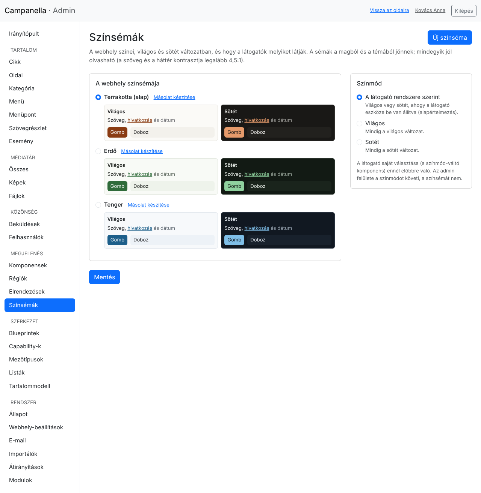
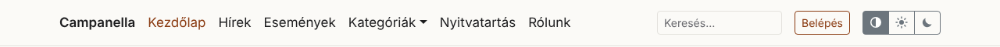
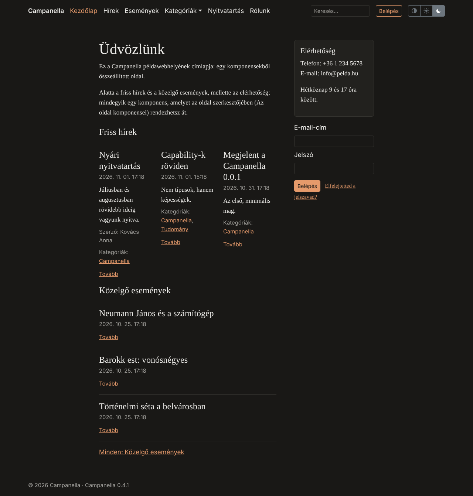
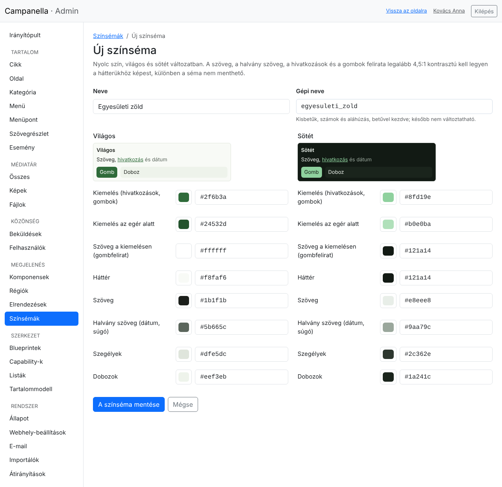

# 16. Színsémák és színmód

A webhely színei egy **színsémából** jönnek: mindegyiknek van egy világos és egy
sötét változata. A **színmód** dönti el, melyiket látják a látogatók: azt, amit
az eszközük beállítása kér (ez az alapértelmezés), vagy mindig a világosat,
illetve mindig a sötétet. A látogató maga is választhat egy **színmód-váltóval**,
ha a webhelyen van ilyen.

## A színséma és a színmód kiválasztása

A **Megjelenés → Színsémák** oldalon (csak adminisztrátoroknak):

- **A webhely színsémája:** a Campanella hármat hoz (*Terrakotta*, ez az alap,
  *Erdő* és *Tenger*), a téma továbbiakat (ezeket *a témából* jelzés mutatja).
  Mindegyik mellett a két változat kicsiben: a szöveg, egy hivatkozás, egy dátum,
  egy gomb és egy doboz a séma színeivel.
- **Színmód:**

  | Választás | A látogató ezt látja |
  |---|---|
  | **A látogató rendszere szerint** (alapértelmezés) | Világos vagy sötét, ahogy az eszköze (telefonja, gépe) be van állítva |
  | **Világos** | Mindig a világos változat |
  | **Sötét** | Mindig a sötét változat |

A **Mentés** után a webhely azonnal az új színekkel jelenik meg.

Minden séma jól olvasható: a szöveg, a hivatkozások és a gombok felirata
legalább 4,5:1 kontrasztú a hátterükhöz képest, mindkét változatban
(az akadálymentesség WCAG 2.2 AA szintje). Egy téma nehezen olvasható sémáját a
Campanella nem kínálja fel.

> Az **admin felülete** a színmódot követi (sötét módban sötét), de a színsémát
> nem: semleges színű marad, bármelyik sémát választod.

## A látogató színmód-váltója

A színmód-váltó egy komponens (13. fejezet): három gomb: a félig telt kör *a rendszer
szerint*, a nap *világos*, a hold *sötét*.

- A látogató választása az ő eszközén marad meg (egy évig), belépés nélkül; a
  webhely beállításánál előbbre való.
- Rákattintva az oldal azonnal átvált; JavaScript nélkül is működik.

A példatartalomban a váltó a navigáció végén van. A **Megjelenés → Régiók**
oldalon áthelyezheted (például a láblécbe) vagy törölheted, mint bármelyik
komponenst. Egy webhelyen, amelyen nincs (például frissítés után), így készítesz
egyet: **Megjelenés → Komponensek → Új komponens**, forrásnak **A látogató**,
megjelenítésnek **Színmód-váltó**; a beállításoknál kérhetsz feliratokat is a
jelek mellé, a **Hol jelenik meg** résznél válaszd a **Navigáció** régiót.

A példatartalom címlapja sötét módban:

## Saját színséma

Ha egyik séma sem illik a webhelyhez (például az egyesület színeihez), készíts
egyet. A legegyszerűbb egy meglévőből kiindulni: a **Megjelenés → Színsémák**
oldalon egy séma mellett a **Másolat készítése**, vagy fent az **Új színséma**.

1. **Neve:** ezt látod a listában (például *Egyesületi zöld*).
2. **Gépi neve:** kisbetűk, számok és aláhúzás, betűvel kezdve
   (*egyesuleti_zold*); később nem változtatható.
3. **A színek:** nyolc szín, a világos és a sötét változatban külön. Mindegyiket
   választhatod a színválasztóval, vagy beírhatod a kódját (`#2f6b3a`). Az előnézet
   azonnal mutatja, hogyan fest.
4. **A színséma mentése.** Ha egy szín nehezen olvasható (a szöveg, a halvány
   szöveg, a hivatkozások vagy a gombok felirata 4,5:1-nél kisebb kontrasztú a
   hátteréhez képest), a Campanella megmondja, melyik, és nem menti: sötétíts
   vagy világosíts rajta.

A saját sémákat *saját* jelzés mutatja a listában. **Szerkesztés**sel később
módosíthatod a nevét és a színeit, **Törlés**sel eltávolíthatod, kivéve azt,
amelyiket a webhely éppen használ (előbb válassz másikat). A Campanella és a
téma sémái nem szerkeszthetők és nem törölhetők, de másolatot készíthetsz róluk.

A saját sémák a **Szerkezet → Tartalommodell** exportjában is benne vannak
(11. fejezet): így egy tesztoldalon készült séma átvihető az élesre.

## Ha valami nem úgy jelenik meg

| Jelenség | Ok és teendő |
|---|---|
| A webhely sötét, pedig a színmód *Világos* | A látogató saját választása (a váltó) előbbre való: kattints a nap vagy a félig telt kör gombjára. |
| Egy téma sémája nincs a listában, és figyelmeztetés van fölötte | A séma kimaradt, a figyelmeztetés megmondja, miért (például nehezen olvasható). A téma készítője javíthatja. |
| *A mentett színséma már nincs meg* | Például megváltozott a téma: a webhely addig az alapsémát használja. Válassz egyet, és mentsd. |
| *Nehezen olvasható: … a kontraszt …:1* a mentéskor | A jelzett szín túl közel van a háttérhez: válassz sötétebbet vagy világosabbat, amíg a hiba el nem tűnik. |
| Egy saját séma nem törölhető | A webhely ezt használja: előbb válassz és ments egy másikat. |
| A színek nem változnak a sémával | A téma a saját alapsablonját használja: a téma készítője a [PHP API 31. fejezete](../../php-api/31-appearance.md#existing-themes) szerint kapcsolhatja be. |

A témák készítőinek szóló leírás:
[PHP API, 31. fejezet](../../php-api/31-appearance.md).

---

Előző: [15. Oldalak komponensekből](15-oldalak.md) ·
[Tartalomjegyzék](README.md)
