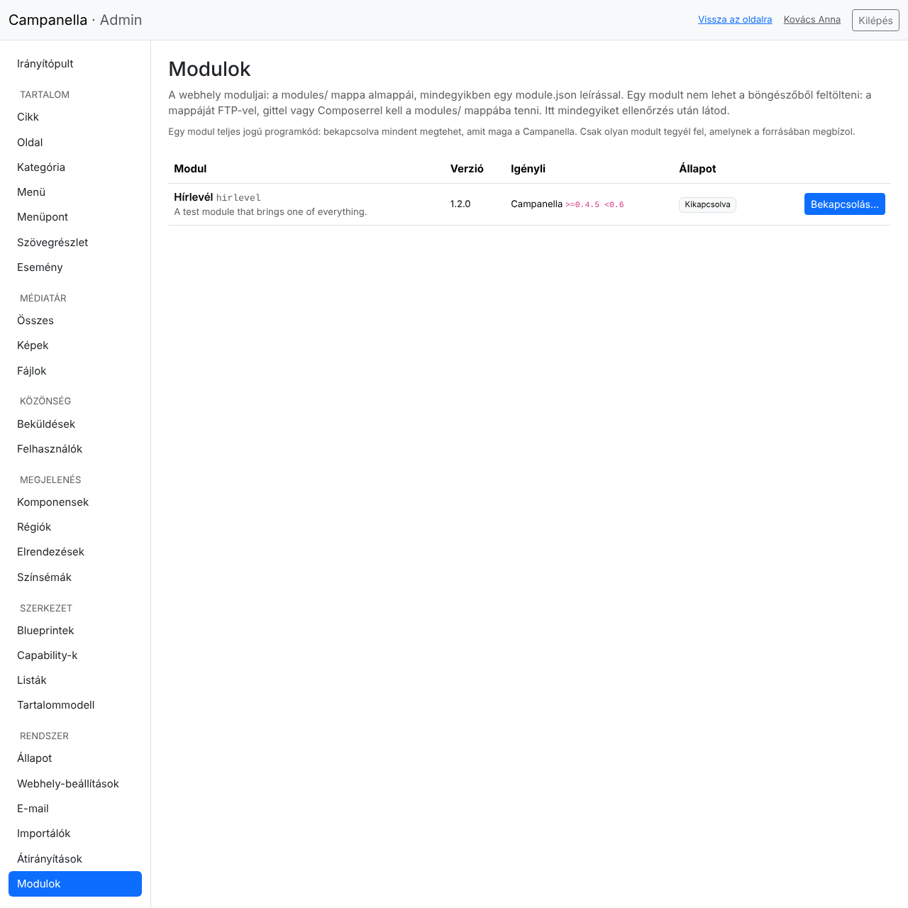
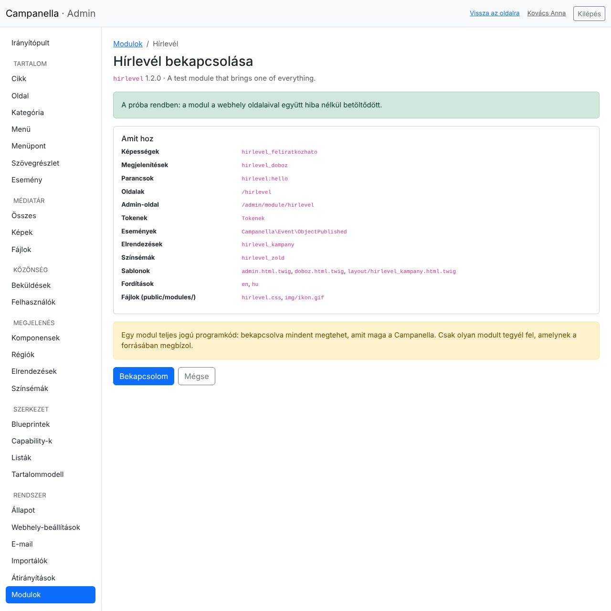

# 17. Modulok

Egy **modul** új dolgokat hoz a webhelyre: például egy hírlevelet, egy
eseménynaptárat vagy egy új megjelenítést a komponensekhez. A Campanella
modulja egy mappa, amelyet a `modules/` mappába kell tenni.

> **Fontos:** egy modul teljes jogú programkód. Bekapcsolva mindent megtehet,
> amit maga a Campanella: olvashatja és módosíthatja az összes adatot. Csak
> olyan modult tegyél fel, amelynek a készítőjében és a forrásában megbízol.

## Egy modul feltöltése

Egy modult **nem lehet a böngészőből feltölteni**. Ez szándékos: így egy
ellopott admin-jelszóval sem lehet programkódot feltenni a szerverre.

1. Csomagold ki a modult a gépeden. Egy mappát kapsz (például `hirlevel`),
   benne egy `module.json` fájllal.
2. Másold a mappát FTP-vel (vagy a tárhely fájlkezelőjével) a webhely
   `modules/` mappájába: `modules/hirlevel/module.json`.
3. Nyisd meg a **Rendszer → Modulok** oldalt (csak adminisztrátoroknak).



A lista minden modult megmutat a verziójával, azzal, hogy melyik
Campanella-verzióval és milyen más modulokkal működik, és az állapotával:

| Állapot | Mit jelent |
|---|---|
| **Kikapcsolva** | Bekapcsolható. |
| **Bekapcsolva** | Működik. |
| **Nem használható** | Valami nincs rendben vele: alatta az ok (például nem ehhez a Campanella-verzióhoz való, vagy hiányzik egy modul, amelyet igényel). |
| **Bekapcsolva, de nem töltődik be** | A `config/local.php` kikapcsolja, vagy egy modul, amelyet igényel, nem működik. Amint ez megszűnik, magától visszajön. |

## Bekapcsolás

A **Bekapcsolás…** gomb előbb kipróbálja a modult:



- minden fájlja olvasható-e, és amit hoz, nem ütközik-e a Campanella vagy egy
  másik modul valamelyik részével;
- a sablonjai lefordíthatók-e;
- a webhely néhány oldala hibátlanul elkészül-e a modullal.

Ha bármi hibás, az oldal megmondja, mi, és a modul **nem kapcsol be**. Ha
minden rendben, felsorolja, mit hoz a modul (képességeket, megjelenítéseket,
oldalakat, táblákat …): a **Bekapcsolom** gombbal kapcsolod be.

Ha a modulnak saját táblái vannak, bekapcsoláskor előbb **mentés készül** az
adatbázisról (a `var/backups/` mappába), csak utána jönnek létre a táblák.

## Kikapcsolás

A **Kikapcsolás** gomb kikapcsolja a modult; **az adatai megmaradnak**, egy
újabb bekapcsoláskor ott folytatja, ahol tartott. Nem kapcsolható ki, amíg

- egy másik bekapcsolt modul igényli;
- a webhely használja: egy tartalomtípus a képességét, egy komponens a
  megjelenítését, vagy a webhely az elrendezését, a színsémáját. Az oldal
  felsorolja, mit kell előbb megváltoztatni.

## Egy modul új verziója

Töltsd fel az új verziót a régi mappa helyére. Ha az új verzió a tábláit is
változtatja, a webhely a Campanella frissítéséhez hasonlóan addig a
frissítés alatti oldalt mutatja a látogatóknak, amíg le nem futtatod a frissítést
(**/admin/upgrade**, 9. fejezet); előtte mentés készül.

## Ha egy modul miatt nem indul el a webhely

Egy hibás modul általában nem állítja le a webhelyet: kimarad, és a Modulok
oldal megmutatja, miért. Ha mégis leállna, a `config/local.php` fájlban
kapcsold ki (a modul mappájának nevével):

```php
'modules' => ['disabled' => ['hirlevel']],
```

Ez mindig erősebb az admin beállításánál, és vele együtt azok a modulok sem
töltődnek be, amelyek ezt igénylik. Ha van parancssorod:
`php bin/campanella module:disable hirlevel`.

## Egy modul adatainak törlése

Egy kikapcsolt modul mellett az **Adatok törlése…** gomb (ha a modul
támogatja) véglegesen törli a modul tábláit és beállításait. Előtte mentés
készül, és a megerősítéshez be kell írnod a modul nevét. A modul mappáját
utána te törölheted a `modules/` mappából.

## Parancssorból

| Parancs | |
|---|---|
| `php bin/campanella module:list` | A modulok és az állapotuk |
| `php bin/campanella module:enable hirlevel` | Kipróbálja és bekapcsolja |
| `php bin/campanella module:disable hirlevel` | Kikapcsolja |
| `php bin/campanella module:uninstall hirlevel --yes` | Törli egy kikapcsolt modul adatait |

## Ha valami nem úgy működik

| Jelenség | Ok és teendő |
|---|---|
| A modul nem jelenik meg a listában | A mappája nem közvetlenül a `modules/` alatt van, vagy a neve nem csupa kisbetű, szám és aláhúzás. A `module.json`-nak a mappa tetején kell lennie. |
| *Nem ehhez a Campanella-verzióhoz való* | Keresd a modul újabb (vagy régebbi) verzióját, amely a webhely verziójával működik. |
| *A modul fájljai nem másolhatók a public/modules/ mappába* | A webszervernek írnia kell tudnia a `public/modules/` mappába: a tárhely fájlkezelőjében állítsd be az írási jogot. |
| A bekapcsolás egy fehér vagy hibaoldallal ér véget | A modul a próba közben leállította a PHP-t: a modul nem kapcsolt be. Írd meg a modul készítőjének; a hibanapló (a tárhelyen) megmondja az okát. |

A modulok készítőinek szóló leírás:
[PHP API, 32. fejezet](../../php-api/32-modules.md).

---

Előző: [16. Színsémák és színmód](16-szinsemak.md) ·
[Tartalomjegyzék](README.md)
