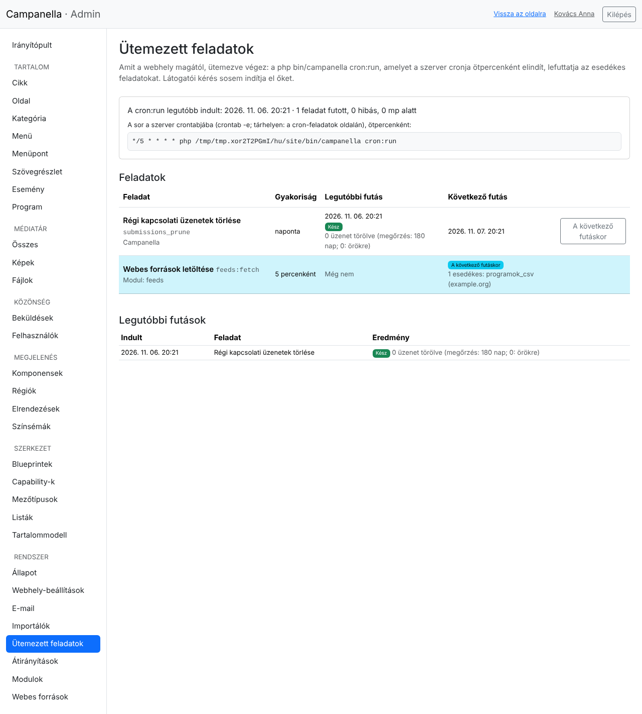
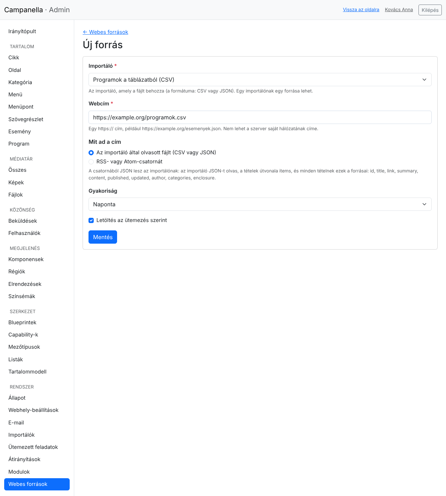
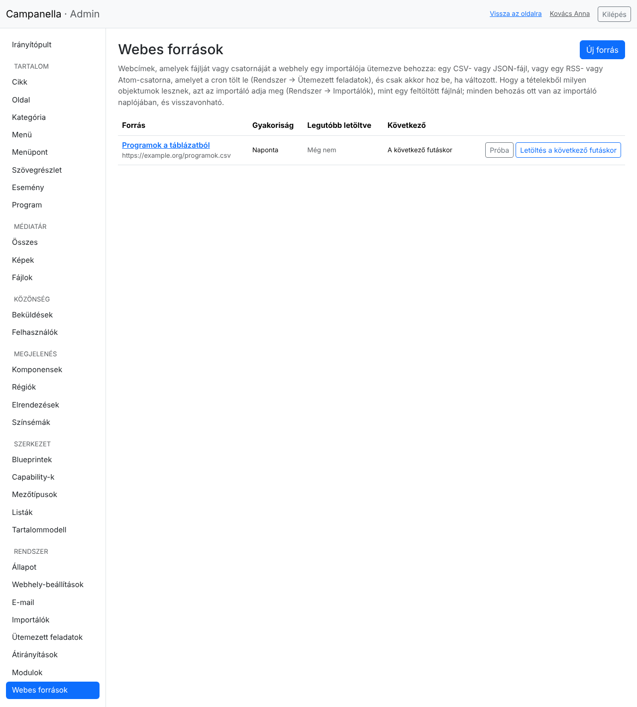

# 18. Ütemezett feladatok és webes források

Néhány munkát a webhely magától, ütemezve végez: például törli a régi
kapcsolati üzeneteket, vagy letölti egy másik webhely eseménynaptárát. Ezek az
**ütemezett feladatok**. A **Webes források** modullal (`feeds`) a webhely egy
webcímről rendszeresen behozhat tartalmat: egy CSV- vagy JSON-fájlt, vagy egy
RSS- vagy Atom-hírcsatornát.

## A cron beállítása

Az ütemezett feladatokat egyetlen parancs futtatja:

```
php bin/campanella cron:run
```

Ezt a szerver **cronja** indítja ötpercenként. A cron a szerver időzítője; egy
látogató kérése sosem indít el ütemezett feladatot, így az oldalak sem
lassulnak tőle. A pontos sort a webhelyed saját útvonalával a **Rendszer →
Ütemezett feladatok** oldal mutatja (lásd lent); valahogy így néz ki:

```
*/5 * * * * php /var/www/campanella/bin/campanella cron:run
```

- **Tárhelyen:** a tárhely vezérlőpultjában keresd a „Cron Jobs” vagy
  „Ütemezett feladatok” menüpontot. Az időzítés: minden 5. perc
  (`*/5 * * * *`), a parancs a fenti sor `php`-tól kezdődő része. Ha a
  tárhelyen több PHP-verzió van, a `php` helyett a 8.3-as PHP teljes útvonala
  kellhet (a tárhely leírása megadja).
- **Saját szerveren:** a webszerver felhasználójaként (például
  `sudo crontab -u www-data -e`) vedd fel a fenti sort.
- **Dockerben:** a Campanella `compose.yaml` fájljában van egy `cron`
  szolgáltatás, amely ötpercenként lefuttatja a parancsot; a
  `docker compose up -d` vele együtt indul. Ha a saját Docker-es webhelyed
  `compose.yaml` fájlja régebbi, másold át belőle a `cron` szolgáltatást.

Egyszerre mindig csak egy `cron:run` fut, és legfeljebb négy percig: ami nem fér
bele, a következő futáskor folytatódik.

## A Rendszer → Ütemezett feladatok oldal



- **Felül** látszik, mikor indult utoljára a `cron:run`, mennyi ideig tartott,
  és hány feladat futott. Ha 30 percnél régebben futott (vagy még soha), sárga
  figyelmeztetés jelenik meg: ilyenkor a cron nincs beállítva, vagy nem fut.
  Alatta van a crontabba másolandó sor.
- **A feladatok táblázata** minden feladatnál mutatja, honnan jön (a
  Campanellából vagy egy modulból), milyen gyakran fut, mikor futott utoljára
  és mi lett az eredménye, valamint hogy mikor esedékes legközelebb. A
  következő futáskor esedékes feladatok sora ki van emelve, és alatta az is
  látszik, mit fog csinálni (például melyik webes forrás jön sorra).
- **A következő futáskor** gombbal egy feladatot esedékessé tehetsz. A feladat
  ekkor sem az admin oldalán fut le, hanem öt percen belül a cronnal.
- **Legalul** a legutóbbi 100 futás naplója van, a hibaüzenetekkel együtt.

## Webes források

### Bekapcsolás

A Webes források modul a Campanellával érkezik, de alapból ki van kapcsolva.
Bekapcsolni a **Rendszer → Modulok** oldalon lehet, a *Feeds* sor
**Bekapcsolás…** gombjával (17. fejezet). Ezután a **Rendszer** menüben megjelenik
a **Webes források** pont.

Egy webes forrás mindig egy **importálót** táplál: a letöltött fájlt egy
importáló hozza be, pontosan úgy, mint egy feltöltött fájlt (12. fejezet).
Ezért előbb az importálót kell elkészíteni; az adja meg, hogy a fájl melyik
oszlopa melyik mezőbe kerül.

### Új forrás



- **Importáló:** amelyik a fájlt behozza. Egy importálónak egy forrása lehet.
- **Webcím:** egy `https://` cím. A szerver saját hálózatának címei (például
  `localhost`, `192.168.…`) nem adhatók meg: így egy admin-jelszóval sem lehet a
  szervert a belső hálózat lekérdezésére használni.
- **Mit ad a cím:** egy fájlt, amelyet az importáló közvetlenül olvas (CSV vagy
  JSON), vagy egy **RSS- vagy Atom-hírcsatornát** (lásd lent).
- **Gyakoriság:** 15 percenként, óránként, 6 óránként vagy naponta.
- **Letöltés az ütemezés szerint:** ha kikapcsolod, a forrás megmarad, de nem
  töltődik le.

### A források listája



- **Próba:** most letölti a fájlt, és megmutatja, mi lenne az első tételekből,
  anélkül hogy bármi változna. Érdemes mentés után először ezt megnézni.
- **Letöltés a következő futáskor:** a forrás öt percen belül letöltődik és
  behozódik, a gyakoriságától függetlenül.
- Egy fájlt csak akkor hoz be újra, ha **változott**: ha a szerver jelzi, hogy
  nem változott, vagy a tartalma ugyanaz, a forrás állapota „Nem változott”.
- Minden behozás bekerül az importáló **naplójába** (Rendszer → Importálók), és
  onnan **visszavonható**.
- Ha egy forrás letöltése **háromszor egymás után nem sikerül**, egyre ritkábban
  próbálkozik (legfeljebb naponta), és az oldal pirossal jelzi. Az első sikeres
  letöltés után visszaáll a beállított gyakoriságra.
- Egy forrás törlésekor a behozott tartalom megmarad.

### RSS- és Atom-csatornák

Egy hírcsatornából a modul minden tételhez ugyanazokat az adatokat adja az
importálónak, akár RSS, akár Atom:

| Forrás | Mi van benne |
|---|---|
| `id` | a tétel egyedi azonosítója (ez legyen az importáló kulcsa) |
| `title` | a cím |
| `link` | a tétel webcíme az eredeti oldalon |
| `summary` | a rövid leírás (HTML) |
| `content` | a teljes szöveg (HTML), vagy ha nincs, a rövid leírás |
| `published` | a megjelenés ideje |
| `updated` | a módosítás ideje |
| `author` | a szerző |
| `categories` | a címkék listája |
| `enclosure` | a csatolt fájl (kép, hang) webcíme |

Az importálót így kell beállítani:

- **Formátum:** JSON; **Az elemek a JSON-fájlban:** `items`.
- **Kulcsoszlop:** `id`; **Címoszlop:** `title`.
- A többi mező például: `content` → Törzsszöveg, `published` → Publikálás ideje,
  `categories` → egy címkéket tartalmazó kapcsolat.
- **Ha egy korábbi elem már nincs a fájlban:** *az objektuma marad, ahogy van*.
  Egy csatornában mindig csak a legutóbbi néhány tétel van, ezért a
  „piszkozat lesz” beállítás minden letöltéskor visszavonná a régebbi tételek
  közzétételét; a modul erre figyelmeztet is.

A HTML-szöveg mentéskor ugyanúgy megtisztul, mint bármely más behozott vagy
beírt szöveg.

## Ha nem működik

- **„Úgy tűnik, a cron nincs beállítva”:** nézd meg, fut-e a cron (a
  tárhely cron-naplója), és a parancs a jó PHP-t és útvonalat használja-e. Kézzel
  is kipróbálhatod: `php bin/campanella cron:run`.
- **„A cím a szerver saját hálózatában van”:** a forrás belső címre mutat, vagy
  a neve belső címre oldódik fel. Ezt a Campanella szándékosan nem engedi.
- **„Csak https:// címről lehet letölteni”:** ha a forrásnak nincs `https://`
  címe, a `config/local.php` fájlban a `fetch.allow_http` engedi a `http://`
  címeket is (lásd a `config/local.php.dist` leírását). A `http://` tartalmát
  útközben bárki megváltoztathatja, ezért csak végszükség esetén használd.
- **„A webcímről letöltéshez a PHP curl kiterjesztése kell”:** kérd a tárhely
  ügyfélszolgálatától a PHP `curl` kiterjesztésének bekapcsolását.
